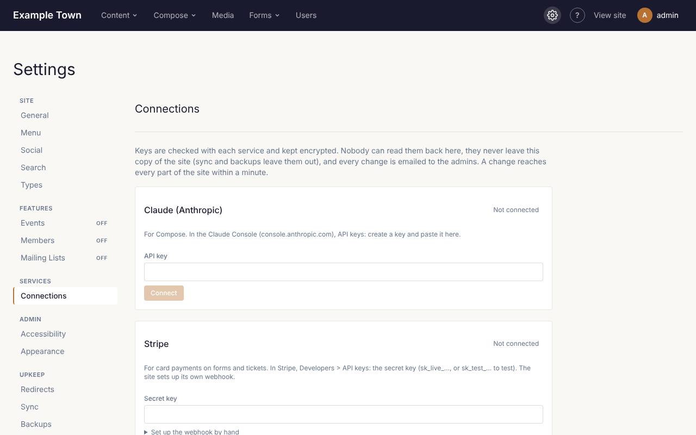

Admins connect the services the site uses in **Settings > Connections**:

- **Claude (Anthropic)**, for **Compose**;
- **Stripe** or **Square**, for card payments on forms and tickets;
- **Mailgun**, for mailing lists.

1. Copy the key from the service's own website. Each card says where to find it.
2. Paste it into the card. For Stripe, Square and Mailgun, also type your own password.
3. Click **Connect**. The site checks the key and sets up the rest itself. If you have more than one
   Square location or Mailgun domain, it asks which one; pick it and click **Save**.

Keys are kept encrypted. Once saved, nobody can see them again, not even admins: the card shows only
the last 4 characters. To change a key, paste the new one and click **Connect**. **Disconnect** removes
it. Every admin gets an email whenever a connection changes, so if you get one you didn't expect,
check this section and change your password.

A card that says **Set by the host** is set up on the server by whoever runs the site, and can only be
changed there.
