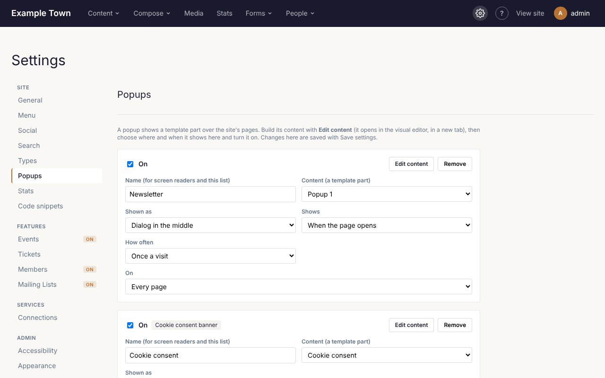
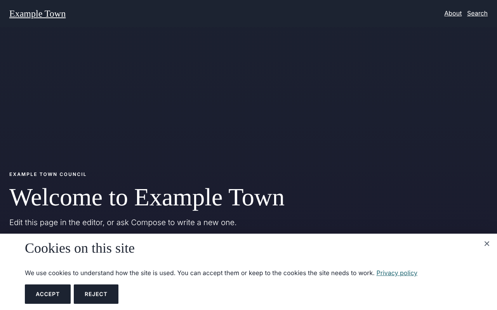

Popups show a message over the site's pages: a newsletter sign-up, a sale, an announcement. One of them
can be the cookie consent banner, which asks visitors whether they accept cookies. Admins set them up
under **Settings > Popups**; editors can change what a popup says (see [Popups](/editors/popups/) in the
Editor guide).

## Popups

### Making a popup

1. Go to **Settings > Popups** and click **Add a popup**. It is added switched off, with empty content.
2. Click **Edit content**. The popup's content opens in the page editor in a new tab: it is a template
   part of its own. Add what it should say: a heading, some text, a button, a form, a **Newsletter
   signup** block. Click **Save & apply**.
3. Back in Settings, choose where and when it shows (see [A popup's settings](#a-popups-settings)).
4. Tick the box at the top of the popup, so it says **On**.
5. Click **Save settings**.

Open the site in a private (incognito) window to see it as a visitor would: a popup set to show once
won't show again in a browser that has already seen it.

### A popup's settings

- **On** / **Off**: the box at the top. Off, the popup is kept but never shows.
- **Name (for screen readers and this list)**: what the popup is called.
- **Content (a template part)**: the template part it shows. Each popup gets a part of its own when it is
  added; you can pick another here.
- **Shown as**:
  - **Dialog in the middle**: a box over the page, which darkens behind it.
  - **Bar along the bottom**.
  - **Bar along the top**.
  - **Box in the corner**: a small box in the bottom corner, leaving the page usable.
- **Shows**:
  - **When the page opens**.
  - **After some seconds**: then set how many.
  - **After scrolling part of the page**: then set how far, as a percentage.
  - **When the visitor goes to leave**: when the pointer leaves the top of the window, on computers only.
- **How often**:
  - **On every page**.
  - **Once a visit**: once until the browser is closed.
  - **Once, then again after some days**: then set how many days.
- **On**:
  - **Every page**.
  - **Only these pages**.
  - **Every page but these**.
- The pages, for the last two: one address a line, such as `/about/`. End an address with `*` to cover
  everything under it: `/events/*` is every event page.

Buttons on each popup:

- **Edit content**: opens its content in the page editor, in a new tab.
- **Remove**: takes the popup away. Its content stays under **Templates**, **Template parts**.

### Closing a popup

Visitors close a popup with:

- its **×** button;
- the Escape key;
- a click outside it, for a dialog;
- any link in its content to `#close-popup`. Use one for a "No thanks" link: in the link box, type
  `#close-popup` as the address.

The cookie consent banner closes with its **×** too, and with Escape, but closing it counts as
**Reject**: the site keeps only the cookies it needs, and remembers that choice. (Escape works on a bar
or corner banner while the visitor is using it, such as after tabbing to its buttons, so Escape pressed
elsewhere on the page never answers for them.) A click outside it doesn't close it. While it is waiting
for their choice, no other popup shows.

## Building a cookie consent banner

In the EU and UK, the law asks visitors' consent before a site sets cookies it doesn't need to work,
such as analytics and advertising cookies. The cookie consent banner asks once, remembers the answer, and
holds back those cookies until the visitor accepts.

### 1. Add the banner

1. Go to **Settings > Popups** and click **Add a cookie consent banner**. (The button is there only while
   the site has none.)
2. It is added switched off, as a **Bar along the bottom**, marked **Cookie consent banner**.

Its content starts with:

- a heading, "Cookies on this site";
- a line of text saying what the cookies are for, ending with a **Privacy policy** link to `/privacy/`;
- an **Accept** button and a **Reject** button;
- a **×** in its corner, which counts as **Reject**.

### 2. Edit its content

Click **Edit content**. The banner's content opens in the page editor in a new tab.

1. Change the heading and text to describe the cookies your site uses, in plain words.
2. Point the **Privacy policy** link at your own privacy page: select the text, click the link, and
   change its address (or use **Find**). Make that page first if the site has none.
3. Change the buttons if you like: their words, colours, size and corners are ordinary button settings.
   Keep their links: **Accept** must link to `#accept-cookies` and **Reject** to `#reject-cookies`.
4. Click **Save & apply**.

:::caution
If the content has no button linking to `#accept-cookies`, the site adds its own **Accept** and
**Reject** buttons under it, so the banner always works. To use your own, keep those two links.
:::

### 3. Choose how it looks, and turn it on

1. Back in **Settings > Popups**, choose **Shown as**: a bar along the bottom or top is usual; a dialog
   in the middle makes sure it is seen.
2. Tick the box at the top, so it says **On**.
3. Click **Save settings**.

The banner has no **Shows**, **How often** or **On** settings: it shows on every page, as soon as the
page opens, until the visitor chooses. Their choice is remembered for six months; then they are asked
again.

### 4. Let visitors change their mind

Add a link to `#cookie-settings` somewhere on every page, such as a "Cookie settings" link in the
footer: edit the footer part (**Content**, **Templates**, **Template parts**), add the words, select them, click the link
button and type `#cookie-settings` as the address. Clicking it opens the banner again.

### 5. Hold back tracking code until visitors accept

- **Code snippets**: under **Settings > Code snippets**, tick **Only after visitors accept cookies** for
  each place that holds analytics, advertising or other tracking code. That code then runs only for
  visitors who accept, and only after they do.
- **The Stats cookie**: if it is on (see [The Stats cookie](#the-stats-cookie)), it is set only for
  visitors who accept.

### 6. Check it

1. Open the site in a private (incognito) window. The banner shows.
2. Click **Reject** (or the **×**). It goes, and stays gone on the next page.
3. Click your **Cookie settings** link. The banner opens again.
4. Click **Accept**. Any code snippets kept for consent now run.

Close the private window to forget the choice and try again.

## The Stats cookie

Turn on **Recognise returning visitors with a cookie** under **Settings > Stats**. The site then keeps a
random number in a cookie in each visitor's browser for 13 months, so [Stats](/editors/stats/) can tell a
returning visitor from a new one.

With a cookie consent banner on, only visitors who accept get the cookie; everyone else is still counted,
once a day. Without a banner every visitor gets it, and Settings warns about that.
