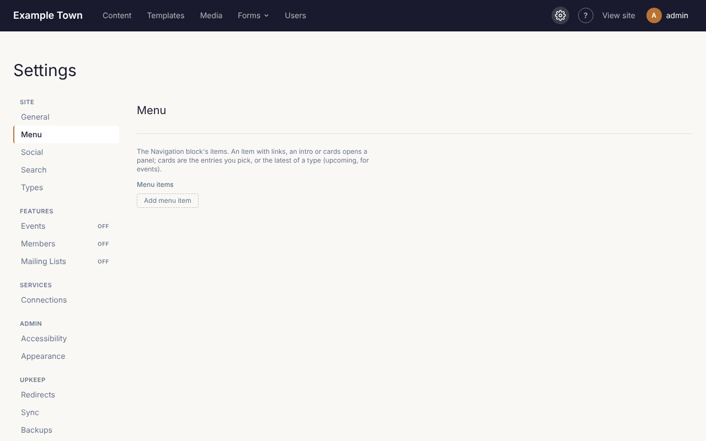

**Settings** (the gear ⚙ in the top bar) holds everything that applies to the whole site. The menu
on the left lists its sections in groups: **Site**, **Features** (each marked **On** or **Off**),
**Services**, **Admin** and **Upkeep**. On a phone, pick a section from the **Section** list at the top.

When you change something, **Save settings** appears beside the section's title. Changes take effect
when you click it. You can move between sections before saving: your changes are kept, and the site
asks before you leave Settings without saving them.

## The menu

The **Menu** section holds the links in your site's main menu.

1. Click **Add menu item**.
2. Fill in the **Label** (the words people see, such as "Visit") and the **Link** (the page's
   address, such as `/visit/`, or a full web address for another site).
3. Use **Up** and **Down** to reorder items, and **Remove** to take one out.
4. Click **Save settings**.

An item can also open a larger drop-down panel: add **Links** under a **Links heading**, a short
**Intro**, or cards showing pages or the latest posts or events.

## Every section

| Section | What it's for |
| --- | --- |
| **General** | The site's name, tagline, which page is the home page, and which page people see when an address doesn't exist. |
| **Types** | The kinds of content the site has, which layout (template) each uses, and which kinds can be marked featured (see [Kinds of content and taxonomies](/admins/content-types/)). Usually set up once. |
| **Search** | Which kinds of content the site search covers. |
| **Social** | Your social media profiles (shown as icons) and the picture used when a page without its own image is shared. |
| **Popups** | Popups over the site's pages and the cookie consent banner (see [Popups and cookie consent](/admins/popups-and-cookies/)). |
| **Stats** | Whether Stats recognises returning visitors with a cookie (see [The Stats cookie](/admins/popups-and-cookies/#the-stats-cookie)). |
| **Code snippets** | Code to put on every page: paste a tag from an analytics, chat or advertising service, or a site verification tag, into **Header**, **Body start** or **Footer**, as the service's instructions say. Paste only code from a service you trust. Tick **Only after visitors accept cookies** for tracking tags. |
| **Events**, **Tickets**, **Members**, **Mailing Lists** | Features the site can use, each turned on here (see [Turning features on](/admins/features/)). |
| **Connections** | Connecting Claude, card payments (Stripe or Square) and Mailgun (see [Connections](/admins/connections/)). |
| **Accessibility** | Whether publishing waits for the [accessibility check](/editors/accessibility/). |
| **Appearance** | The colours and logo of these admin screens. |
| **Redirects** | Send visitors from an old address to a new one (see [Redirects and missing pages](/admins/redirects/)). |
| **Email log** | Keep a record of the emails the site sends (see [Email log and backups](/admins/email-log-and-backups/)). |
| **Sync** and **Backups** | Copying content between copies of the site, and backups. Usually left to whoever set up the site. |

## The home page

To use a different page as the home page, choose it in **Settings > General** and click **Save
settings**. The home page can't be moved to the trash while it is the home page.
