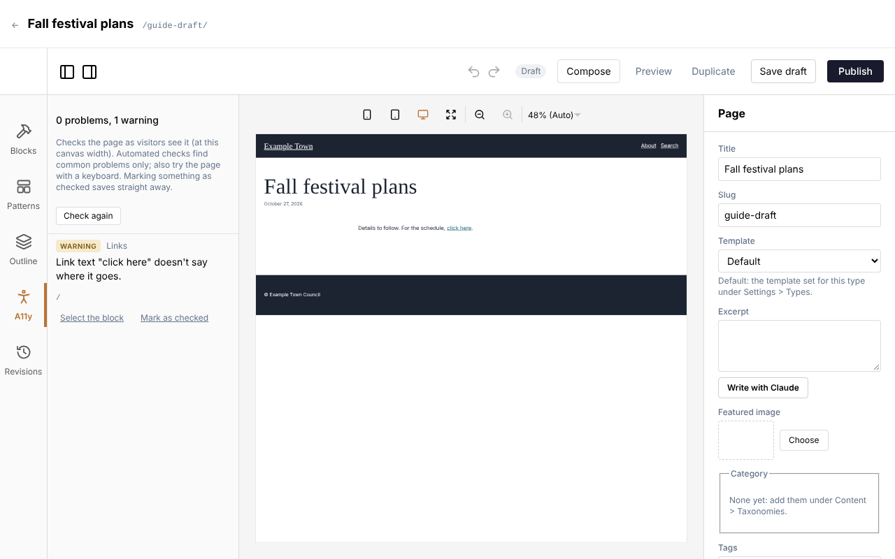
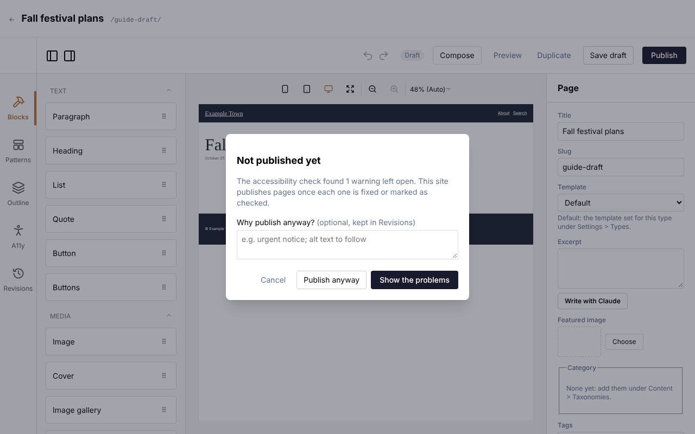

An accessible page works for everyone: people who are blind and hear pages read aloud by a screen
reader, people who can't use a mouse, and people who find small or faint text hard to read. The editor
checks for the most common problems as you work, so you can fix them before visitors meet them.

## The A11y check

Click **A11y** on the left side of the editor (below **Blocks**, **Patterns** and **Outline**). It checks
the page as visitors will see it, including the header, footer and anything else the page's template
adds around your content.

At the top it sums up what it found, for example **2 problems, 1 warning**, or **No problems found**.
Under that it reminds you that it **Checks the page as visitors see it (at this canvas width).
Automated checks find common problems only; also try the page with a keyboard.**

The list updates by itself a moment after you change the page. **Check again** runs the check straight
away.

### Problems and warnings

Each item in the list has a coloured label:

- **Problem**: something that needs fixing, such as a link with no words or text too faint against its
  background.
- **Warning**: something a person has to judge, such as a link that just says "click here".
- **Checked**: a problem or warning someone has looked at and marked as fine (see [Marking something as
  checked](#marking-something-as-checked)).

Next to the label is the kind of check (**Image**, **Headings**, **Links**, **Buttons**, **Embeds** or
**Contrast**), then the message, and in small grey type the address, picture or words it is about, so
you can find it.

Problems are listed before warnings. Under each one:

- **Select the block** scrolls to the block concerned and selects it, so its settings open on the right.
  Fix it there and the item goes from the list.
- **Show (in the template)** appears instead when the problem isn't in one of your page's blocks: it is
  in the header, footer or another part of the template, or it is about the page as a whole. It scrolls
  to the spot. Template parts are changed in the template, not on this page; if you don't edit
  templates, tell whoever looks after them.

:::tip
The check looks only at what shows at the editor's current width. Something hidden on a desktop but
shown on phones is checked only when you switch the editor to the phone view with the buttons above
the page, so try each size.
:::

## Everything it checks

| The check says | What it means | How to fix it |
| --- | --- | --- |
| **Image has no alt text.** (Problem) | A picture has no description at all, so a screen reader may read out its file name. This usually comes from an **HTML** block or a block made for your site. | Give the picture alt text. In an **HTML** block, add `alt="..."` to the picture. |
| **Linked image has no alt text, so the link has no name.** (Problem) | A picture is a link, but it has no description and no words beside it, so a screen reader can't say where the link goes. | Give the picture alt text that says where the link leads, for example "Book a visit". |
| **Image has empty alt text: fine only if it is decorative.** (Warning) | An **Image** or **Media & text** picture has no description. That is right for a picture that is only decoration, and wrong for one that tells visitors something. | Write alt text in the block's **Alt text (describes the image)** box, or in **Media** for every place the picture is used. If the picture really is decoration, mark it as checked. |
| **The page has no main heading (h1).** (Warning) | Every page should have one main heading saying what it is about, usually its title. | Make the page's title a level 1 heading: in a **Heading** or **Title** block, set **Level** to **H1**, or in a **Hero** turn on **Title is the page's main heading (h1)**. If the template already shows the title, it may be hidden at this width. |
| **More than one main heading (h1).** (Warning) | Two or more headings claim to be the page's main heading. | Keep one **H1** and set the others to **H2**. |
| **Empty heading (h2).** (Problem, with the level) | A heading has no words. Screen readers announce it as an empty heading. | Type the heading's words, or delete the block. |
| **Heading skips a level (h2 to h4).** (Warning) | Headings go down more than one step at a time. People using screen readers jump between headings to find their way, and a missing level looks like something is missing. | Use headings in order: **H1** for the page, **H2** for its sections, **H3** for parts of a section. Change the **Level**, not the look: to make a heading smaller, change its text size instead. |
| **Link has no text or label.** (Problem) | A link has no words, and no picture with alt text, so a screen reader can't say where it goes. | Give it words, or give its picture alt text. A link with an icon only (such as a social network) needs a label. |
| **Link text "click here" doesn't say where it goes.** (Warning) | The link's words are one of: click here, here, read more, more, learn more, link, this, go, details or more info. Read out of context in a list of links, these mean nothing. | Change the words to say where the link leads, such as "See the full schedule" or "Read our annual report". |
| **Link goes nowhere (#).** (Warning) | A link or button still has the placeholder address `#`. A new **Button** starts with it. | Set the button's **Link** with **Find** (see [Links](/editors/page-editor/#links)), or delete the button. |
| **Button has no text or label.** (Problem) | A button (in a form, a slider, a menu) has no words or label. | Give the button words. If it comes from your site's design, tell whoever looks after the site. |
| **Embedded frame has no title.** (Problem) | Something embedded from another site (a video, a map, a booking widget) has no title, so a screen reader can't say what it is. | In the **Embed** block's **Embed HTML**, add `title="..."` to the `<iframe>`, for example `title="Map of the town centre"`. YouTube and Vimeo links added to a **Video gallery** get a title by themselves. |
| **Text contrast 3.12:1 (needs 4.5:1): #888888 on #ffffff.** (Problem) | The text colour is too close to the colour behind it. The numbers say how far apart they are and how far apart they need to be. Normal text needs 4.5:1; large text (about 24 pixels, or 19 pixels in bold) needs 3:1. | Pick a darker text colour on a light background, or a lighter one on a dark background. Changing the background works too. Each block's colour pair is listed once. |
| **Text over an image: its contrast can't be measured. Check by eye that it stays readable on every part of the image (a darker overlay or a text shadow helps), then mark it as checked.** (Problem) | Text sits on a picture (a **Hero**, a **Cover**, a gallery caption over the picture). The check can't tell how readable it is, because the picture's colours vary. | See [Text over images](#text-over-images). |

## Text over images

Text over a photo is always listed as a problem until someone has looked at it, because no computer can
measure it reliably: white text may be fine over a dark sky and unreadable over a white wall in the same
picture.

1. Look at the text on the page at each screen size (desktop, tablet and phone), because the picture is
   cropped differently on each.
2. If any of it is hard to read, make the picture darker behind it:
   - in a **Hero**, choose a stronger **Overlay (keeps the text readable)** (**Light**, **Medium** or
     **Strong**), and set **Darkest at** to where the text sits;
   - in a **Cover**, raise the **Overlay opacity**, or set **Overlay** to **From bottom** or **From left**
     to darken just where the text is;
   - choose a different focal point so a busier part of the picture isn't behind the text (see [Focal
     points for one block](/editors/images-and-files/#focal-points-for-one-block)).
3. Once it is easy to read everywhere, [mark it as checked](#marking-something-as-checked).

## Marking something as checked

Warnings, and text over an image, are things a person has to judge. If you have looked and it is fine
(a picture that is truly decoration, a "Read more" link right under its heading), mark it so it stops
counting.

1. Under the item, click **Mark as checked**.
2. Add a **Note (optional)**, for example "the overlay keeps it readable".
3. Click **Mark as checked** again (or press Enter). **Cancel** leaves it as it was.

The mark is saved straight away, on its own: the panel says **Saving…**, then **Saved** (or **Not
saved:** and the reason). It doesn't count as an unsaved change to the page, and your other changes
stay unsaved until you save them as usual.

Checked items move to **Checked** (with how many) at the bottom of the list. Click it to open it. Each
shows **Checked by**, the person's name, the date and the note. **Unmark** puts it back on the list.

Other problems (an empty heading, a link with no words, too little contrast) can't be marked as checked:
they need fixing.

### When a mark lapses

A mark is about the item as it was when someone looked. If the text, the address or the picture it was
about changes, the mark no longer applies: the item comes back on the list with **Marked as checked
before, but it has changed since: check it again.** Look at it again and mark it once more if it is
still fine.

## Writing good alt text

Alt text is the description a screen reader reads out in place of a picture. Write it in **Media** (so it
goes everywhere the picture is used) or in the block (for one place only). See [Describing an
image](/editors/images-and-files/#pictures).

- **Say what the picture shows that matters here**, in a sentence or less: "Volunteers planting trees by
  the river", not "Image of people".
- **Don't start with "Image of" or "Photo of"**: screen readers already say it is a picture.
- **Include words that are in the picture**, such as the text on a poster.
- **For a linked picture**, say where the link goes: "Donate to the appeal".
- **Leave it empty for pure decoration**, such as a pattern or a background texture, and mark the warning
  as checked.
- **Compose** in **Media** can write a first draft for you: read it and correct it, especially names of
  people and places.

The **Hero** block's picture is treated as decoration, so anything visitors need to know belongs in the
hero's title or text.

## Headings, links and colours

- **Headings**: one **H1** per page (usually the title), then **H2**, **H3** in order. Use heading blocks
  for headings, not bold paragraphs, and don't choose a level for its size.
- **Link words**: the words should make sense on their own. "Download the 2026 timetable (PDF)" is better
  than "Click here". A new **Hero** starts with a **Learn more** button: change it to say where it goes.
- **Colours**: keep to your site's colour combinations, which are made to be readable. When you pick
  your own, check the A11y list for contrast problems. Never rely on colour alone to show something
  (such as "the dates in red are full").
- **Videos**: keep **Show controls** on, so people can pause a video, especially one set to play by
  itself.

:::note
The check finds common problems only. It can't tell whether alt text is accurate, whether a page makes
sense read aloud, or whether everything can be reached with the keyboard. Now and then, open the page
and move through it with the Tab key: every link and button should be reachable, and you should always
see where you are.
:::

## When publishing waits for the check

An admin can turn on **Check accessibility before publishing** (in **Settings**, **Accessibility**; see
[Checking accessibility before publishing](/admins/features/#checking-accessibility-before-publishing)).
The A11y panel then says **This site checks pages before publishing: fix each problem or mark it as
checked, or publish anyway with a reason, kept in Revisions.**

When you click **Publish** (or **Publish changes**), the editor shows **Checking accessibility…** and
runs the check afresh. If nothing is left open (every problem and warning fixed or marked as checked),
the page is published as usual. Otherwise it isn't published yet and a box appears:

**Not published yet**, and for example **The accessibility check found 2 accessibility problems and 1
warning left open. This site publishes pages once each one is fixed or marked as checked.** Then:

- **Show the problems** opens the A11y list so you can fix them or mark them as checked. Then click
  **Publish** again.
- **Publish anyway** publishes regardless. First say why in the box **Why publish anyway? (optional, kept
  in Revisions)**, for example "urgent notice; alt text to follow". The version is kept in
  [Revisions](/editors/saving-and-publishing/#going-back-to-an-earlier-version) with a note such as
  **Published with 2 accessibility problems left open: urgent notice; alt text to follow**, so the team
  can follow up.
- **Cancel** (or Escape) closes the box and leaves the page unpublished.

If the check couldn't run at all, the box says **The accessibility check couldn't run on this page.**
and offers only **Publish anyway** and **Cancel**. Try reloading the editor first.

A few things to know:

- Warnings hold the publish as well as problems, so mark the ones you have judged to be fine.
- The check applies to pages, posts and other entries with a page of their own. Entries that are data
  only (such as venues) aren't held, and nor are templates, parts and patterns when you click **Save &
  apply**.
- Saving a draft is never held: only publishing is.

### Publishing from the content list

While the check is on, the content list's bulk **Publish** skips entries with a page, because the check
can only run in the editor. The message at the top of the list names each one, for example **Skipped:
Summer fair: publish it from the editor, where the accessibility check runs first.** Open each in the
editor and publish it there.
