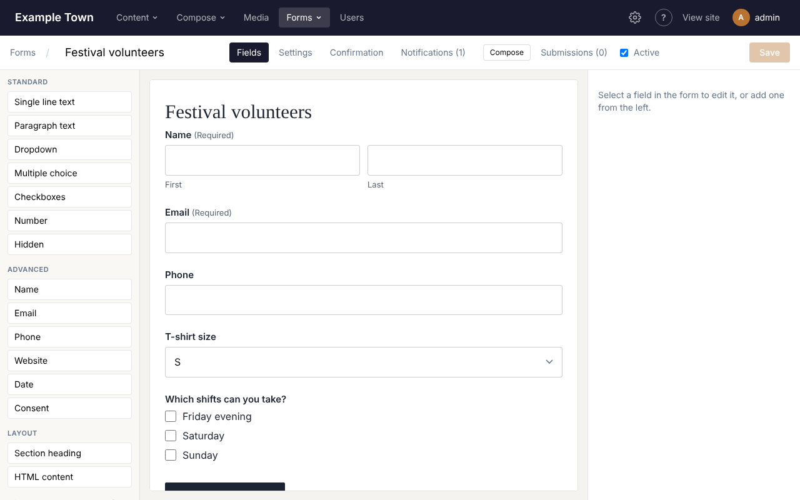
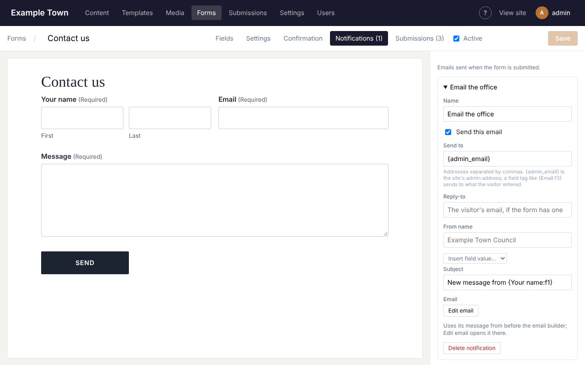
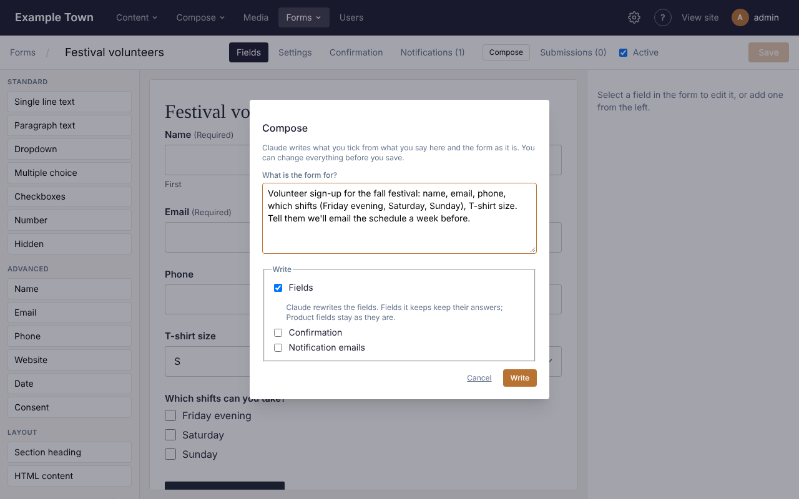
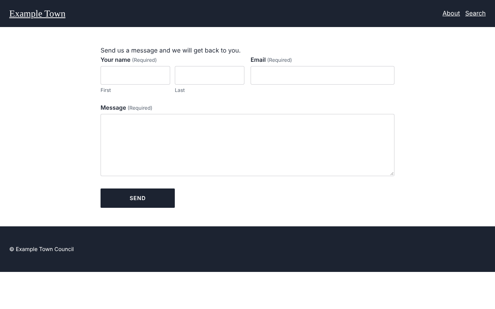
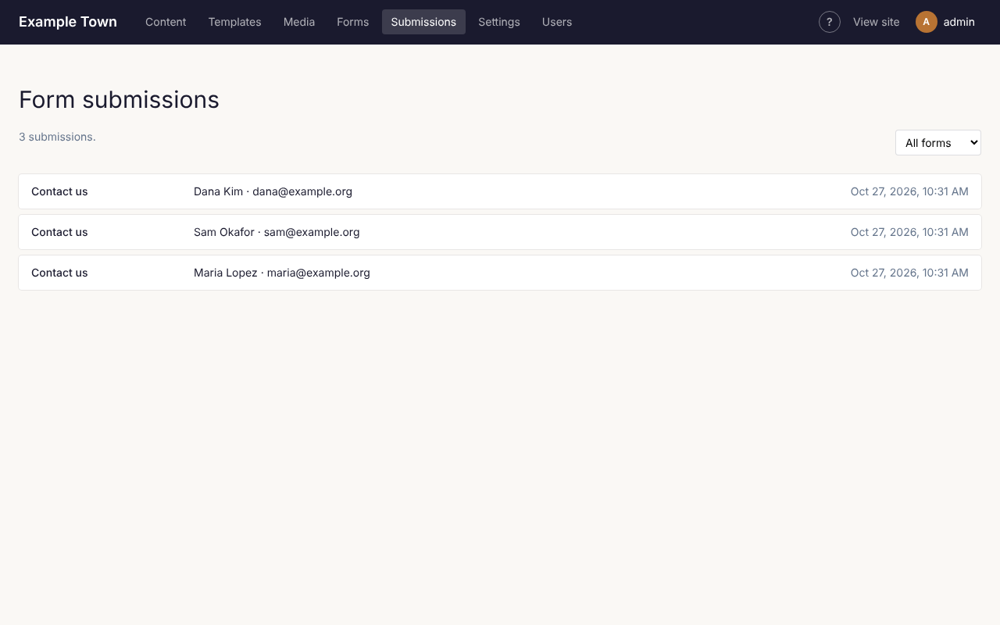

Forms let visitors send you a message, sign up, apply, register or pay. You build a form once in the
form builder, then place it on any page with the **Form** block. Everything people send is kept under
**Submissions**, and the site can email you (and them) each time.

## The Forms list

Click **Forms** in the top bar, then **Forms**. Each form is listed with:

| Column | What it shows |
| --- | --- |
| **Title** | The form's name. Click it to open the form builder. |
| **Fields** | How many fields the form has. |
| **Submissions** | How many times it has been sent. Click the number to read them. |
| **Last submission** | The date it was last sent. |
| **Status** | **Active** (taking answers) or **Inactive** (switched off, see below). |

At the end of each row:

- **Edit** opens the form builder.
- **Duplicate** makes a copy named "(copy)" and opens it. The copy starts **Inactive**, so it won't
  appear anywhere until you tick **Active** in the builder and save.
- **Delete** asks first. What people already sent through the form is kept, but pages using the form
  stop showing it.

## Making a form

1. Click **Forms** in the top bar, then **Forms**, then **New form**.
2. Type a name for the form (for example "Contact us") and click **OK**. The form builder opens.
3. On the **Fields** tab, add the questions you want to ask: click a field type on the left to add it
   below the selected field, or drag it into the form where you want it.
4. Click a field in the form to change its settings on the right (its label, whether it's required,
   and so on).
5. Click **Save** in the top right (or press Ctrl+S, Cmd+S on a Mac).

A new form comes ready with a thank-you message and one email to the site's admin address, so it
works as soon as it has fields and is on a page.

:::tip
You can also have Claude write the whole form for you: see [Having Claude write it](#having-claude-write-it).
:::

## The form builder

Along the top of the builder:

- **Forms** takes you back to the list.
- The form's name, which you can click and change.
- The tabs: **Fields**, **Settings**, **Confirmation**, **Payment** (only on sites that take card
  payments, see [Taking payments](#taking-payments)) and **Notifications** (with how many there are).
- **Compose**, to have Claude write the form (see below).
- **Submissions**, with how many there are, which opens what people have sent through this form.
- **Active**: untick it to switch the form off. An inactive form disappears from every page it's on
  and takes no answers, but nothing is deleted. Tick it again (and save) to bring it back.
- **Save**. Beside it you'll see **Unsaved changes**, **Saving...** or **Saved**. If you try to leave
  with unsaved changes, your browser asks you first.

The middle of the screen is a live preview of the form, drawn with your site's own styles. A field
that only shows in some cases (see [Showing fields only when needed](#showing-fields-only-when-needed))
has a small **Conditional** label, and a hidden field shows as a dashed box.

### Adding and arranging fields

- **Add a field**: click its type on the left (it goes below the field you have selected), or drag it
  into the form.
- **Move a field**: drag it to its new place in the preview, or select it and click **Move up** or
  **Move down**.
- **Copy a field**: select it and click **Duplicate**.
- **Remove a field**: select it and click **Delete**. If another field's show or hide rule depends on
  it, you're warned first.

### Field types

The field types are in groups on the left.

| Field | Use it for |
| --- | --- |
| **Single line text** | Short answers, such as a business name. |
| **Paragraph text** | Longer answers, such as a message. |
| **Dropdown** | Picking one option from a list that drops down. |
| **Multiple choice** | Picking one option, with all the options shown as round buttons. |
| **Checkboxes** | Ticking any number of options. |
| **Number** | A number, optionally between a smallest and largest value. |
| **Hidden** | A fixed value the visitor never sees, saved with each submission (set it as the field's **Default value**). |
| **Name** | First and last name boxes side by side, with optional prefix, middle name and suffix. |
| **Email** | An email address. It must look like name@example.com. |
| **Phone** | A phone number. |
| **Website** | A web address. It must start with https:// (or http://). |
| **Date** | A date, picked from a calendar. |
| **Consent** | A single tick box such as "I agree to the privacy policy". |
| **Product** | Something the visitor pays for (only on forms that take payment). In the **Pricing** group. |
| **Section heading** | A heading, with optional text under it, to break up a long form. |
| **HTML content** | A block of your own text or HTML shown inside the form, such as a note. |

**Standard** holds Single line text to Hidden, **Advanced** holds Name to Consent, **Pricing** holds
Product, and **Layout** holds Section heading and HTML content.

### A field's settings

Select a field in the preview to see its settings on the right. At the top you'll see its type and its
short code (such as **f3**), which the site uses to tell fields apart. Which settings appear depends on
the type:

- **Label**: the question, shown above the box. (For a **Hidden** field it's **Name (only you see
  this)**; for a **Section heading** it's **Heading**.)
- **Description**: a hint shown under the box (for a Section heading, **Text under the heading**).
- **Checkbox text** (Consent): the words beside the tick box.
- **HTML** (HTML content): the text or HTML to show.
- **Required**: the form won't send until this is filled in. Required fields show **(Required)** after
  their label.

**Input** (for fields people type into):

- **Placeholder**: example text shown faintly in the empty box. On a Dropdown this is **First option
  (placeholder)**, the line shown before anything is picked.
- **Default value**: what the box holds to start with. For a Date, type it as YYYY-MM-DD.
- **Maximum characters** (Single line and Paragraph text): the longest answer allowed. Visitors see a
  counter as they type.
- **Minimum** and **Maximum** (Number): the smallest and largest number allowed.
- **Format** (Phone): **US: (###) ###-####** formats the number as people type and needs 10 digits;
  **Any** takes any phone number, such as an international one.

**Layout**:

- **Width**: how much of the row the field takes: **Full width**, **Three quarters**, **Two thirds**,
  **Half**, **One third** or **One quarter**. Put two **Half** fields one after the other to have them
  side by side, for example first name and email. On phones every field is full width.
- **Description above the input**: show the hint between the label and the box instead of under it.
- **CSS class**: a style name your site's designer may give you. Leave it empty otherwise.

**Validation**:

- **Error message**: what visitors see when the field is missing or not filled in properly. Leave it
  empty for the standard wording, such as "This field is required." or "Enter an email address like
  name@example.com."

**Name** fields also have **Parts (and their labels)**: tick **Prefix**, **Middle** or **Suffix** to
add those boxes, and type a different label for any part. First and last always show.

### Choices

**Dropdown**, **Multiple choice** and **Checkboxes** fields (and Product fields with a choice of prices)
have a list of **Choices**:

- Type in a box to change a choice's wording.
- The small round button or tick box in front of a choice makes it **Selected by default**. Click it
  again to clear it.
- **Up** and **Dn** move a choice; **x** removes it (you're warned if a show or hide rule uses it).
- **Add choice** adds one at the end.
- **Edit as list** shows all the choices in one box, one per line, which is quicker for long lists or
  pasting from elsewhere. Click **Apply** when done, or **Cancel**.
- **Store different values from the labels (e.g. codes)**: tick this to keep a short code for each
  choice (for example "M" for "Medium"), which then appears in submissions and emails. A **Value** box
  appears beside each choice. In **Edit as list**, write a line as "Label | value".

If you change a choice's wording or value, show or hide rules that use it are updated to match.

## Showing fields only when needed

Any field (except Hidden) can show or hide depending on the visitor's other answers, for example
"Which shift?" only when someone ticks "I can volunteer".

1. Select the field and open **Conditional logic** at the bottom of its settings.
2. Click **Show or hide based on answers**.
3. Pick **Show** or **Hide**, then **all** or **any** (whether every rule has to match, or just one).
4. For each rule, pick the other field, how to compare (**is**, **is not**, **contains**, **starts
   with**, **ends with**, **greater than**, **less than**) and the answer. For a field with choices
   you pick the answer from its list.
5. **Add rule** adds another; **x** removes one. **Always show** removes the logic altogether.

What happens to a hidden field:

- Visitors don't see it and don't have to fill it in, even if it's **Required**.
- Anything typed in it before it was hidden isn't saved, isn't sent in emails and isn't charged for
  (a Product field).
- A field that depends on a hidden field treats it as empty, so whole chains of questions hide
  together.

If the form needs another field before you can add a rule, the builder says **Add another field to show
or hide this one based on its answer.**

## Settings tab

- **Description (shown under the title where the form is placed)**: an introduction. It shows only if
  the Form block has **Show the form description** switched on.
- **Submit button text**: the button's wording (**Submit** if left empty), for example "Send message"
  or "Register".
- **Labels**: **Above inputs**, or **Left of inputs (wide screens)**.
- **Spam protection (hidden honeypot field)**: on for new forms. It adds a box that people never see
  but spam robots fill in; anything sent with it filled in is quietly thrown away. Leave it on.
- **CSS class**: a style name for the whole form, if your site's designer gives you one.

## What people see after sending (Confirmation tab)

Under **After someone submits**, choose:

- **Show a message**: the form is replaced by your **Message**. Use **Insert field value...** to put an
  answer in it, for example "Thanks, {Name:f1}!". Paragraphs are added automatically, and HTML is
  allowed.
- **Go to a page**: pick a page from the list. Draft pages are marked **(draft)**. While the page is a
  draft, visitors see the **Message (until the page is published)** instead, so fill that in too.
  **Edit the page** opens it in a new tab.
- **Go to a web address**: type the full address, starting with https://.

**Compose** at the top of this tab has Claude write just the thank-you message or page (see below).

## Getting an email when someone sends the form (Notifications tab)

Notifications are the emails sent each time the form is sent. A new form has one, to the site's admin
address. Click a notification to open it:

1. **Name**: for you, so you can tell several apart (for example "To the office").
2. **Send this email**: untick to pause this email without deleting it. A paused one shows **(off)**.
3. **Send to**: the addresses, separated by commas. **{admin_email}** is the site's admin address. To
   email the visitor, use their email field's tag (such as **{Email:f3}**).
4. **Reply-to**: leave it empty, so that replying to the email goes straight to the visitor (the first
   email field's answer). Or type another address.
5. **From name**: the name the email comes from. Empty, it's your organisation's name.
6. **Subject**: the subject line. **Insert field value...** adds an answer or other detail to it, such
   as the visitor's name.
7. **Email**: click **Edit email** to design the email itself (see below). A new email lists all the
   answers.
8. Click **Save** at the top.

**Add notification** adds another email, for example a "thanks, we got your message" email to the
visitor alongside the one to your office. **Delete notification** removes one.

If the form takes payment, the emails go out once the payment is complete, not when the form is first
sent.

### Merge tags

The **Insert field value...** lists add tags in curly brackets, which are swapped for the real details
when the email is sent:

| Tag | Becomes |
| --- | --- |
| **All fields** `{all_fields}` | Every answer, as a table (with the total, if the form takes payment). Hidden fields and fields hidden by logic are left out. |
| **Form title** `{form_title}` | The form's name. |
| **Site admin email** `{admin_email}` | The site's admin address. |
| **Date** `{date}` | The date it was sent. |
| **Payment total**, **Payment ID**, **Payment summary** | The amount paid, the payment's reference, and a table of what was bought (forms that take payment only). |
| Each field, by its label | That field's answer, for example `{Email:f3}`. |

### Designing the email

**Edit email** opens the email builder over the whole screen. It has three tabs, **Visual**, **Plain
text** and **Preview**, and at the top right **Templates** and **Done**. Changes are saved with the
form: click **Done**, then **Save** in the form builder.

**Visual** works like the page editor: drag blocks from the left into the email, click one to change
it on the right. With no block selected, the right side shows the email's own settings: **Preview text
(after the subject in the inbox)**, **Page background**, **Email background**, **Text colour**,
**Link and button colour**, **Font** and **Width (px)**. Buttons above the canvas show the email at
**Email** width or **Phone** width.

| Block | What it does |
| --- | --- |
| **Heading** | A heading, in **Large**, **Medium** or **Small**. Field tags are allowed. |
| **Text** | Formatted text: bold, italic, bulleted lists and links, with **Insert field value...** for tags. |
| **Button** | A button with a label and a link (a web address, mailto:, a /path on your site, or a field tag). |
| **Image** | A picture from the media library, with alt text, width and an optional link. |
| **Form field** | One answer (with or without its label), or **All fields (a table)**. |
| **Payment** | What was paid for, the total, and optionally the status, provider, payment ID and date. Shows nothing for a form that doesn't take payment. |
| **Events** | Your next upcoming events, or events you pick (only when your site uses Events). |
| **Section** | A coloured box to group other blocks, with padding and rounded corners. |
| **Two columns** | Two blocks side by side. On phones they stack. |
| **Divider** | A thin line. |
| **Spacer** | Empty space of a height you choose. |

In the Visual tab, answers show as highlighted stand-ins such as "Email answer", and the Payment block
shows one of each product as a sample.

**Plain text** is the version for mail apps that don't show designed emails. Leave it empty and it is
made from your design when the email is sent. To write your own, click **Fill from the visual design**
and edit it, or type it from scratch with **Insert field value...**. **Clear** empties it again. A plain
text of your own doesn't list Events blocks' events, so leave it empty if your email has one.

**Preview** shows the email exactly as it would be sent: who it goes **To**, the **Reply-to**, the
**Subject**, the email itself (**Desktop** or **Phone** width) and its plain text on the right. Under
**Answers from**, pick **Sample answers** or one of the form's real submissions. If no address would
receive it, the preview says **No valid address: this email wouldn't be sent.**

### Email templates

Click **Templates** in the email builder to reuse a design across forms:

- **Save as template**: type a **Template name** and click it to save this email's design and plain
  text for later.
- **Use**: replaces this email with the template (it asks first).
- **Save over it**: replaces the template with this email.
- **Delete**: removes the template. Emails made from it keep their design.
- **Default for**: choose **New form notifications** to make new forms, and notifications you add with
  **Add notification**, start from this template. Only one template can be the default.

## Having Claude write it

Click **Compose** at the top of the form builder and say what the form is for, for example:
"Volunteer sign-up for the fall festival: name, email, phone, which shifts, T-shirt size. Tell them
we'll email the schedule a week before." Then tick what Claude should write:

- **Fields**: the questions, with sensible widths, hints, choices and show or hide rules. If the form
  already has fields, Claude rewrites the list: fields it keeps keep their answers and settings, and
  **Product** fields stay as they are (Claude never writes prices).
- **Confirmation**: **A message**, or **A thank-you page (made as a draft)**. The page is built in
  your site's style and hidden from search engines and the site's search. Open it with **Edit the
  page** on the Confirmation tab, check it and publish it. Until then, people see the message.
- **Notification emails**: the email to you, and a "thanks, we got it" email to the visitor when the
  form asks for their email address. They replace the existing emails, but each keeps the addresses,
  reply-to and from name of the one it replaces, and its look.

Click **Write**. It says **Writing... this takes up to a minute.** When it's done, the builder shows what
Claude wrote. Read it, change anything you like, then click **Save**: nothing is saved until you do.
**Cancel** closes the box without writing anything.

The **Confirmation** and **Notifications** tabs have their own **Compose** button, for just that part.

If Claude couldn't do something, a note appears above the settings, for example that an email to the
visitor wasn't added because the form has no Email field. Click **Dismiss** to hide it.

You can also start a new form this way: click **Compose** in the top bar, then **Form**, give it a
name, say what it's for, tick what to write and click **Send**. The form is made, opens in the builder
and Claude writes it straight away. See [Writing with Claude](/editors/writing-with-claude/).

## Putting a form on a page

1. Open the page in the editor.
2. Drag the **Form** block (in the **Sections** group) onto the page.
3. With the block selected, choose your form from the **Form** list on the right. Inactive forms are
   marked **(inactive)**. **Manage forms** opens the Forms list in a new tab.
4. Switch on **Show the form title** and **Show the form description** if you want them above the
   form.
5. Publish the page.

The same form can be on several pages. Changes you save in the form builder show on every page at once.

### Changing the form's look

By default fields are white with black text, and labels take the colour of the section around them.
Open **Form style** in the Form block's settings to change:

- **Form background (default none)** and **Form border (default none)**: either one puts the form in a
  box with some space around it.
- **Form text (heading, intro, small print)**.
- **Field background (default white)**, **Field text (default black)**, **Field border** and
  **Placeholder text**.
- **Labels**.
- **Button background** and **Button text**.
- **Field being typed in (border and ring)**.
- **Checkboxes and radio buttons**.
- **Field height**: **Normal**, **Compact** or **Large**.
- **Field text size**: **Normal**, **Small** or **Large**.
- **Field border width**: **Thin (default)**, **None**, **Medium** or **Thick**.
- **Field corners** and **Button corners**: **Default**, **Square**, **Slightly rounded**, **Rounded**
  or **Pill**.

Leave a setting empty to keep the default. Check that text stays easy to read against its background.

## What visitors meet

- Answers are checked when the form is sent. If something is missing or wrong, the form comes back
  with the visitor's answers kept, a message at the top ("There was a problem with your submission...")
  and the problem fields highlighted.
- Very long answers are cut at 10,000 characters.
- Spam protection works without visitors doing anything: there's no puzzle to solve.
- To stop floods, one form takes at most 20 submissions a minute from everyone together. Past that,
  visitors see "This form is receiving too many submissions. Please go back and try again in a
  minute."

:::tip
If you see a lot of junk submissions anyway, let your site's admin know.
:::

## Reading what people sent

Click **Forms**, then **Submissions**, in the top bar (or **Submissions** in the form builder). The
newest are at the top, each showing its first two answers and when it was sent (and, while all forms
are shown, which form it came from).
The screen shows the latest 500.

- **All forms**: pick a form to see only its submissions. Two buttons then appear: **Export CSV** and
  **Edit form**.
- Click a submission to read it in full: every answer, its payment if there is one, and **Sent from**
  (the page it was sent from).
- **Reply by email** (when one of the answers is an email address) opens your email program.
- **Delete** removes the submission after asking. This can't be undone.

To download all of a form's submissions as a spreadsheet (for Excel or Google Sheets), pick the form
from **All forms**, then click **Export CSV**. It has a **Submitted** column (the date and time),
then one column per field. For forms that take payment it adds **Payment**, **Amount**, **Currency**,
**Provider** and **Payment ID**. Answers that start with = + - or @ get an apostrophe in front, so a
spreadsheet treats them as text, not formulas.

## Taking payments

A form can also take money, for example a donation, a registration fee or an order. An admin first
connects Stripe or Square under Settings (see [Connections](/admins/connections/)). Until then the
**Payment** tab and the **Pricing** fields don't appear.

### Setting up payment

1. Open the **Payment** tab and tick **Take payment**. The tab then reads **Payment (on)**.
2. If both Stripe and Square are connected, choose one under **Take payment with**. With one, the tab
   says which it uses. "(test mode)" means it's connected with test details, so no real money moves.
3. **Currency**: US dollar, Canadian dollar, Euro, British pound, Australian dollar or New Zealand
   dollar.
4. **Description of the payment**: shown on the checkout page and the receipt (the form's name when
   empty). **Insert field value...** can add an answer, such as the visitor's name.
5. **Receipt email**: which email field fills in the checkout and gets the payment provider's receipt.
   By default it's the form's first email field.
6. On the **Fields** tab, add **Product** fields for what the form charges (see below). Their total is
   what the visitor pays.
7. Click **Save**.

The tab also shows a webhook address. It's for whoever set up payments; you don't need to do anything
with it.

If the tab says **No payment provider is set up**, ask an admin: until a provider is connected the form
refuses submissions that have something to pay.

### Product fields

Add a **Product** (in **Pricing**) for each thing people can pay for. Under **Price**, choose:

- **One price**: type the **Price**. Without a quantity, it's charged whenever the field shows (show or
  hide rules can hide it).
- **A choice of prices**: a list of options, each with its own price, shown as a **Dropdown** or
  **Multiple choice** (**Show as**). In **Edit as list**, write each line as "Label | price".
- **An amount the visitor enters**: for donations or "pay what you can". Set a **Smallest amount** and
  **Largest amount** if you like.

For **One price** and **A choice of prices**, tick **The visitor chooses a quantity** to let people buy
several, up to **Most they can choose** (100 if left empty). A note under the settings says whether the
field is required or optional to pay for.

### What happens when someone pays

1. The visitor fills in the form. A **Total** above the button adds up as they choose.
2. When they click the button, they go to Stripe's or Square's secure checkout page to pay.
3. Once they've paid, they come back to your thank-you message or page, and the notification emails go
   out.

If they don't finish paying, they come back to the form with their answers kept and a note that their
payment wasn't completed, so the form wasn't sent. If the total comes to nothing (for example nothing
was chosen), the form is sent straight away without a checkout. A total under 50 cents (or 0.50 in
the form's currency) is refused, because the payment providers can't take less.

In **Submissions**, each paid form shows its payment: **Unpaid** (sent to checkout but not paid),
**Processing** (a payment that takes a few days, such as a bank debit), **Paid**, **Failed** or
**Cancelled** (the checkout ran out unpaid), with the amount, each item, **Paid with**, the **Payment
ID** and when it was **Paid**. Test payments are marked "(test)".

:::note
The Submissions screen has no refund button. To refund a form payment, ask whoever manages your
site's Stripe or Square account.
:::
