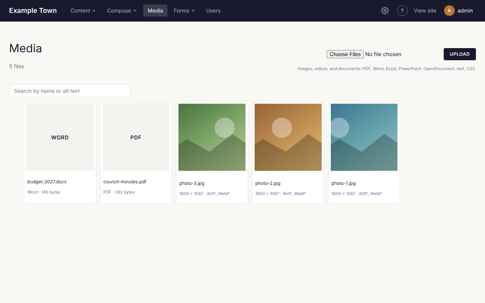
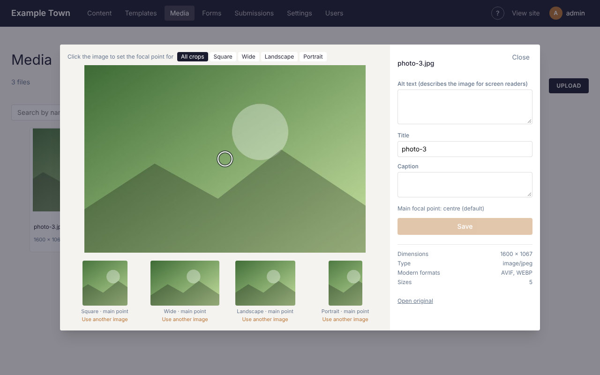

All your pictures, videos and documents live in **Media**, in the top bar. Anything there can be used on
any page, and anyone who edits the site can use it.

## The Media screen

Click **Media** in the top bar. You see:

- how many files the site has (for example **240 files**);
- the upload box, top right;
- a search box;
- your files, newest first, 60 to a page. Use **Previous** and **Next** at the bottom to see more.

Each file shows a small preview (videos and documents show their type, such as **PDF** or **Word**), its
file name and a line of details: a picture's size in pixels, a document's type and size. **AVIF, WebP**
means the site has made lighter copies of the picture for fast loading, and **focal point** means someone
has chosen which part of it stays in view (see [Keeping the important part in
view](#keeping-the-important-part-in-view)).

Click any file to open its details.

## Uploading files

### From the Media screen

1. Click **Media** in the top bar.
2. Click the file box at the top right (most browsers call it **Choose Files**) and pick the file on your
   computer. To upload several at once, hold Ctrl (Cmd on a Mac) or Shift while you click them.
3. Click **Upload**.

The line under the box shows how it is going, for example **Uploading 2 of 5: garden.jpg…**. When all
the files are done the page reloads with them at the top. If any file was refused, a message lists each
one with the reason first.

### From the page editor

Wherever a block or a setting takes a picture (an **Image** block, a **Hero**, a **Cover**, a page's
**Featured image** and so on), click **Choose**. A window opens with your files:

- Click a file to use it.
- **Search media** finds a file by its title, file name or alt text.
- **Upload** adds a new file from your computer and puts it in the list, ready to click.
- **Close** goes back without choosing.

The window shows only files of the right kind: pictures for a picture setting, videos for a video,
documents for the **File** block.

### What you can upload

| Kind | Types | Largest |
| --- | --- | --- |
| Pictures | JPEG, PNG, WebP, AVIF, GIF, SVG and other picture files your browser offers | 90 MB |
| Videos | MP4, WebM and MOV | 200 MB (see the note below) |
| Documents | PDF, Word, Excel, PowerPoint, OpenDocument (text, spreadsheet, presentation), plain text and CSV | 50 MB |

:::caution
Many hosting plans refuse any upload over 100 MB before it reaches the site, so keep videos under 100 MB.
A long video is usually better on YouTube or Vimeo, added with a [Video gallery](#video-galleries).
:::

### What the site does with a picture

You don't need to resize photos before uploading. The site does it for you:

- A picture wider or taller than 2560 pixels is scaled down to 2560 for use on pages. The original is
  kept as well.
- Smaller copies are made for phones, tablets, lists and thumbnails, so visitors download no more than
  their screen needs.
- JPEG and PNG pictures also get lighter copies in the newer AVIF and WebP formats, which browsers that
  can use them load instead.
- Photos in iPhone (HEIC), TIFF or BMP format are turned into JPEG.
- SVG drawings, GIFs and animated pictures are kept exactly as uploaded, with no smaller copies, so an
  animation keeps moving.

:::tip
For big banner pictures (a **Hero** or a **Cover**) use photos at least 1600 pixels wide. The details
panel tells you when a picture is too small for a crop (see [When a crop comes out
small](#when-a-crop-comes-out-small)).
:::

### File names

The site tidies the file name: capitals become small letters, and spaces and other symbols become
hyphens, so `Summer Fair 2026.JPG` is stored as `summer-fair-2026.jpg`. If a file of that name is already
there, the new one gets a number (`summer-fair-2026-1.jpg`); nothing is ever written over. The file's
**Title** starts as its name without the ending, and you can change it in its details.

### When an upload is refused

| The message says | What it means |
| --- | --- |
| **Only images, videos (MP4, WebM, MOV) and documents (PDF, Word, Excel, PowerPoint, OpenDocument, text, CSV) can be uploaded here** | The file isn't a kind the site takes. Save it as one of those, for example a PDF. |
| **Documents can be up to 50 MB** | Make the document smaller, for example by saving a PDF with smaller pictures in it. |
| **Files can be up to 90 MB here** | The picture or document is too big. Make it smaller and try again. |
| **Videos can be up to 200 MB** ... | The video is too big. Shorten it, or put it on YouTube or Vimeo. |
| **That file isn't a PDF file inside, whatever its name says.** (or Word, Excel...) | The file's ending doesn't match what is in it, for example a web page renamed to `.pdf`. Open it in its own program and save it again in the right format. |
| **Another upload took this name at the same moment: upload the video again.** | Two videos with the same name were uploaded together. Upload this one again. |

## Finding a file

Type in the search box on the **Media** screen (**Search by name or alt text**) and press Enter. It
finds files whose title, file name or alt text contain what you typed. That is one more good reason to
write alt text and clear titles.

## A file's details

Click a file on the **Media** screen to open its details. The file is on the left and its settings on
the right. **Close** (top right), Escape, or a click outside the panel closes it.

### Pictures

- **Alt text (describes the image for screen readers)**: a short description of the picture, read aloud
  to people who can't see it and shown if the picture doesn't load. Write what someone would need to
  know, for example "Children planting flowers at the community garden". Leave it empty only for pictures
  that are purely decoration. See [Accessibility](/editors/accessibility/#writing-good-alt-text) for more
  on writing it.
- **Title**: a name for your own use, shown in the library and used as the link's words when you link to
  the file.
- **Caption**: a line of text about the picture, such as who took it.

Then click **Save**. **Save** stays greyed out until you change something; **Saved** appears in green
once it is done.

The alt text you write here is used wherever the picture appears, unless a block gives it its own alt
text. When you choose a picture in an **Image** block, the block's own **Alt text** box is filled from
here if it is empty.

**Not sure what to write?** Click **Compose** beside **Alt text**. Claude looks at the picture, with its
file name, title, caption and any alt text it has already, and writes one sentence into the box. The
button reads **Writing…** while it works, then **Written by Claude: check it, then Save.** appears. Read
it and change anything that isn't right (it can't know people's names or places unless the title or
caption says them), then click **Save**. Nothing is saved until you do. Adding a title or caption first
gives it more to go on.

:::note
**Compose** appears only for photos and similar pictures (JPEG, PNG, GIF, WebP, AVIF), not for SVG
drawings, videos or documents. It needs the site to be connected to Claude: if it isn't, a message under
the box says so. An admin sets that up (see [Connections](/admins/connections/)).
:::

Under the **Save** button the panel lists the picture's **Dimensions**, file **Size**, **Type**, **Modern
formats** (**AVIF, WEBP** when the lighter copies are made, **Pending** while they are still being made,
or **Not applicable** for files that don't get them) and how many **Sizes** were made.

At the bottom:

- **Open original** opens the full picture in a new tab.
- **Copy link** copies the picture's full web address, to paste into an email or a message. **Link
  copied** confirms it. If your browser won't allow it, the panel says **Could not copy: open the file
  and copy its address instead.**

### Videos

A video's details show a player, so you can watch it, with its **Title** and **Caption**, its **Size**
and **Type**, **Open original** and **Copy link**. Videos have no alt text or focal point.

### Documents

A PDF's details show the document itself, so you can scroll through it. Other documents (Word, Excel and
so on) say **No preview: open the file to see it.** Documents have a **Title** and **Caption**, their
**Size** and **Type**, **Open file** and **Copy link**. They have no alt text or focal point.

## Keeping the important part in view

Pictures are often cropped to fit a shape: a square on a list of posts, a wide strip across a banner.
By default the site keeps the middle. To choose which part always stays in view, set the picture's
**focal point**.

1. Open the picture's details in **Media**.
2. **Click on the most important part of the picture** (a face, a building). You can also drag across
   it. A ring marks the spot.
3. Look at the four small previews underneath: they show how each crop will look.
4. Click **Save**. The message **Saving and re-cropping thumbnails...** shows while the site makes new
   crops around your point.

The line under **Caption** shows the point, for example **Main focal point: 40%, 30%**, or **centre
(default)** when none is set. **Reset** beside it goes back to the centre.

### A different point for each shape

The four previews are the shapes the site crops to most:

| Shape | Proportions | Sharp from |
| --- | --- | --- |
| **Square** | 1:1 | 1000 × 1000 pixels |
| **Wide** | 16:9, like a TV screen | 1600 × 900 pixels |
| **Landscape** | 4:3 | 1200 × 900 pixels |
| **Portrait** | 3:4 | 900 × 1200 pixels |

Sometimes one point doesn't suit every shape: a group photo might need the faces in the middle for a
square but the left-hand side for a wide strip. Above the picture is a row of buttons after **Click the
image to set the focal point for**: **All crops**, **Square**, **Wide**, **Landscape** and **Portrait**.

1. Click a shape's button (or click its preview underneath).
2. Click the picture where that shape should centre.
3. Click **Save**.

Under each preview, **main point** means the shape uses the main focal point, and **own point** means you
set one just for it. **reset** beside **own point** goes back to the main point. Click **All crops** to
go back to setting the main point.

A crop whose shape is close to one of these four (within about 15%) uses that shape's point.

### When a crop comes out small

Under each preview is its shape and the smallest picture that fills it sharply, such as **16:9 · 1600 ×
900 or larger**. If it adds **(this one is smaller)**, in orange, the picture has too few pixels for that
shape and the crop may look a little blurry on big screens. Use a larger photo, or use another image for
that shape (below).

### Using another image for one shape

If a picture just doesn't work in one shape (a tall portrait that looks wrong as a wide banner, say), you
can choose a different picture to be used only for that shape.

1. Under that shape's preview, click **Use another image**.
2. Pick the other picture from the window that opens.
3. With that shape selected, the panel shows the other picture and says, for example, **The wide crop
   uses another image. Click it to set its focal point for this crop; it applies only here.** Click it to
   set its point.
4. Click **Save**.

From then on, wherever this picture is cropped to that shape (a block set to that **Aspect ratio**, or
the small square thumbnails), the other picture is shown instead, with the focal point you set for this
use and its own alt text (or this picture's, if it has none). The other picture's own focal points stay
as they were.

Under the preview, **Use a different image** swaps in another one, and **Remove** goes back to cropping
this picture.

## Choosing pictures and videos in blocks

Wherever you can add a picture or a video, a small preview shows what is chosen, with:

- **Choose** (when nothing is chosen yet) or **Replace** (to pick another), which opens the media window.
- **Edit**, which opens the file in **Media** in a new tab, to change its title, caption, alt text or
  focal point. Save there, then come back to your page.

These pickers appear in the **Image**, **Hero**, **Cover**, **Media & text** and **Video** blocks, a page's
**Featured image**, and the **Share image** in its SEO settings. Blocks in general are covered in [The
page editor](/editors/page-editor/).

### The Image block

Besides the picture, the **Image** block has:

- **Alt text (describes the image)**: for this place only; it wins over the library's.
- **Caption**.
- **Link**.
- **Placement**.
- **Image size**: from **Thumbnail (150px square)** up to **Full (the original)**.
- **Aspect ratio**: **Original**, **Square (1:1)**, **Wide (16:9)**, **Landscape (4:3)**, **Portrait
  (3:4)**, **Photo (3:2)**, **Tall (2:3)**, **Cinema (21:9)**, **Banner (3:1)** or **Story (9:16)**.
- **Fit**: **Cover (crop to fill)** or **Contain (show the whole image)**.
- **Circle**.
- **Fill the block behind the content**.
- **Shade (darker towards the bottom)**.

:::note
The **Hero** block's picture is treated as background decoration, so it has no alt text. Put anything
visitors need to know in the hero's title or text. The **Cover** block has its own **Alt text** box.
:::

### Focal points for one block

The **Hero**, **Cover** and **Image** blocks can have their own focal point for each screen size, for
when the picture's own point from **Media** isn't right in that place.

1. Select the block.
2. Under **Focal point**, pick **Desktop**, **Tablet** or **Phone**.
3. Click the picture where it should centre on that size of screen. The small preview beside it shows how
   it will be cropped.

A size you have set shows a dot after its name (**Phone •**). The line underneath says **Now: the
image's own focal point, from the media library.** for a size you haven't set (or **(the centre)** when
the picture has no point either); click **Use the image's own** to go back to it after setting one.

- On **Hero** and **Cover**, the desktop crop is wide (16:9) and tablets and phones are tall (3:4).
  Tablet means screens up to 1024 pixels wide, phone up to 599.
- On an **Image** block, **Focal point** appears only when the picture is cropped: when an **Aspect
  ratio** is set, **Fit** is **Cover (crop to fill)**, or **Fill the block behind the content** is on.
  All three sizes use the block's aspect ratio (4:3 if none is set).
- A **Cover** set to **Use the page's featured image** has no **Focal point** here: set it on the
  featured image in **Media**.
- Choosing a different picture clears the block's own focal points.

:::tip
The phone and tablet buttons above the page in the editor show the page at that size, so you can check
each crop.
:::

## Image galleries

The **Image gallery** block (under **Media** in **Blocks**) shows several pictures together.

1. Add an **Image gallery** block and select it.
2. Click **Add images**. In the window, click each picture you want: each gets a number showing its
   order. Click a picture again to leave it out.
3. Click **Add 4 selected** (the number is how many you picked).

Each picture becomes its own image inside the gallery, with its alt text from the library. **Select an
item in the gallery to change, reorder or remove it**: select one picture to change its alt text or
caption, drag it to move it, or delete it.

### Gallery settings

- **Display**: **Grid**, **Masonry** (columns of pictures at their own heights, like a pinboard) or
  **Slider** (a row visitors move through).
- **Columns** (for a slider, **Visible at once**): how many across, 3 if empty.
- **Image shape** (grid and slider): **As uploaded**, or one of the aspect ratios listed for the Image
  block above, so every picture is the same shape.
- **Crop images to fit** (a grid with **As uploaded**): crops the pictures to line up neatly. Turn it off
  to show each one whole.
- **Gap**: the space between pictures.

Under **Style**:

- **Corners**: **Square**, or rounded: **Small**, **Medium** or **Large**.
- **Each item's caption**: **Below it**, **Over the image** (on a dark fade) or **Hidden**.
- **On hover**: **Nothing**, **Zoom the image** or **Lift**.

A slider also has **Slider** settings:

- **Arrows**: **Round**, **Square**, **Plain (no background)** or **None**.
- **Arrows' place**: **Over the items**, **Either side** or **Below**.
- **Arrows' background (and the current dot)**: one of the site's colours.
- **Arrows' colour**: one of the site's colours.
- **Dots**: a dot for each stop, to jump to it.
- **Show part of the next item**, so visitors can see there is more.
- **Advance automatically**, and how many **Seconds per item** (2 to 20). It pauses while someone hovers
  over it or uses it, and doesn't move at all for visitors whose device is set to reduce motion.

**Copy styles** and **Paste styles** carry these settings to another gallery (see [Copying a block's
look](/editors/page-editor/#copying-a-blocks-look)).

## Video galleries

The **Video gallery** block shows videos the same ways: **Grid**, **Masonry** or **Slider**.

- **Add uploaded videos** picks video files from **Media** (several at once, as for pictures).
- **Add YouTube or Vimeo links**: paste the videos' web addresses, one per line, and click **Add links**.
  Each becomes a player. Anything that isn't a YouTube or Vimeo link stays in the box with the message
  **Not a YouTube or Vimeo link:** and the address.

Its settings are the same as an image gallery's, except that it has no **Image shape**, no **Over the
image** captions, no **Zoom the image** and no **Advance automatically**.

:::tip
To show a single YouTube or Vimeo video, add a **Video gallery** with just one link.
:::

## The Video block

For one video file, add a **Video** block and in its settings:

- **Video**: click **Choose** to pick one from **Media** or upload it. Large videos take a while to
  upload.
- **Or a video file's address**: instead of choosing one, paste the address of a video file kept
  elsewhere (an MP4 file, not a YouTube page).
- **Poster image (shown before it plays)**: a picture shown until the video starts.
- **Remove the poster**: takes it away.
- **Caption**.
- **Autoplay (muted)**.
- **Loop**.
- **Show controls**: on unless you turn it off.

:::caution
Videos that play by themselves can distract or upset some visitors. If you use **Autoplay (muted)**,
keep **Show controls** on so people can stop it.
:::

The **Embed** block takes the code a video or map service gives you for embedding (paste it into
**Embed HTML**). With only a **URL** filled in, it shows as a plain link.

## Documents (PDFs, Word, Excel...)

You can upload documents to **Media** just like pictures: PDFs, Word, Excel and PowerPoint files,
OpenDocument files, plain text and CSV, up to 50 MB each. You can choose several files at once.

Then link to them from a page in any of these ways.

### The File block

The **File** block (in **Blocks**, under **Media**) shows the document's name as a link, its type and
size (for example **PDF · 1.4 MB**) and a **Download** button. In its settings:

- **File**: **Choose** opens the media window showing only documents; **Replace** picks another;
  **Edit** opens it in **Media** in a new tab.
- **Or an address**: instead of a file from **Media**, the address of a document kept elsewhere.
- **Link text**: the words of the link. Empty, it uses the document's title.
- **Show its type and size**: on unless you turn it off. (Shown only for files from **Media**.)
- **Button**: the button's words, **Download** to start with. Empty the box for no button.

The link opens the document (a PDF in the browser); the button saves it to the visitor's computer.

### A link in text or on a button

- **From some words in a paragraph**: select the words, click **Link** above the text box, then **Media
  library**, and pick the document. If no words are selected, the document's title is put in as the
  link's words.
- **From a button** (or an image or hero): click **Find** beside its **Link** box, then **Media
  library**, and pick the document.

The **Media library** button there lists every kind of file: pictures, videos and documents. Links are
covered in more detail in [The page editor](/editors/page-editor/#links).

### In an email or a message

To put a document's address in an email or a newsletter, open it in **Media** and click **Copy link**.
Every picture and video has **Copy link** too.

:::tip
PDFs open in the visitor's browser. Word, Excel, PowerPoint and OpenDocument files download.
:::

## Files are never deleted

There is no delete in **Media**. Pictures, videos and documents stay in the library for good, so a file
used on an old page, in an email or in a link someone saved can't go missing by accident. To stop using
a file, remove it from the page or replace it with another.
