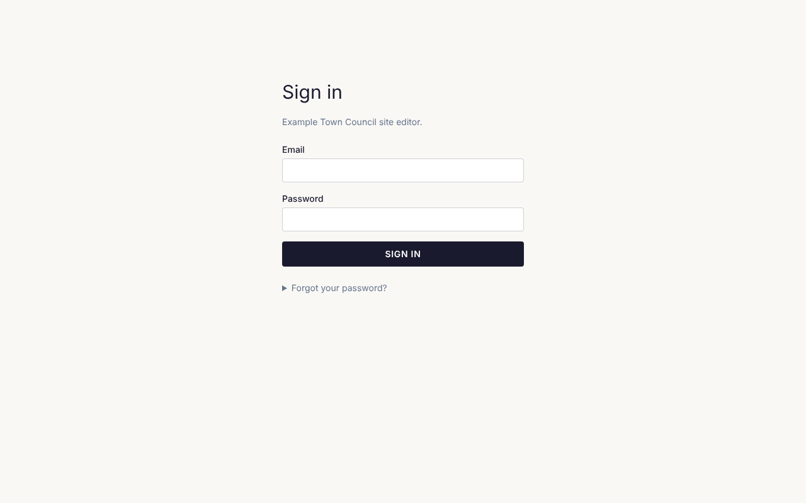
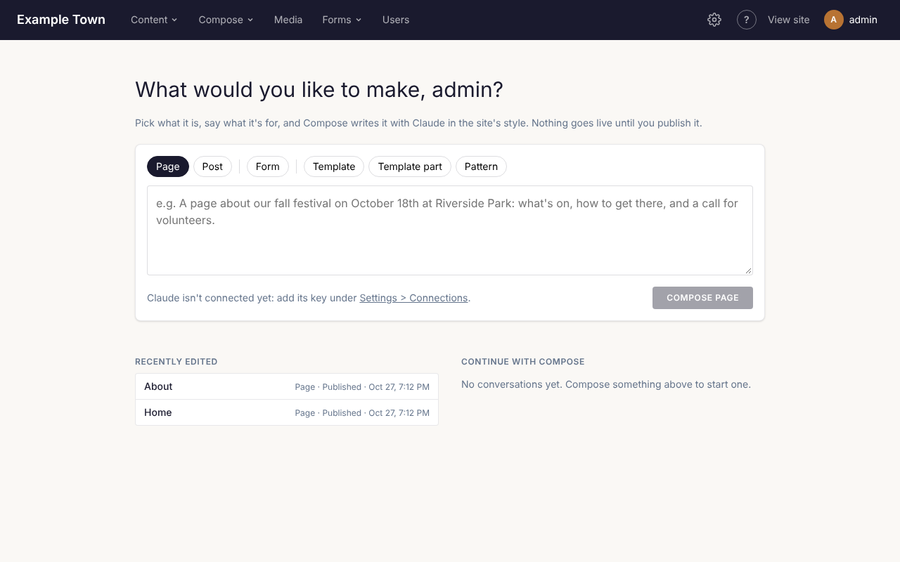
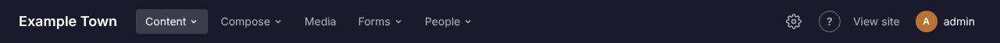

This guide is for the people who keep a site up to date day to day. You don't need to know anything
about websites or code to follow it. Each page walks through one job, step by step.

The **?** button at the top of every admin screen brings you back here (it opens in a new tab). Admins
have a guide of their own for site-wide settings: the [Admin guide](/admins/).

## Signing in

1. Go to your site's address and add `/admin/` to the end, for example `www.yoursite.org/admin/`.
2. The **Sign in** screen opens. Enter your **Email** and **Password**.
3. Click **Sign in**.

You arrive on the home screen, or on the admin screen you were trying to open. You stay signed in on
that browser while you keep using it; after seven days away, you are asked to sign in again.

If signing in doesn't work, the screen says why:

| Message | What to do |
| --- | --- |
| That email and password don't match an account. | Check the email address and try the password again (capital letters count). Or set a new password (below). |
| Too many tries. Please wait a while and try again later. | After 10 wrong tries in 15 minutes, signing in waits for a while, even with the right password. Wait, or set a new password. |
| This account does not have editor access. | This is a member's account, or one without access to the admin. Ask an admin to give you the editor role. |

### Forgot your password?

1. On the sign-in screen, click **Forgot your password?**.
2. Enter your email address and click **Send link**.
3. The screen says "If that address has an account, a link to set a new password is on its way." Open
   the email and click its link.
4. On **Set your password**, type a **New password** (at least 10 characters) and type it again under
   **Repeat it**.
5. Click **Save password**. You are signed in.

The link works once and only for an hour. If it has run out, the page says "This link has expired or was
already used."; click **Send a new one**. If no email comes, check your spam folder; you can ask for a
link up to three times an hour. Setting a new password signs you out on your other devices.

### New here?

Someone at your organisation sends you an invitation by email:

1. Click the link in the email.
2. On **Set your password**, choose a password (at least 10 characters), type it again under **Repeat
   it** and click **Save password**.
3. You are signed in and arrive on the home screen.

The invitation lasts a week. If it has run out, was used already, or a newer one was sent, the page says
so; ask an admin to send a new one (see [People and access](/admins/people/)).

### Signing out

Click your initial (and your name) at the top right. A box shows your email address and whether you are
an **Editor** or **Admin**. Click **Sign out**. Sign out when you have used a shared or public computer.

## The home screen

Signing in takes you to the home screen, which asks **What would you like to make?** It is the quickest
way to have Claude start something for you:

1. Pick what it is: a kind of content with a page (such as **Page**, **Post** or **Event**), or **Form**,
   **Campaign** (with mailing lists), **Template**, **Template part** or **Pattern**.
2. For a form, template, part or pattern, give it a name.
3. In the big box, say what it's for, for example "A page about our fall festival on October 18th at
   Riverside Park".
4. Click the button (it says **Compose page**, **Compose form** and so on), or press Ctrl+Enter (Cmd+Enter
   on a Mac).

Claude writes it in your site's style. A page or post opens in Compose, which makes a draft; a form,
campaign, template, part or pattern opens in its own editor, where you check it and save. Nothing goes
live until you publish it. To bring a flyer, photos or a link along, click **Add documents, images or
links first** instead. See [Writing with Claude](/editors/writing-with-claude/).

If it says "Claude isn't connected yet", an admin needs to add Claude's key under **Settings**,
**Connections** (see [Connections](/admins/connections/)). You can still make everything by hand.

Below the box:

- **Recently edited**: the last things edited on the site, with their kind, whether they are
  **Published** or a **Draft**, and when. Click one to open it.
- **Continue with Compose**: the latest conversations with Compose about pages, each with the last
  thing asked. Click one to open the page with its conversation and carry on.

The site's name (or logo) at the top left of every admin screen brings you back here.

## Finding your way around

The bar across the top of every admin screen takes you to each part of the site:

| Menu item | What is in it |
| --- | --- |
| The site's name | The home screen. |
| **Content** ▾ | A list for each kind of content your site has, such as **Pages**, **Posts**, **Events** and **Venues**; **Taxonomies** (categories, tags and the like); and, below a line, **Templates**, the shared layouts every page uses, with the header, footer and patterns. See [Pages and posts](/editors/pages-and-posts/). |
| **Compose** ▾ | Have Claude make something new: each kind of content with a page; below a line, **Form** and **Campaign** (with mailing lists); below another, **Template**, **Template part** and **Pattern**. See [Writing with Claude](/editors/writing-with-claude/). |
| **Media** | Your photos, images, videos and documents. See [Images and files](/editors/images-and-files/). |
| **Stats** | How many people visit, and what they read. See [Stats](/editors/stats/). |
| **Forms** ▾ | **Forms** (contact forms, sign-up forms and the like) and **Submissions** (what people sent through them). See [Forms](/editors/forms/). |
| **People** ▾ | **Mailing Lists** and **Tickets**, each only when your site uses it; for admins also **Users** and **Members**. With only one of these, it shows as that link instead of a menu; with none, it isn't there. |
| ⚙ (the gear) | **Settings**: site-wide settings, such as the menu. Admins only. |
| **?** | This guide, in a new tab. |
| **View site** | Your public website in a new tab, to see your changes as visitors will. |
| Your initial and name | Your email address, your role and **Sign out**. |

Click **Content**, **Compose**, **Forms** or **People** to open its menu, then click the screen you want.
Only one menu is open at a time; click anywhere else or press Escape to close it. The menu you are in is
highlighted.

**On a phone or a narrow window**, the menus are behind the ☰ button at the top right. It lists every
screen, with each menu's name as a heading, then **Settings** (admins) and **View site**. On a phone, your
name is left out beside your initial.

**On your website**, while you are signed in, a dark editor bar appears across the top of the site's
pages: **Dashboard** goes to the home screen, **Edit page** opens the page you are looking at in the
editor (admins also get **Edit template**), and **Sign out** signs you out.

## Editors and admins

There are two kinds of account:

- **Editors** look after the content: pages, posts, events, templates, images, forms and submissions,
  tickets and Compose. They see Stats.
- **Admins** can do everything editors can, and also change site-wide settings (the menu, the home page,
  redirects, connections), refund tickets, and decide who has access.

If you can't see something this guide mentions, it is probably for admins (see the
[Admin guide](/admins/)), or a feature your site doesn't use, such as events, members or mailing lists.

## What's in this guide

- [Pages and posts](/editors/pages-and-posts/): adding, finding, copying and organising content, with
  categories, tags and page addresses.
- [Using the page editor](/editors/page-editor/): blocks, patterns, links, the page's settings and
  templates.
- [Saving and publishing](/editors/saving-and-publishing/): drafts, publishing, previewing and going back
  to an earlier version.
- [Images and files](/editors/images-and-files/): uploading, describing and cropping images, galleries,
  videos and documents.
- [Forms](/editors/forms/): building forms, their emails, and reading what people send.
- [Writing with Claude](/editors/writing-with-claude/): having pages, forms and more drafted from your
  documents, then asking for changes.
- [Accessibility](/editors/accessibility/): making sure everyone can use your pages.
- [Events and tickets](/editors/events-and-tickets/): events, venues, the calendar, and selling tickets
  or taking sign-ups.
- [Mailing lists](/editors/mailing-lists/): writing and testing campaigns, the weekly digest, segments,
  sign-up forms, and how each email went.
- [Popups](/editors/popups/): changing what a popup or the cookie consent banner says.
- [Stats](/editors/stats/): how many people visit, what they read and where they come from, and making
  campaign links.
- [Common questions](/editors/common-questions/): quick answers when something isn't working.
