When you open a page, the editor shows it as it will look on your site. You build the page from
**blocks** (a heading, a paragraph, a picture, a row of buttons...) and change each one in the panel on
the right.

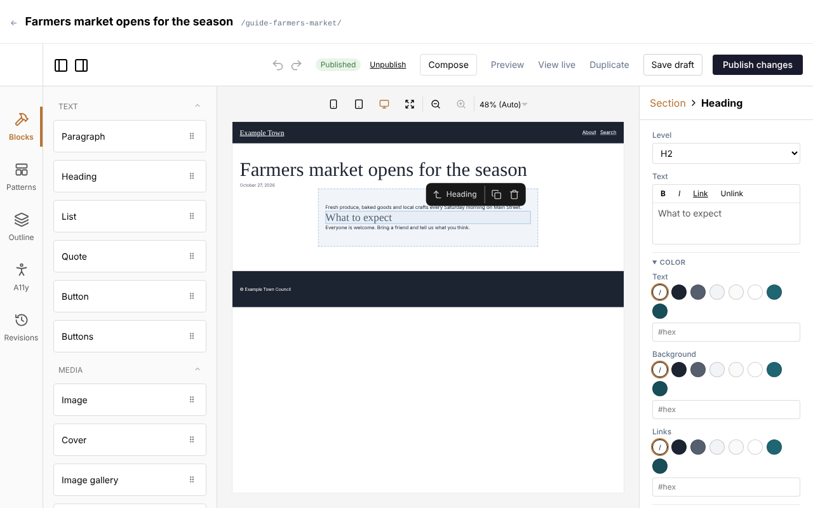

## The editor's layout

The editor has four parts.

### Along the top

The bar above the editor shows the page's title and its address. The **←** at its left goes back to the
list the page is in.

The toolbar under it has:

- **Published** or **Draft**: whether the page is on the site, and **Unsaved changes** or **Unpublished
  changes** when there are some.
- **Discard changes** and **Unpublish**, on a published page.
- **Compose**: opens Claude beside the page (see [Writing with Claude](/editors/writing-with-claude/)).
- **Preview**: the page as it will look, including changes you haven't saved.
- **View live**: the published page, in a new tab.
- **Duplicate**: makes a draft copy of the page and opens it.
- **Save draft** and **Publish** (or **Publish changes**).

Saving, publishing, previewing and going back to an earlier version are explained in
[Saving and publishing](/editors/saving-and-publishing/).

The undo and redo arrows are in the toolbar too.

### The left rail

The icons down the left side open:

- **Blocks**: every block you can add, in groups (see [Every block](#every-block) below). Click a
  group's name to fold it away or open it again.
- **Patterns**: ready-made groups of blocks (see [Patterns](#patterns)).
- **Outline**: a list of everything on the page, showing what sits inside what. Click a line to select
  that block. This helps when a block is hard to click on the page itself. Each line also has a copy
  icon (**Duplicate**) and a bin icon (**Delete**).
- **A11y**: an accessibility check of the page (see [Accessibility](/editors/accessibility/)).
- **Revisions**: earlier versions of the page (see
  [Saving and publishing](/editors/saving-and-publishing/#going-back-to-an-earlier-version)).

### The page in the middle

The middle shows the page as visitors will see it, with the header, footer and anything else its
template puts around it. Click a block to select it.

Buttons above the page switch it between phone, tablet and desktop widths, and zoom in or out, so you
can check how it looks on a small screen.

Only the page's own content can be changed here. The header, footer and other parts that come from the
template are shown so you can see the whole page, but you can't select them (see
[The header, footer and templates](#the-header-footer-and-templates)).

### The panel on the right

The right-hand panel shows the settings of the selected block, under its name. With no block
selected, it shows **Page settings**: the page's title, address, featured image, categories, tags and
so on (see [The page's settings](#the-pages-settings)).

Above the block's name at the top of the panel is where it sits: **Page**, then each block it is
inside (such as **Page › Section › Columns › Column**). Click one to select that block instead, or
click **Page** to go back to the page's settings.

## Working with blocks

### Adding a block

1. Open **Blocks** on the left.
2. Drag the block you want onto the page, to where it should go. A line shows where it will land.
3. Let go. The new block is selected and its settings show on the right.

Blocks that hold other blocks (such as **Section** and **Columns**) show an empty space you can drop
blocks into.

### Changing a block

Click the block on the page. Its settings appear on the right. Change them there: the page updates as
you type. Text is written in the boxes on the right, not on the page itself.

### Moving, copying and removing a block

When a block is selected, a small toolbar appears above it with its name and three buttons:

- **Select parent**: selects the block it sits inside (handy for getting from a paragraph to the
  section around it).
- **Duplicate**: puts a copy of the block (and everything in it) straight after it.
- **Delete**: removes the block and everything in it.

To move a block, drag it on the page to its new place. A line shows where it will land; you can drop it
into another section or column too.

### Keyboard shortcuts

| Keys | What they do |
| --- | --- |
| Ctrl+Z (Cmd+Z on a Mac) | Undo the last change. Press again to undo more. |
| Ctrl+Shift+Z or Ctrl+Y (Cmd+Shift+Z or Cmd+Y on a Mac) | Redo what you undid. |
| Delete or Backspace | Removes the selected block (not while you are typing in a box). |

:::tip
Made a mistake? Undo takes back the last change, and you can undo several times. Pasted styles and
restored versions can be undone the same way.
:::

### Blocks inside blocks

Some blocks hold other blocks:

- **Section**: a band across the page, with its own background and spacing.
- **Columns** and **Column**: blocks side by side.
- **Buttons**: a row of **Button** blocks.
- **Quote**: the quoted words, as **Paragraph** blocks.
- **Cover**: blocks laid over a picture.
- **Media & text**: blocks beside a picture.
- **Image gallery** and **Video gallery**: their pictures and videos.
- **Collection**: the card repeated for each entry.
- **Members only**: blocks only members see.

Drag blocks into them. The **Outline** shows how everything is nested.

**To put blocks side by side:**

1. Add a **Columns** block.
2. Drag a **Column** block into it for each column you want.
3. Drag your blocks (a heading, a paragraph, a picture) into each **Column**.

On phones the columns stack one under the other, unless you tick **Keep side by side on phones** in
the **Columns** settings.

## Styles

Most blocks share the same style settings, near the end of their panel. Groups can be folded away by
clicking their heading. Which groups a block has depends on the block.

- **Width**: **Default**, **Wide** or **Full width**. Inside a section that keeps its content to a
  reading width, **Wide** lets the block spread wider and **Full width** takes it from edge to edge.
- **Color**:
  - **Text**.
  - **Background**.
  - **Links**.
  - For each: click one of the site's colours, the **/** circle to go back to the default, or type a
    colour code (such as `#1a1a2e`) in the box.
- **Text** (for blocks with words):
  - **Size**: one of the site's text sizes.
  - **Font**: the site's display font or its body font.
  - **Weight**: **Light**, **Regular**, **Medium**, **Semibold** or **Bold**.
  - **Alignment**: **Left**, **Center** or **Right**.
  - **Case**: **Uppercase** or **As typed**.
  - **Letter spacing**: type a value, such as `0.06em`.
  - **Line height**: type a value, such as `1.6`.
- **Spacing**:
  - **Padding top**: space inside the block, between its edge and its content.
  - **Padding right**.
  - **Padding bottom**.
  - **Padding left**.
  - **Margin top**: space outside the block, between it and its neighbours.
  - **Margin bottom**.
  - Each is **None**, one of the site's spacing sizes, or **Custom** (type a value such as `2rem`).
- **Border**:
  - **Corner radius**: how round the corners are, such as `6px`.
  - **Border width**: such as `1px`.
  - **Border color**.
- **CSS class**: a name your site's designer may give you for a special style. Leave it empty
  otherwise.

Every setting left empty uses the site's own style, so a block looks right without any of them.

### Layout inside a block

**Section**, **Cover** and the **Page content** block have a **Layout** group that sets how the blocks
inside them are arranged:

- **Arrange children**:
  - **Stacked**: one under the other, as wide as the block.
  - **Stacked, centred content width**: one under the other, kept to a comfortable reading width in
    the middle. New sections start like this. Its setting:
    - **Content width**: **Standard (720px)**, **Narrow (560px)**, **Reading (640px)**, **Medium
      (800px)**, **Large (960px)**, **Extra large (1120px)**, **Wide (1280px)** or **Full width**.
  - **Row**: side by side. Its settings:
    - **Justify**: **Start**, **Center**, **End** or **Space between**.
    - **Align**: **Top**, **Center**, **Bottom** or **Stretch**.
    - **Wrap onto new lines**.
  - **Column (flex)**: one under the other, with the same **Justify** and **Align** settings.
  - **Grid**: in a grid. Its settings:
    - **Columns**: how many (empty: as many as fit).
    - **Minimum column width**: how narrow a column may get (such as `12rem`).
- **Gap between children**: the space between the blocks inside.

### Copying a block's look

To make one block look like another:

1. Select the block whose look you like.
2. Scroll to the end of its settings and click **Copy styles**.
3. Select the other block and click **Paste styles** (the button names the kind of block you copied
   from).

Its colours, spacing, text style, borders and width change to match; its words and pictures stay as
they are. Between two blocks of the same kind (two sections, say) the layout comes too: alignment, gaps,
height, overlay, size, columns and display.

The copy stays in your browser, so you can paste it on another page, a template or a pattern. Changed
your mind? Click undo.

Blocks inside a linked pattern don't offer **Copy styles**: their look belongs to the pattern.

### Advanced settings

Every block's settings end with **Advanced: all attributes (JSON)**, which shows all of its settings as
code. It is there for people who know what they are doing; you never need it for ordinary editing.

## Writing and formatting text

Text boxes for paragraphs, headings, captions and list items have a small toolbar above them:

- **B**: bold.
- **I**: italic.
- **Link**: link the selected words (see [Links](#links)).
- **Unlink**: take the link off the selected words.

Select some words first, then click the button.

## Links

There are two places to make a link:

- **In text**: select some words in a text box and click **Link** above it.
- **In a link box**, such as a button's **Link**, a Hero's **Button link** or a menu item's link: click
  **Find** beside the box. You can also type or paste an address straight into the box.

Both open the same link picker, with a box that says **Search pages, or paste a link**:

- **To a page on your site**: start typing its title and pick it from the list (use the arrow keys and
  Enter, or click it). Each result shows its kind, its address, and **(not published)** if it is a
  draft. With the box empty, the list shows the pages edited most recently.
- **To a file**: click **Media library** and pick a picture, a document or a video.
- **To another website**: paste its full address (such as `https://example.org`) and pick **Link to
  this address**. A plain domain such as `example.org` gets `https://` added.
- **An email address or phone number**: type it (a phone number without spaces) and pick **Link to
  this address**. The link opens an email or a phone call.
- **A part of the same page**: type `#` and the part's name.

If nothing is found, the picker says **Nothing found. Type a full address (https://…) to link to another
site.** **Cancel** (or the Escape key) closes it without linking.

In text, a few more things apply:

- **Open in a new tab** is ticked for links to other websites and unticked for your own pages. Change it
  if you want.
- If no words are selected, the link is added with the page's title or the file's name as its words.
- **To change a link**, put the cursor in it and click **Link** again: its address is filled in, ready to
  change. **Remove link** there takes it off.

Link boxes don't have **Open in a new tab** in the picker: blocks such as **Button** and **Image** have
their own **Open in a new tab** setting.

## Every block

These are the blocks as the **Blocks** list groups them. Some groups only appear when your site uses
that feature, and some blocks only appear on the kinds of content they work with (an event's blocks on
events, for example). Templates offer every block.

Your site may also have blocks of its own, made for its design; they appear in these groups too.

### Text

#### Paragraph

Ordinary text.

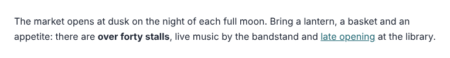

Its settings:

- **Text** (with bold, italic and links).
- The **Color**, **Text** and **Spacing** styles.

#### Heading

A title for a section of the page.

Its settings:

- **Level**: **H1** to **H6** (see the tip below).
- **Text**.
- The **Color**, **Text** and **Spacing** styles.

:::tip
Use **H2** for each main section of a page, and **H3** for the parts inside it. The page's title is
usually already the **H1**, so a page needs no other.
:::

#### List

Bullet points, numbered steps or a list with icons.

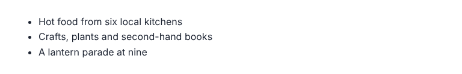

Its settings:

- **Marker**: **Bullets**, **Numbers**, **Icon** or **None**.
- **Icon**: with **Icon**, the icon to use.
- **Icon color**: its colour.
- **Items**: each item's text, with **Up**, **Down** and **Remove**; with icons, **Icon for this item** gives one item a different icon.
- **Add item**: adds one.
- **Paste several**: takes a list, one item per line; **Add lines** adds them all.
- **Text**: the text styles and **Space between items**.

#### Quote

Words quoted from someone. Put **Paragraph** blocks inside for the quote itself.

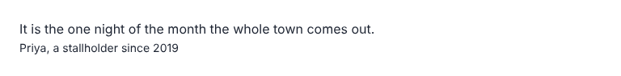

Its settings:

- **Citation**: who said it.
- All the styles.

#### Button

One link styled as a button, such as "Book now". Put it inside a **Buttons** block.

Its settings:

- **Label**: the words on it.
- **Link** (with **Find**).
- **Open in a new tab**.
- **Style**: **Default** or **Outline**.
- **Width**: **25%**, **50%**, **75%** or **100%** of the space.
- The **Color**, **Text** and **Border** styles.

#### Buttons

A row of **Button** blocks.

Its settings:

- **Justify**: **Start**, **Center**, **End** or **Space between**.
- **Stack vertically**.
- **Gap** between the buttons.

### Media

Pictures, galleries, videos and documents are covered in more depth in
[Images and files](/editors/images-and-files/).

#### Image

One picture.

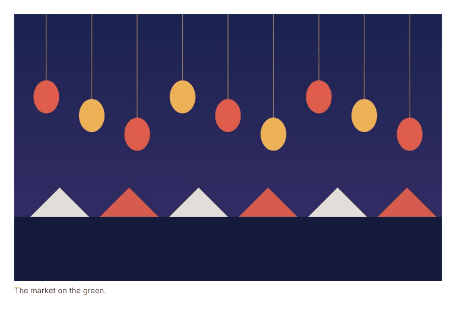

Its settings:

- **Image**: **Choose** (or **Replace**) picks one from the media library; **Edit** opens it in the media library in a new tab.
- **Alt text (describes the image)**.
- **Caption**.
- **Link**.
- **Open link in a new tab**.
- **Placement**: **Float left**, **Float right** (text wraps round it), **Centred**, **Wide** or **Full width**.
- **Image size**: **Full (the original)**, **Large (1024px)**, **Medium (768px)**, **Small (300px)** or **Thumbnail (150px square)**.
- **Aspect ratio**: **Original**, or a shape such as **Square (1:1)** or **Wide (16:9)**.
- **Fit**: **Cover (crop to fill)** or **Contain (show the whole image)**.
- **Circle**.
- **Fill the block behind the content**: the picture fills the block it is in (such as a card), behind the rest.
- **Shade (darker towards the bottom)**.
- **Focal point** when it is cropped (see below).
- The **Spacing** and **Border** styles.

#### Cover

A picture with blocks laid over it, such as a heading and a button.

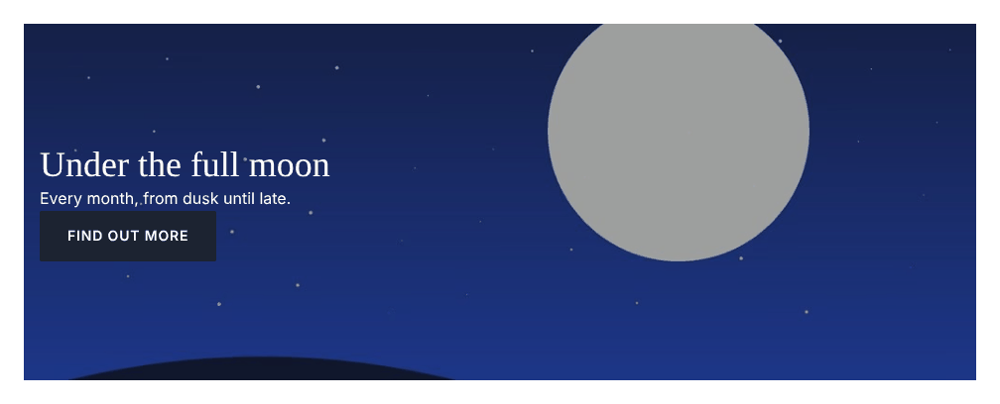

Its settings:

- **Image**.
- **Use the page's featured image** instead.
- **Alt text**.
- **Focal point**.
- **Overlay color**.
- **Overlay**: **Even**, **From bottom** or **From left** (a gradient keeps the text readable where it sits and leaves the rest of the picture clear).
- **Overlay opacity**: how dark, from 0 to 100%.
- **Minimum height** (such as `430px`).
- **Content position**: where the blocks sit, from **Top left** to **Bottom right**.
- **Dark text (light image)**.
- The **Layout** group and the styles.

#### Image gallery

Several pictures as a grid, masonry columns or a slider.

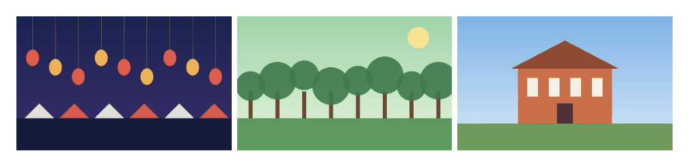

Its settings:

- See [Galleries](/editors/images-and-files/#image-galleries).
- **Display**.
- **Add images**.
- **Columns** (or **Visible at once** in a slider).
- **Image shape**.
- **Crop images to fit**.
- **Gap**.
- The **Style** and **Slider** groups.

#### Video gallery

Several videos together.

Its settings:

- As the image gallery, with **Add uploaded videos** and **Add YouTube or Vimeo links** (one link per line, then **Add links**).

#### Media & text

A picture beside some text. Drag blocks into the text side.

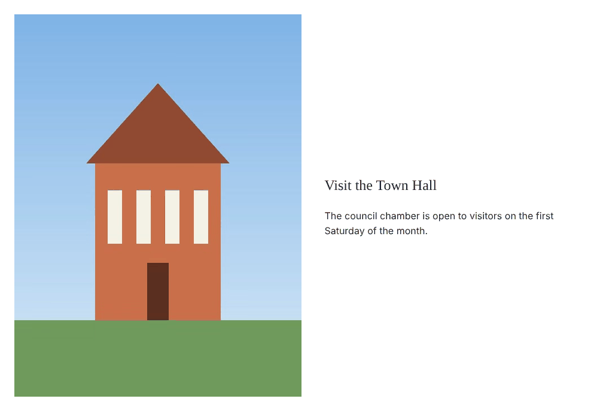

Its settings:

- **Image**.
- **Image side**: left (**Default**) or **Right**.
- **Image width (%)** (50 if empty).
- **Text position**: **Top**, **Middle** or **Bottom**.
- **Stack on phones**.
- The styles.

#### Embed

Something from another website, such as a YouTube or Vimeo video.

Its settings:

- **URL**: its address.
- **Embed HTML**: code another website gives you to paste.
- **Aspect ratio**: **Provider's size** or a shape.

#### Video

A video file from the media library.

Its settings:

- **Video**: **Choose** one from the media library.
- **Or a video file's address**.
- **Poster image (shown before it plays)**, and **Remove the poster**.
- **Caption**.
- **Autoplay (muted)**.
- **Loop**.
- **Show controls**.

#### File

A document (a PDF, say) with its type, size and a Download button.

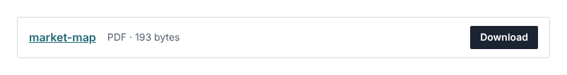

Its settings:

- **File**: **Choose** opens the media library on your documents; **Edit** opens the file in the media library.
- **Or an address**: a document elsewhere.
- **Link text** (the file's title if empty).
- **Show its type and size**.
- **Button**: its words (**Download**); empty for no button.
- The **Color** and **Spacing** styles.

### Layout

#### Section

A band across the page that holds other blocks, with a background colour and spacing.

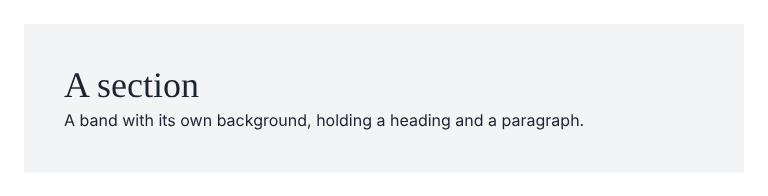

Its settings:

- **Element**: what kind of area it is for screen readers (such as header, footer or main); usually leave it at **Default**.
- The **Layout** group.
- All the styles.

#### Columns

Puts **Column** blocks side by side.

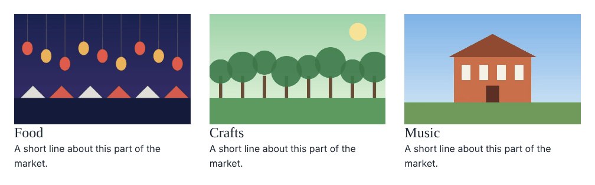

Its settings:

- **Gap** between the columns.
- **Vertical alignment**: **Top**, **Middle** or **Bottom**.
- **Keep side by side on phones**.
- The styles.

#### Column

One column inside **Columns**.

Its settings:

- **Width**: such as `33.33%` (empty: the columns share the space).
- **Vertical alignment**: **Top**, **Middle**, **Bottom** or **Stretch**.
- **Gap between blocks**.
- The styles.

#### Spacer

Empty space between blocks.

Its settings:

- **Height**: such as `40px`.

#### Separator

A line between parts of a page.

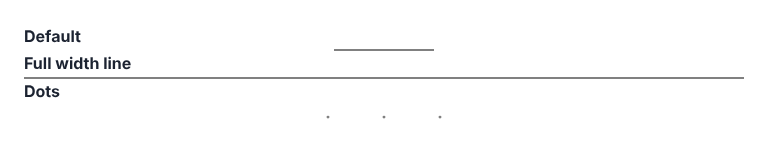

Its settings:

- **Style**: **Default**, **Full width line** or **Dots**.
- The **Color** and **Spacing** styles.

#### Global

Content kept in one place and shown on many pages: change it once, and every page shows the change.

Its settings:

- **Global**: which one.
- **Edit this global** opens it in a new tab.

#### Site title

The site's icon and name, linking to the home page (usually in the header).

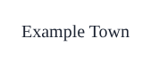

Its settings:

- **Icon**: whether to show it.
- **Name**: whether to show it.
- **Before the name**: words in front of it, such as "Welcome to ".

#### Navigation

The site's menu (usually in the header). Its links are changed under **Settings**, **Menu** by an admin (see [Settings and the menu](/admins/settings/#the-menu)).

Its settings:

- **Search button**.
- **Name for screen readers** (such as "Primary").

#### Social links

Icons linking to the site's social media profiles. The profiles are set under **Settings**, **Social** by an admin.

Its settings:

- **Icon size (px)**.
- **Alignment**: **Left**, **Center** or **Right**.
- **Show the network names**.
- The styles.

### Lists and listings

#### Collection

An automatic list of your posts, events or other content, each shown as a card.

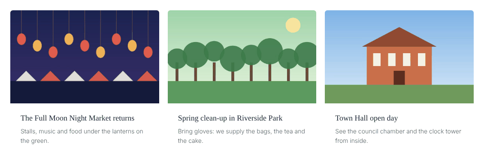

Its settings:

- See [Collections](#collections) below.

#### Filters

A search box and a dropdown of categories (or another way of sorting) above a listing, such as a category page. The list updates as visitors use them.

Its settings:

- **Search box**, its **Search placeholder** and **Suggestions as you type**.
- **Filter by**: which kind of term.
- **Dropdown placeholder**.
- **Show the count**.
- **Search parameter** (under **Addresses**): its name in the page's address.
- **Filter parameter** (under **Addresses**): the same for the dropdown. Only change these two to keep older links working.

#### Map

A map with a pin for each entry of a kind that has a location. Each pin links to its entry.

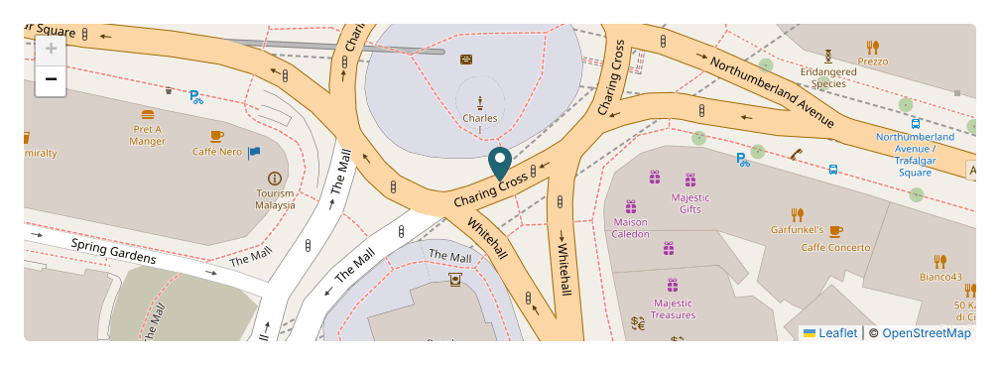

Its settings:

- **Show**: which kind of content.
- **Follow the Filters block's**: which kind of term, so the map follows a Filters block on the page.
- **Only featured entries until filtered**.
- **Center (latitude, longitude)** (empty: every pin in view).
- **Zoom (1-19)**.
- **Height**.
- **Latitude field** (under **Fields**, as are the next three; ask whoever set up your site which to use).
- **Longitude field**.
- **Address field (popup)**.
- **Leave out when this field is on**.

#### Search

A search box that leads to the site's search page.

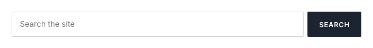

Its settings:

- **Placeholder**: the words shown in the empty box.
- **Button text**.
- **Label**, and **Show the label**.
- The styles.

#### Events calendar

Upcoming events as a month calendar or a list, on any page.

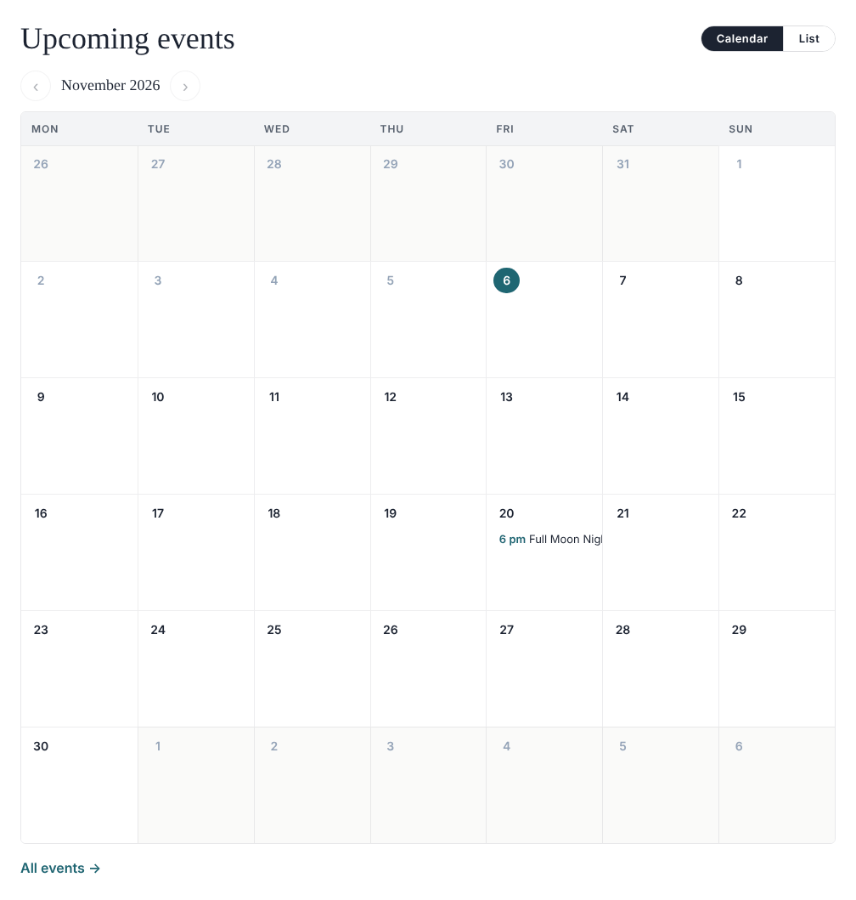

Its settings:

- See [Events and tickets](/editors/events-and-tickets/).
- **Title**.
- **Shows first**: **Calendar** or **List**.
- **Events in the list**.
- **Categories (any of)**.
- **Tagged with (any of)**.

#### Events page (list, month, day)

The full events listing, with its month and day views. Usually only in the events template.

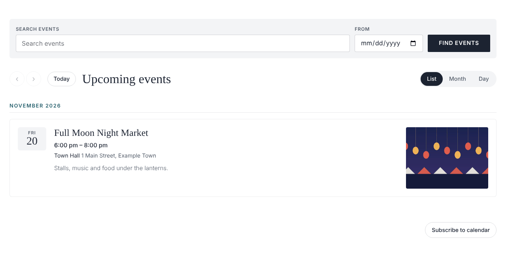

It has no settings of its own.

#### Listing title

The name of the listing a page shows, such as a category's name, on category pages and other listings.

Its settings:

- **Show the prefix (e.g. 'Member Category:')**.
- The styles.

### Card fields

These show one piece of an entry. They are mostly used inside a **Collection**'s card, where each card
shows its own entry's, and in templates, where they show the page's own. Each card in the
**Collection** picture above is a **Featured image**, a **Title** and an **Excerpt**.

#### Title

The entry's title.

Its settings:

- **Level**: **Paragraph** or **H1** to **H6**.
- **Link to the entry**.
- **Open in a new tab**.
- The styles.

#### Featured image

The entry's featured image.

Its settings:

- **Link to the entry**.
- **Open in a new tab**.
- **Aspect ratio**.
- **Height**: **Default**, **Auto (the image's own height)**, **Small**, **Medium**, **Large**, **Extra large** or **Custom**. In a card, **Default** is **Medium** (240px), cropped to fill the card's width.
- **Fit**.
- **Image size**.
- **Fill the card behind the content** (give the card a minimum height).
- **Shade (darker towards the bottom)**.
- **Overlay**: how dark, from 0 to 100%.
- The styles.

#### Excerpt

The entry's short summary.

Its settings:

- **Word limit** (55 if empty).
- **Read more text**.
- The styles.

#### Date

When the entry was published.

Its settings:

- **Date format** (see the note below).
- **Last updated date** instead.
- **Link to the entry**.
- The styles.

#### Event date

An event's date and time.

Its settings:

- **Date format (PHP)**.

#### Categories

The entry's terms of one kind, such as its categories or tags.

Its settings:

- **Taxonomy**: which kind.
- **Separator**: what goes between them (a comma if empty).
- The styles.

#### Field

Any other piece of information the entry has, such as a phone number or website.

Its settings:

- **Field**: its name (ask whoever set up your site).
- **Show as**: **Text**, **Web link**, **Email link**, **Phone link** or **Image**.
- **Label before it**.
- **Link text**, for links.
- **Open in a new tab**, for web links.

:::note
Date formats use letters for each part of the date: `F j, Y` shows "March 5, 2026" and `M j, Y` shows
"Mar 5, 2026". Left empty, **Date** uses `F j, Y` and **Event date** uses `M j, Y`.
:::

### Sections

#### Hero

A large picture across the top of a page, with a title, some text and up to two buttons.

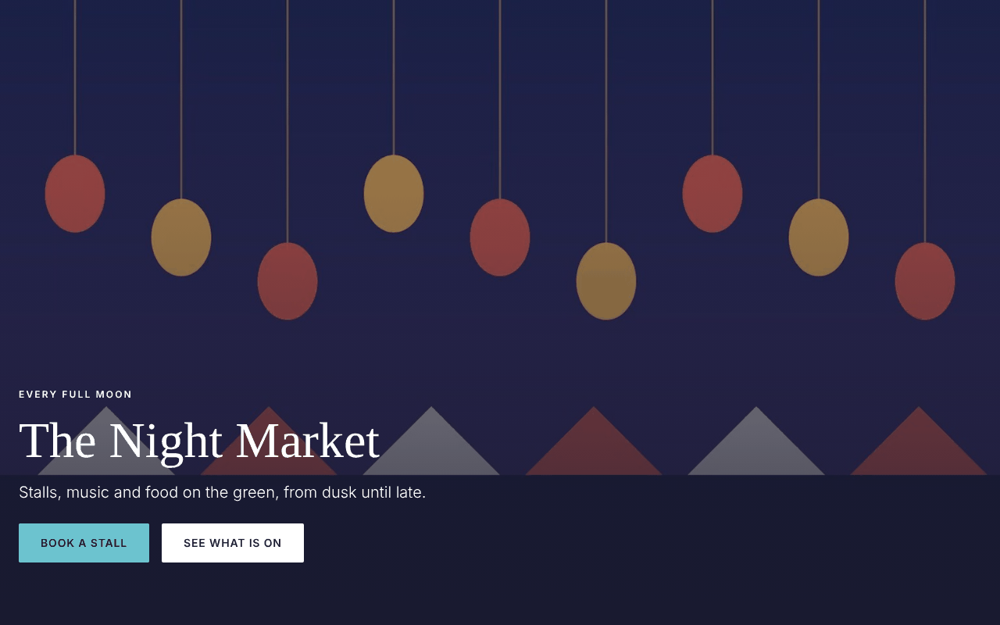

Its settings:

- **Image**.
- **Focal point**.
- **Overlay (keeps the text readable)**: **None**, **Light**, **Medium** or **Strong**.
- **Darkest at**: **Bottom**, **Left** or **All over**.
- **Eyebrow**: a short line above the title.
- **Title**.
- **Text**.
- **Button label**: leave it empty for no button.
- **Button link**.
- **Second button label**: leave it empty for no second button.
- **Second button link**.
- **Height**: **Full screen**, **Large** or **Medium**.
- **Title is the page's main heading (h1)**: untick it if the page already has one.

#### Form

One of your [forms](/editors/forms/).

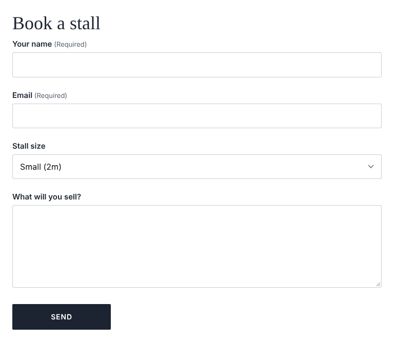

Its settings:

- **Form**: which one.
- **Show the form title**.
- **Show the form description**.
- **Form style** (see below).

### Site

These come with events and tickets, and show only while your site uses them. See
[Events and tickets](/editors/events-and-tickets/).

#### Event details

An event's page: its picture, title, description, date, venue and ticket form. Only on events.

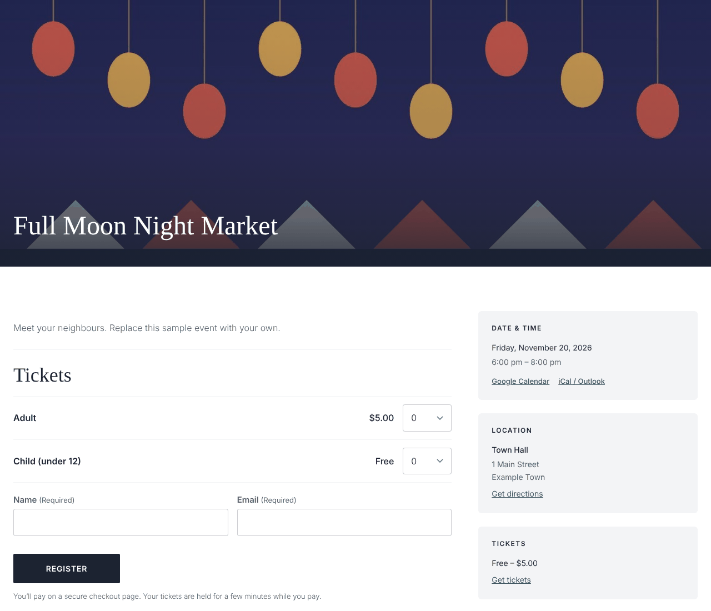

It has no settings of its own.

#### Event schedule

An event's schedule. Only on events.

It has no settings of its own.

#### Tickets

The booking form for a ticket, on any page.

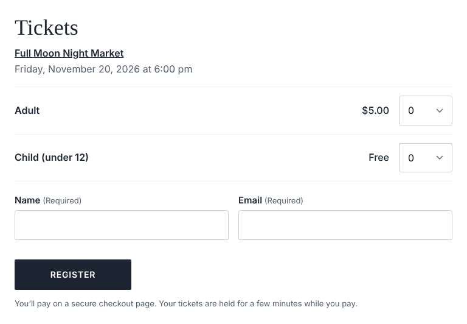

Its settings:

- See [Selling tickets](/editors/events-and-tickets/#selling-tickets-or-taking-sign-ups).
- **Ticket**.
- **Date**.
- **Heading**.

### Members

Shown only while your site has members (an admin turns them on: see
[Turning features on](/admins/features/#members)).

#### Members only

Blocks only members (and editors) see. Put blocks inside it. Everyone else sees a message and a sign-in link.

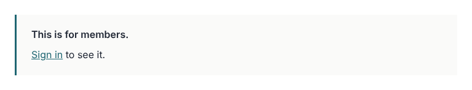

Its settings:

- **Members of (none ticked: any level)**.
- **Show nothing to everyone else**.
- **Message for everyone else**.

#### Member account

Signing in, creating an account and resetting a password; once signed in, the member's details and Sign out.

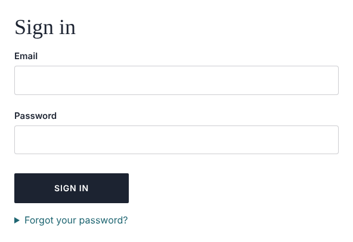

It has no settings of its own.

#### Member sign-in link

A link to the account page that reads "Sign in", or "My account" once signed in.

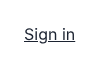

Its settings:

- **Label**.
- **Label when signed in**.

### Mailing Lists

Shown only while your site has mailing lists (an admin turns them on: see
[Turning features on](/admins/features/#mailing-lists)). Everyone who signs up gets an email with a
link to confirm.

#### Newsletter signup

A compact sign-up for one list, for a band or the footer.

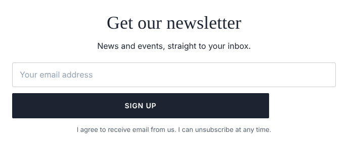

Its settings:

- **List**.
- **Heading**: clear it to leave it out.
- **Text**: clear it to leave it out.
- **Button**.
- **Inside the email field**.
- **Consent wording**.
- **Tag sign-ups with (comma separated)**.
- **Align**: **Centred** or **Left**.
- **Form style**.

#### Subscribe

A sign-up form for one or more lists.

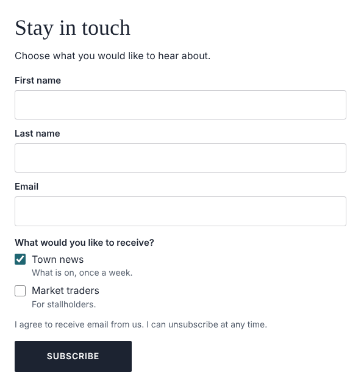

Its settings:

- **Lists offered (none ticked: every public list)**.
- **Heading**.
- **Text**.
- **Button**.
- **Consent wording**.
- **Tag sign-ups with (comma separated)**.
- **Ask for first and last name**.
- **Also ask (optional for visitors)**: extra details.
- **Form style**.
- **Layout**: **Stacked** or **In a row**.

#### Email preferences

Where people who follow a link from one of the site's emails confirm, choose their lists or unsubscribe.

Its settings:

- **Shows first**: **Email preferences** or **Unsubscribe**.

### Advanced

#### HTML

Your own HTML code, put on the page exactly as written.

Its settings:

- **HTML**.

#### Template part

A shared part, such as the header or footer, placed in a template.

Its settings:

- **Part**: which one.

#### Page content

In a template: where each page's own content goes.

Its settings:

- **Content area** (see [Content areas](#content-areas)).
- The **Layout** group.

:::caution
Code in an **HTML** or **Embed** block runs for everyone who views the page, including admins. Only paste
code from a source you trust.
:::

### Form style

The **Form**, **Subscribe** and **Newsletter signup** blocks have a **Form style** group (closed at first:
click it to open). Fields are white with black text unless you change them. Every setting left empty
keeps the default.

- **Form background (default none)**: puts the form in a box.
- **Form border (default none)**: also puts the form in a box.
- **Form text (heading, intro, small print)**.
- **Field background (default white)**.
- **Field text (default black)**.
- **Field border**.
- **Labels**.
- **Placeholder text**.
- **Field being typed in (border and ring)**.
- **Checkboxes and radio buttons**.
- **Button background**.
- **Button text**.
- **Field height**: **Normal**, **Compact** or **Large**.
- **Field text size**: **Normal**, **Small** or **Large**.
- **Field border width**: **Thin (default)**, **None**, **Medium** or **Thick**.
- **Field corners**: **Default**, **Square**, **Slightly rounded**, **Rounded** or **Pill**.
- **Button corners**: the same choices.

## Collections

A **Collection** lists your content automatically: the latest posts on the home page, upcoming events,
a team. Its settings are in groups.

**Content**

- **Show**:
  - **Latest**: the newest entries of some kinds. Tick the **Content types** to include. Then you can
    narrow it to some categories (each kind of term has its own list, such as **Categories (any of)**)
    or **Tagged with (any of)**, and choose:
    - **Upcoming events only (soonest first)**, when only events are ticked.
    - **Featured only**, for content that can be marked featured (an admin turns this on: see
      [Featured content](/admins/content-types/#featured-content)).
    - **Order**: **Newest first**, **Oldest first**, **Title A to Z**, **Title Z to A**, **Manual
      order** or **Random**.
    - **How many**: 10 if empty.
    - **Skip the first**: to leave out ones shown elsewhere.
  - **Hand-picked**: the entries you choose. Under **Entries, in order**, type two or more letters in
    **Search to add** and click an entry to add it. They show in the order of the list: **↑** and **↓**
    move one up or down, and **Remove** takes one off.
  - **Page's list**: whatever the page is showing, such as a category's entries or search results.
    Used in templates for listing pages.
- **Shuffle on each visit**: a different random set (or order) each time someone visits.

**Layout**

- **Display**: **Grid**, **List** or **Slider**.
- **Columns** (in a slider, **Per view**), and for a grid, how many on a **Tablet** and a **Phone**.
- **Space between cards**.
- **Cards in a row as tall as the tallest** (grids).

**Card**

- **Card design**: one of your site's card designs, or **Custom (edit the card's blocks)**. With a
  design chosen, each entry's card is made for you. To change the card yourself, choose **Custom**,
  then select a block inside the first card on the page: every card follows.

**Paging** (not for sliders)

- **Pagination**: **None**, **Page numbers**, **Previous and next** or **Load more button**.
- **Message when there is nothing to show**.

**Appearance**: the usual styles.

## Focal points per screen size

The **Hero**, **Cover** and (when it is cropped) **Image** blocks show only part of their picture, and
that part changes with the screen's shape. To choose which part stays in view:

1. Select the block and find **Focal point** in its settings.
2. Pick **Desktop**, **Tablet** or **Phone**.
3. Click the most important part of the picture (a face, a building). The small preview beside it shows
   how it will be cropped on that screen.

A size you have set shows a dot after its name. A size you don't set uses the picture's own focal point
from the media library; **Use the image's own** goes back to it. See
[Keeping the important part in view](/editors/images-and-files/#keeping-the-important-part-in-view).

## Patterns

**Patterns** are ready-made groups of blocks, such as a "call to action" band or a team section,
already styled to match your site.

**To add a pattern:**

1. Open **Patterns** on the left. Type in **Search patterns** to find one by name.
2. Select a block on the page if you want the pattern to go after its section; otherwise it goes at the
   end of the page.
3. Click **Insert** beside the pattern.

Click a pattern's address under its name to edit the pattern itself, in a new tab.

### Copy and linked patterns

A pattern is one of two kinds:

- **A copy** (most patterns): the blocks become the page's own. Change anything you like; the pattern
  and other pages stay as they are.
- **Linked** (marked **Linked** in the list): the layout and style stay the pattern's, and each page
  changes only the content. When someone edits the pattern, every page using it changes too, keeping
  its own content.

In a linked pattern you can't move, remove, copy or add blocks, and each block's settings show only its
content, with a note: **Part of a linked pattern: change its content here. Layout and style are set in
the pattern.** What you can change:

| Block | Content you can change |
| --- | --- |
| **Paragraph**, **Heading** | The text. |
| **List** items | Each item's text. |
| **Quote** | **Citation**. |
| **Button** | **Label** and **Link**. |
| **Image** | **Image**, **Alt text**, **Caption** and **Link**. |
| **Cover**, **Media & text** | **Image** and **Alt text**. |
| **Hero** | **Image**, **Eyebrow**, **Title**, **Text**, and both buttons' labels and links. |
| **Embed** | **URL**. |
| **Video** | **Video** and **Poster image**. |

Select the linked pattern itself (with **Select parent**, or in the **Outline**) to see where it comes
from. **Detach (make an ordinary copy)** turns it into an ordinary copy whose blocks are the page's own
to change; later edits to the pattern then no longer reach this page.

### Saving your own pattern

To reuse something you built:

1. Select its outer block (usually a **Section**).
2. At the end of its settings, click **Save as pattern…**.
3. Give it a **Pattern name**.
4. Under **When placed on a page**, choose **Copy** (each page gets its own blocks to change freely) or
   **Linked** (pages change only the content; this block becomes the first use).
5. Click **Save pattern**.

The pattern then appears in the **Patterns** tab on every page.

## The page's settings

Click an empty part of the page, or **Page** at the top of the right-hand panel, to see **Page
settings**. What's there depends on the kind of content.

- **Title**: the page's name, shown at the top of the page and in the browser tab. While a page is
  unpublished, its address follows the title as you type.
- **Slug**: the last part of the page's address. Only lower-case letters, numbers and dashes. Changing
  the address of a published page leaves the old address leading to the new one. See
  [Page addresses](/editors/pages-and-posts/#page-addresses).
- **Template**: the layout around the page. **Default** uses the template chosen for this kind of
  content (by an admin, under **Settings**, **Types**). Usually leave it as it is. A template without a
  place for the page's content shows a warning, since the page's own content wouldn't show.
- **Excerpt**: a sentence or two summing up the page, shown in lists and search results. **Compose**
  under it has Claude write one from the page as it is now.
- **Featured image**: the picture used for this page in lists and when it is shared.
- **Categories** and any other ways your site sorts this kind of content: tick the ones that apply.
  Long lists have a box to find one. New ones are added under **Content**, **Taxonomies**.
- **Tags**: type a tag and press Enter (or a comma) to add it. Pick an existing tag from the list, or
  **Create** a new one. Click × on a tag to take it off.
- **Details**: the extra information this kind of content has, such as a phone number, a website or a
  **Featured** switch. Web address boxes have **Find**.
- **Members** (only while your site has members): **Members only** keeps the page for members, of all
  levels or the **Levels** you tick. Everyone else sees its title, excerpt and featured image with a
  sign-in link, and it is left out of lists and search for them. It applies when the page is published.
- **SEO**: how the page appears in Google and when it is shared.
  - **Search title**: the title search engines show. Its counter turns red past 60 characters, where
    search engines cut it off. Empty, it uses the page's title.
  - **Meta description**: the short description search engines show. Its counter turns red past 160
    characters. Empty, it uses the page's excerpt.
  - **Compose**: Claude writes both from the page as it is now. Edit the suggestion as you like.
  - Under them, a preview of how the page may look in search results.
  - **Share image**: the picture shown when the page is shared on social media. Empty, the featured
    image is used, then the site's default. **Remove share image** clears it.
  - **Hide from search engines and AI answer engines** asks Google and the like not to list the page,
    and the tools behind ChatGPT, Claude, Perplexity and Google's AI answers not to read it. Use it for
    pages only your members or partners need, for example.
  - **Leave out of this site's search** stops the page appearing in your own site's search (it still
    shows in menus and lists).

Events have more settings here (**Starts**, **Ends**, **Time zone**, **All-day event**, **Repeats**
and **Tickets**): see [Events and tickets](/editors/events-and-tickets/).

Changes to the settings show on the page as you make them, and save with the page.

## Content areas

Some templates have more than one place for a page's own content, such as a main column and a sidebar.
Each place is a **content area**. On a page using such a template, every area shows where the template
puts it; an empty one says **Content area:** and its name, with **Drop blocks here.** Drag blocks into
it like anywhere else. Each page fills in its own areas.

In a template, each area is a **Page content** block. Its **Content area** is `main` (the default) for
the page's own content, or another name (such as `sidebar`) for an extra area. Two **Page content**
blocks can't share a name: a second one left as `main` is renamed `area-2` when you save.

## The header, footer and templates

The parts that appear on every page, such as the header, menu and footer, aren't part of each page.
They are in **Content**, **Templates**: **templates** (the layout of a whole page), **template parts**
(such as the header and footer) and **patterns**. When an admin hovers over one of these in the editor,
it is outlined, with a link (such as **Edit template part: header**) that opens it in a new tab.

Templates, parts and patterns are edited in the same editor as pages, with the same blocks. The
differences:

- There are no drafts. The button says **Save & apply**, and saving changes every page that uses it,
  straight away.
- They don't save themselves as you go, so save before you leave.

:::caution
A change to a template or the header changes every page that uses it, straight away. Take care, and
check a few pages afterwards.
:::

Some pages are made entirely from their template (a home page, often). When you open one, a line under
the editor's toolbar says **Editing this page's template**, and the button says **Save & apply**:
changes go to every page using that template.

To start a new page from a template or a pattern, click **Make a page** beside it in **Content**,
**Templates** (or at the top of the editor while editing it). Give the page a title, choose its type
and click **Make the page**. You get a new draft with a copy of the template's blocks to change freely:
editing it never changes the template.

To change the name of a template, part or pattern, click **Rename** beside it in **Templates** (or at
the top of the editor while editing it) and type the new name. Its **Address** follows the name; change
it if you want another. Click **Rename**. Pages, settings and other templates using it switch to the new
address, and anything still using the old one keeps working. Save your changes before giving a template
you're editing a new address.

To remove a template, part or pattern you no longer need, click **Trash** beside it in **Templates**. A
box tells you which pages use it first: while it's in the trash, those pages show the next template in
line, or leave the part or pattern out. Click **Move to the trash** to go ahead. The **Trash** at the
bottom of **Templates** lists what's there: **Restore** brings one back as it was, and **Delete
permanently** removes it for good.

To have Claude build a new template, header, footer or pattern, click **Compose** in the top bar, then
**Template**, **Template part** or **Pattern**, name it, say what it is for and click **Send**; the
editor opens and Claude builds it (see [Writing with Claude](/editors/writing-with-claude/)).

The menu's links are changed under **Settings**, **Menu**, not in the header itself. See
[Settings and the menu](/admins/settings/).
