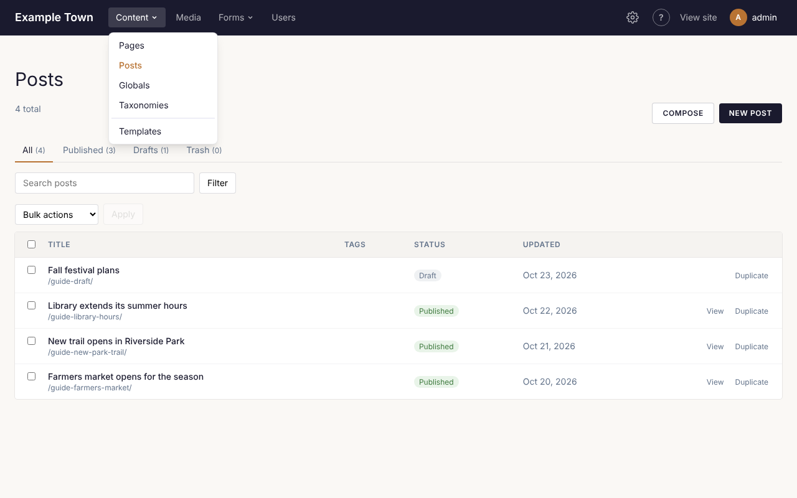

Everything on your site lives under **Content** in the top bar. Click it to see each kind of content
your site has, such as **Pages**, **Posts** or **Events**, then pick one to see its list. Below them are
**Taxonomies** (categories, tags and the like, see [Categories and tags](#categories-and-tags)) and
**Templates** (the shared layouts, see [Using the page editor](/editors/page-editor/#the-header-footer-and-templates)).

## The content list

The heading names the kind of content, and the line under it says how many there are (for example
**12 total**). Things in the trash aren't counted.

### What each row shows

| Column | What it shows |
| --- | --- |
| The tick box | Ticks the row for [doing the same thing to several at once](#doing-the-same-thing-to-several-at-once). The box in the heading row ticks or unticks every row. |
| **Title** | The title, with the page's address underneath (for example `/about-us/`). Click the title to open it in the editor. A page with no title yet shows **(no title)**. A star (★) means it is [featured](#featured-content). |
| **Tags** | The page's tags. Click one to see everything with that tag. |
| **Status** | **Published** (on the site), **Draft** (not on the site) or **Trash**. A published page with edits that aren't live yet also says **Unpublished changes**. |
| **Updated** | When it was last changed. For events this column is **Starts** instead, the event's start date. |
| (last column) | **View** opens a published page in a new tab, as visitors see it. **Duplicate** makes a copy (see [Making a copy](#making-a-copy)). |

The newest changes are at the top. Event lists are in order of start date instead, the latest first.
The list shows up to 500 at a time: if you have more, use the search box or a filter to find older
ones.

Some kinds of content have no page of their own (for example venues, which only appear on the events
held there). Their rows show no address and no **View**: a venue shows its address instead. Clicking one
opens a short form with its **Name**, **Status** and details, and a **Save** button, rather than the page
editor (see [Events and tickets](/editors/events-and-tickets/#venues)).

### Status tabs

Above the list are four tabs. The number beside each is how many it holds.

- **All**: everything except the trash.
- **Published**: what is on your site now.
- **Drafts**: not on your site yet, or taken off it.
- **Trash**: deleted, but not gone for good (see [Deleting](#deleting)).

### Finding something

Under the tabs is a row of filters. Fill in what you need, then click **Filter**:

- **Search**: type a few words of the title. Searching looks at titles only, and capital letters don't
  matter.
- **All tags**: pick a tag to see only what has it. To go back to everything, click **Clear tag** beside
  the **Filter** button. (This box only appears once your site has tags.)
- **Featured only**: tick it to see only featured content. It only appears for kinds of content that can
  be featured.

The search and filters stay in force when you switch between the status tabs. If nothing matches,
the list says **Nothing here yet.**, **Nothing with this tag.** or, in the trash, **The trash is empty.**

:::note
If an admin has turned events off, the list of events, venues and event categories shows a note saying
so. Nothing is deleted: they come back when an admin turns events on again (see
[Turning features on](/admins/features/#events)).
:::

## Adding a new page or post

1. Click **Content**, then the kind of thing you want to add (for example **Pages**).
2. Click the **New** button in the top right (it says **New Page**, **New Post** and so on).
3. The page editor opens with an empty page, titled **(untitled)** at the top. Type a title in the
   **Title** box on the right.
4. Add what you want on the page (see [Using the page editor](/editors/page-editor/)).
5. Click **Publish** when it is ready for visitors, or leave it as a draft for now (see
   [Saving and publishing](/editors/saving-and-publishing/)).

:::tip
Your work is saved automatically as you go, a few seconds after each change. A new page stays a
private draft until you click **Publish**, so it is safe to start something and finish it later. You'll
find it again on the **Drafts** tab.
:::

Prefer to start from a document you already have? Click **Compose** beside the **New** button instead.
See [Writing with Claude](/editors/writing-with-claude/).

To start from one of your templates or patterns, use **Make a page** in **Content**, **Templates**
(see [Using the page editor](/editors/page-editor/#the-header-footer-and-templates)).

## Page addresses

Each page has an address, shown at the top of the editor beside its title (for example `/about-us/`;
the home page shows `/`). It is kept in the **Slug** box in the page's settings, on the right of the
editor.

- **On a new page, the address follows the title** as you type it: "About us" gives `about-us`.
  It keeps following until the page is published, or until you type an address of your own in **Slug**.
- **Once a page is published**, changing its title no longer changes its address. Links people have
  saved keep working.
- **Only small letters, numbers and hyphens.** Anything else you type in **Slug** becomes a hyphen, and
  capitals become small letters.
- **Two pages can't share an address.** Some kinds of content share one set of addresses (on many
  sites, pages and posts both live at `/<address>/`). If you give a page an address another one already
  has, it isn't saved, and the top of the editor says why, for example **The address “events” is used by
  the page “Events”. Choose another.** Change the **Slug** and save again.

### Changing the address of a published page

Change the **Slug** and publish the change (**Publish changes**). Until then the page stays at its old
address. Once it is live, the old address keeps working and sends visitors to the new one: a redirect
is added for you. Admins can see and change redirects under **Settings**, **Redirects** (see
[Redirects and missing pages](/admins/redirects/)).

## Making a copy

**Duplicate** makes a draft copy of a page and opens it in the editor, ready to change. It is a quick
way to start a page that looks like one you already have. You'll find **Duplicate** at the end of each
row in the list, and at the top of the editor.

The copy:

- is titled like the original with "(copy)" at the end, and has its own address;
- is a draft, so nobody sees it until you publish it;
- has the original's content, excerpt, featured image, template, tags, categories and other settings
  (and an event's dates);
- starts from the original's latest saved version, including changes that aren't published yet;
- has no history: earlier versions stay with the original.

If you click **Duplicate** in the editor while you have changes that aren't saved yet, a box warns you
that the copy is made from the saved page. Click **Cancel**, wait for the change to save, and try again.

:::note
A copy of an event doesn't sell tickets until you choose its ticket (see
[Events and tickets](/editors/events-and-tickets/)).
:::

## Doing the same thing to several at once

1. Tick the box beside each one in the list (or the box in the heading row for all of them). The number
   ticked shows beside the buttons, for example **3 selected**.
2. Pick an action from **Bulk actions**.
3. Click **Apply**. (It can't be clicked until something is ticked and an action is chosen.)

A line at the top of the list then says what happened, and what was skipped and why.

| Action | What it does |
| --- | --- |
| **Publish** | Puts drafts on your site. A page still at its first, temporary address gets one made from its title. |
| **Move to drafts** | Takes published pages off the site and keeps them as drafts. |
| **Move to trash** | Takes them off the site and puts them in the trash. |
| **Mark featured** / **Unmark featured** | Turns the **Featured** switch on or off. Only for content that can be featured. |
| **Add a term…** | A second box appears: **Choose a term**, listing your categories, tags and other terms, grouped by taxonomy. Pick one and click **Apply** to add it to every ticked page. |
| **Remove a term…** | The same, to take a term off them. |

In the **Trash** tab, the actions are **Restore (as drafts)** and **Delete permanently** instead.

### What gets skipped

**Publish** leaves some pages alone and names them in the message at the top:

- a page with no title (give it a title first);
- a page whose address another page already has (change its **Slug** first);
- when your site checks accessibility before publishing (an admin turns this on), every page with a
  page of its own: publish those from the editor, where the check runs first (see
  [Accessibility](/editors/accessibility/#when-publishing-waits-for-the-check)).

**Move to trash** skips the home page.

:::caution
**Publish** in the list only publishes drafts. It doesn't put the **Unpublished changes** of a page that
is already published live: open the page and click **Publish changes** for that.
:::

Adding or removing a term changes published pages straight away, and also their unpublished changes
for tags. The message says how many pages it changed, and how many already had it (or didn't have it).
If someone has one of those pages open in the editor at the time, they are asked before their next save
overwrites the change (see
[When two people edit the same page](/editors/saving-and-publishing/#when-two-people-edit-the-same-page)).

## Deleting

1. Tick the pages in the list.
2. Choose **Move to trash** from **Bulk actions** and click **Apply**.

The page comes off your site but isn't gone. To bring it back, open the **Trash** tab, tick it, choose
**Restore (as drafts)** and click **Apply**. It comes back as a draft: publish it again when you are
ready.

To remove something for good, open the **Trash** tab, tick it, choose **Delete permanently** and click
**Apply**. A box asks you to confirm, because this can't be undone. Only things already in the trash can
be deleted permanently.

:::caution
The home page can't be moved to the trash. To use a different home page, ask an admin to change
it under **Settings** (see [The home page](/admins/settings/#the-home-page)).
:::

## Categories and tags

Categories, tags and any other ways your site sorts content are called **taxonomies**. Each category
or tag is a **term**. They group related content, so visitors can find everything on one subject:
many sites show a page for each one, listing everything filed under it.

- **Categories** can sit under each other (Events, then Concerts under it).
- **Tags** are a flat list of keywords, and every kind of content can have them.

### Choosing them for a page

With nothing selected in the editor, the page's settings on the right include a box for each
taxonomy that kind of content uses.

**Categories** (and other taxonomies like them) are a list of tick boxes, with terms that sit under
others indented beneath them. Tick each one that applies. The ones ticked are listed above the boxes.
When there are more than 12, a **Find** box above them (**Find categories**, for example) narrows
the list as you type. If the taxonomy has
no terms yet, it says **None yet: add them under Content > Taxonomies.**

**Tags** are a single box:

1. Click in the **Tags** box. A list of your tags opens.
2. Type to narrow the list, then click a tag, or use the arrow keys and press Enter. Click it again to
   take it off.
3. To make a new tag, type it and press Enter (or a comma), or click **Create "…"** at the bottom of the
   list. A new tag joins your list of tags once the page is saved (on a published page, once you
   publish the change).
4. To remove a tag, click the **×** on it, or press Backspace in the empty box to remove the last one.

Like everything in the page's settings, categories and tags go live when you publish.

### The Taxonomies screen

Click **Content**, then **Taxonomies**, to look after the terms themselves. There is a tab for each
taxonomy, with how many terms it has. Under the tabs, a line says which kinds of content use it.

**To add a term:**

1. Type its **Name**.
2. Leave **Address (optional)** empty to make one from the name, or type your own.
3. Choose where it goes in **Under**: **(top level)** or under another term. (Tags, and other flat lists,
   don't have this.)
4. Click the **Add** button (it says **Add category**, **Add tag** and so on).

You can also make new tags straight from a page's settings.

**Each term's row** shows its **Name**, its **Address**, which **Template** its page uses (when terms
have pages) and how many entries use it (**Used on**, or **Not used**). At the end of the row:

- **Save**: to rename a term or change its address, type in its **Name** or **Address** box, then click
  **Save** on that row. When terms have pages, the old address keeps working and sends visitors to the
  new one.
- **Details**: opens a box for the term's description, picture and search settings (see below).
- **View**: opens the term's page on your site, listing everything filed under it.
- **Delete**: asks to confirm, then deletes the term. It is taken off every page that had it (the box
  says how many), and the terms under it move up a level. Your pages themselves stay.

Two terms of one taxonomy can't have the same address: saving one says **Another term already uses the
address "…"**.

### Putting terms in order

Terms are listed in the order you give them, which is also the order visitors see them in, for
example in a list of categories to filter by.

Each term has a handle (six dots) to the left of its name. Drag it:

- onto the top or bottom edge of another term, to put it just above or below that term;
- onto the middle of another term, to put it underneath that one;
- onto **Drop here to move to the top level**, which appears above the list while you drag.

A line or an outline shows where it will land. A term can't go under itself or under one of its own
terms.

**Without a mouse:** move to the handle with the Tab key and press Enter. A small menu opens with **Move
up** and **Move down**, and (for categories) **Move under**: choose a term, or **(top level)**, then
click **Move**. Press Escape to close the menu.

### A term's details

Click **Details** on a term's row. The box has:

- **Description**: a few sentences about the term, shown on its page and used as its description in
  search results when its SEO has none.
- **Featured image**: a picture shown on its page and when the page is shared.
- **Fields**: any extra details your site keeps for these terms.
- **SEO**: how its page appears in Google, as for a page (see
  [Using the page editor](/editors/page-editor/#the-pages-settings)).

**Compose** at the top fills these in for you from the term's name and what is filed under it. Type
anything Claude should know in the box above (it is optional), then click **Compose**. Check what it
wrote. Nothing is saved until you click **Save**; **Cancel** closes the box without saving.

### The template a term's page uses

When a taxonomy's terms have pages, each row has a **Template** box. **Default** uses the taxonomy's
template, or the one set on a term above it. Terms under a term with its own template share it.

To set the same template for several terms at once, tick their boxes, choose it in the box above the
list (**Template for the ticked categories**, for example) and click **Apply**.

Admins can add taxonomies of their own and choose which kinds of content use them (see
[Kinds of content and taxonomies](/admins/content-types/#your-own-ways-to-sort-content)).

## Featured content

When an admin has turned on **Featured** for a kind of content ([see how](/admins/content-types/#featured-content)),
each one has a **Featured** switch in its settings, under **Details**. Then:

- in the list of that content, a star (★) marks the featured ones;
- tick **Featured only** and click **Filter** to see just those;
- tick several and choose **Mark featured** or **Unmark featured** from **Bulk actions**;
- a Collection block can show featured content only (see
  [Using the page editor](/editors/page-editor/#every-block)).

Marking something featured from the list takes effect on the site straight away, and is kept in any
unpublished changes too.

## Members-only pages

When your site has members (an admin turns this on, see [Turning features on](/admins/features/#members)),
a page's settings have a **Members** section. Turn on **Members only** and, if your site has several
levels, tick the levels that may see it (none ticked means every member). Everyone else sees its title,
excerpt and featured image with a sign-in link, and it is left out of lists and search for them. Like
other settings, it takes effect when you publish.
