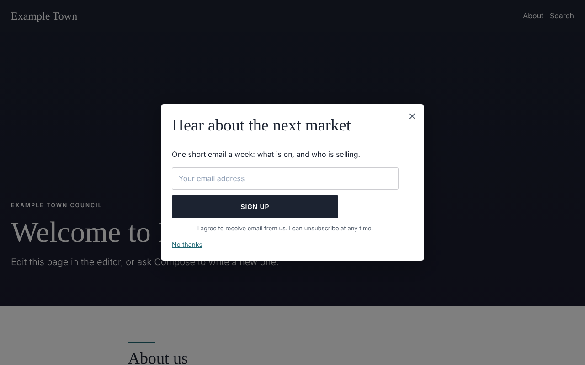

A popup shows a message over the site's pages: a newsletter sign-up, a sale, an announcement. The
cookie consent banner is a popup too: it asks visitors whether they accept cookies.

Admins add popups and choose where, when and how often they show (see
[Popups and cookie consent](/admins/popups-and-cookies/) in the Admin guide). What a popup says is
ordinary content, which editors can change.

## Changing what a popup says

A popup's content is a **template part**, named after the popup (such as "Popup 1" or "Cookie consent").

1. Click **Content**, then **Templates**.
2. Under **Template parts**, click the popup's part.
3. Change it in the page editor like any page: add or change headings, text, buttons, a **Newsletter
   signup** block, a form.
4. Click **Save & apply**. The popup shows the change at once, on every page where it appears.

Keep a popup short: a heading, a line or two of text and one thing to do.

## Special links

Inside a popup, links to these addresses do something instead of opening a page. Add one like any link:
select the words, click the link button and type the address.

- `#close-popup`: closes the popup. Use it for a "No thanks" link.
- `#accept-cookies`: accepts cookies (the cookie consent banner's **Accept** button).
- `#reject-cookies`: refuses cookies that aren't needed (its **Reject** button).
- `#cookie-settings`: opens the cookie consent banner again, so a visitor can change their mind. This
  one works anywhere on the site, such as a "Cookie settings" link in the footer.

## The cookie consent banner

The banner's content is the part called "Cookie consent". It has:

- a heading;
- a line about the site's cookies, with a link to the privacy policy;
- an **Accept** button and a **Reject** button.

You can change all the words, and the buttons' colours, size and corners. Keep the buttons' links:
**Accept** must link to `#accept-cookies` and **Reject** to `#reject-cookies`. If the **Accept** link
goes, the site adds its own plain **Accept** and **Reject** buttons, so the banner still works.

Visitors can also close the banner with its **×** or the Escape key, which counts as **Reject**. Their
choice is remembered for six months.

## Seeing a popup as a visitor would

A popup set to show once won't show again in a browser that has seen it, and signed-in editors see
popups like everyone else. To see one again, open the site in a private (incognito) window.
