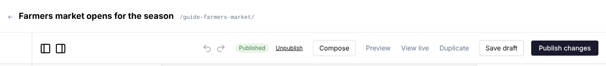
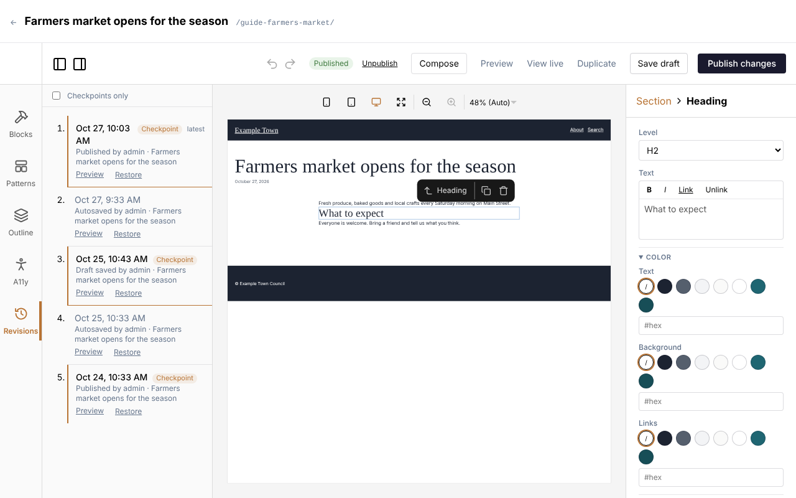

Saving and publishing are two different things:

- **Saving** keeps your work. Only the people who look after the site can see it.
- **Publishing** puts it on your website for visitors.

A page you are working on is always saved; it only changes for visitors when you publish.

## The top of the editor

From left to right, the top of the editor has:

| Item | What it is |
| --- | --- |
| **Published** or **Draft** | Whether the page is on your site now. |
| What's happening | **Unsaved changes**, **Saving…**, **Autosaved** with the time, and so on (see below). |
| **Discard changes** | Only on a published page with changes that aren't live yet. |
| **Unpublish** | Only on a published page. |
| **Compose** | Opens the Compose panel (see [Writing with Claude](/editors/writing-with-claude/)). |
| **Preview** | Shows the page as it will look, in a new tab. |
| **View live** | Only on a published page: opens it as visitors see it now. |
| **Duplicate** | Makes a draft copy (see [Making a copy](/editors/pages-and-posts/#making-a-copy)). |
| **Save draft** | Saves without publishing. |
| **Publish** or **Publish changes** | Puts the page, or your changes, on your site. |

The ← arrow at the far left of the line above takes you back to the list.

## Your work saves itself

The editor saves your changes for you, 3 seconds after you stop making them. If you keep editing
without a pause, it still saves at least every 30 seconds.

What the top of the editor says:

| It says | Meaning |
| --- | --- |
| **Unsaved changes** | You have changed something that isn't saved yet. |
| **Saving…** | It is saving now. |
| **Autosaved** and a time | Everything up to then is saved. |
| **Draft saved**, **Published**, **Unpublished** and a time | The last button you clicked worked. |
| **Unpublished changes** | The page is published, and you have saved changes that aren't live yet. |
| **Not autosaved: no connection. It will try again after your next edit.** | Your internet connection dropped. Your changes are still in the editor: check your connection, then make any small edit or click **Save draft**. |
| **Not saved:** and a reason | Something stopped the save, such as an address another page already has. Fix what it says and save again. |

An automatic save never publishes anything. On a page that is already published, it keeps your changes
aside as **unpublished changes**: visitors go on seeing the live page until you click **Publish
changes**.

:::note
Templates, template parts and patterns don't save themselves, and nor do pages edited through their
template (see [Templates: Save & apply](#templates-save--apply)). Save those yourself.
:::

## Save draft

**Save draft** saves straight away, without waiting, and marks a **checkpoint** in the page's history
(see [Going back to an earlier version](#going-back-to-an-earlier-version)). Use it when you reach a
point you might want to come back to.

- On a page that isn't published yet, it saves the page as a draft.
- On a published page, it keeps your changes as unpublished changes. The live page stays as it is.

## Publishing

- **Publish** (on a page that isn't on the site yet) saves the page and puts it on your site.
- **Publish changes** (on a page that is already published) makes your saved and unsaved changes go
  live, all at once.

Both also mark a checkpoint in the page's history. Once published, the top says **Published** and the
time.

When you first publish a new page, it gets its address from its title, unless you typed one of your
own (see [Page addresses](/editors/pages-and-posts/#page-addresses)).

Visitors see a published page, or published changes, straight away. Very occasionally it can take up to
a minute.

### When publishing waits for the accessibility check

If an admin has turned on the accessibility check before publishing, clicking **Publish** or **Publish
changes** first checks the page (the top says **Checking accessibility…**). If anything is left to fix,
a box says **Not published yet**, with **Show the problems**, **Publish anyway** and **Cancel**. See
[Accessibility](/editors/accessibility/#when-publishing-waits-for-the-check).

## Previewing

**Preview** opens the page in a new tab, exactly as it will look once published. It includes everything
in the editor, even changes that haven't saved yet.

A coloured bar across the top of the preview says what you are looking at, for example **Preview of
unsaved changes: the live page is unchanged until you publish**, or **…: this page is not published**.
Click **Back to the editor** in the bar to return (or just close the tab). Nobody else can see a preview,
and search engines never list it.

**View live** (on published pages) shows the page as visitors see it now, without your unpublished
changes.

## Taking a page off the site

- **Unpublish** takes the page off your site and keeps it as a draft. A box asks **Take this page off
  the site? It stays here as a draft.** Click **OK**. Any unpublished changes are kept in the draft.
- **Discard changes** throws away your unpublished changes and goes back to the live version. A box asks
  **Discard the unpublished changes and go back to the live page?** Click **OK**, and the editor reloads
  with the live page. It only appears on a published page with unpublished changes.

To put an unpublished page back on the site, open it and click **Publish**.

To remove a page altogether, move it to the trash from the list (see
[Deleting](/editors/pages-and-posts/#deleting)).

## What visitors see, when

| You have... | Visitors see |
| --- | --- |
| A new page you haven't published | Nothing: it isn't on the site. |
| Clicked **Publish** | The page. |
| Edited a published page (saved automatically or with **Save draft**) | The page as it was last published. |
| Clicked **Publish changes** | The page with your changes. |
| Clicked **Discard changes** | The page as it was last published (nothing changes for them). |
| Clicked **Unpublish**, or moved it to the trash | Nothing: the page has gone from the site. |

Some settings also wait for publishing: the title, address, excerpt, featured image, tags, categories
and the rest of the page's settings.

## Going back to an earlier version

The editor keeps earlier versions of the page. To go back to one:

1. Click **Revisions** on the left side of the editor.
2. Find the version you want. **Preview** shows it in a new tab.
3. Click **Restore**. The page in the editor goes back to that version, settings included, and the
   top says **Restored the version from** and its date.
4. The restored version saves itself as a draft. Click **Publish changes** to put it on the site (or keep
   editing first).

Restoring can be undone with the undo arrow, so it is safe to try. Nothing goes live until you publish.

### Reading the list

The newest versions are at the top, and the very newest is marked **latest**. Each one shows when it was
saved, how it was saved (**Autosaved**, **Draft saved**, **Published**, **Unpublished**), who saved it
and the page's title then.

- **Checkpoints** are the versions saved with a button: **Save draft**, **Publish**, **Publish
  changes**, **Unpublish** or **Save & apply**. They are marked **Checkpoint** and have a coloured line beside them.
- **Automatic saves** between them are kept as one version for each stretch of up to ten minutes of one
  person's editing, so the list doesn't fill up with a version every few seconds. When a stretch lasted a
  while, it says when the edits began, for example **(edits since 3:05 PM)**.

Tick **Checkpoints only** to hide the automatic saves.

Some versions carry a note:

- **Restored from** a date (and **then edited**): this version brought back an earlier one.
- A note in red such as **Published with 1 warning left open: urgent notice**: the page was published
  even though the accessibility check found something, and this is why (see
  [Accessibility](/editors/accessibility/#when-publishing-waits-for-the-check)).

The list shows the 50 most recent versions. A brand new page says **No saved versions yet** until its
first save.

:::note
Discarding unpublished changes doesn't add a version, but the changes you discarded are still in the
list if they were saved, so you can restore them.
:::

## Leaving the editor

If you click a link that leaves the editor (the ← arrow, or any other link) while you have
changes that aren't saved yet, a box asks **Save your changes?**:

- **Save draft** (or **Save as unpublished changes** on a published page) saves them, then goes where
  you were heading. The live page stays as it is until you publish.
- **Leave without saving** goes without them.
- **Stay** (or the Escape key) closes the box and keeps you in the editor.

If you reload the page, close the tab or use the browser's back button with unsaved changes, your
browser asks instead, in its own words. Links that open in a new tab don't ask.

Because changes save themselves within a few seconds, you rarely see this box. It mostly appears when
you leave straight after an edit.

## When two people edit the same page

The editor remembers which version of the page you opened. If someone else saves the page after that:

- **Automatic saves stop**, and the top says **Not autosaved: someone else saved this since you opened
  it. Save to choose whose version to keep.** Your changes are still in the editor.
- **When you save or publish**, a box says **Someone else saved this since you opened it** and that
  saving now replaces their version with yours.
  - **OK** saves your version over theirs.
  - **Cancel** saves nothing (the top says **Not saved: someone else saved this since you opened it.**).
    To see their version, reload the page. Your unsaved changes in this tab are then lost, so copy
    anything you need first.

The same happens if someone changes the page from the content list while you have it open, for example
by adding a category or tag to it with **Bulk actions**.

:::tip
To avoid this, agree who is editing which page, and reload a page before you start if someone else
may have changed it.
:::

## Templates: Save & apply

Templates, template parts (such as the header and footer) and patterns have no drafts. They are
saved with **Save & apply**, which changes every page that uses them on the site straight away.

Some pages are made entirely from their template (often the home page). When you open one, a line under
the editor's toolbar says **Editing this page's template** and its name, and the button is **Save &
apply** too. If that page has unpublished changes, **Save & apply** saves the template and keeps the
page's own settings with those changes; the live page stays as it is until you publish them.

Templates, template parts and patterns opened on their own have no **Revisions** (it says **Templates
have no revisions.**). A page edited through its template does: in **Revisions**, it can only restore
versions saved with the template it uses now; others say **preview only**. A restored layout says **Save & apply keeps it**: it changes nothing until you
click **Save & apply**, which applies it to every page using that template.

See [Using the page editor](/editors/page-editor/#the-header-footer-and-templates) for more about
templates.

## Other messages

- **Saved, but this version could not be added to the history.** Your page is saved; only its entry in
  **Revisions** is missing. Carry on as usual.
- **A linked pattern whose blocks were changed was saved as an ordinary copy.** The blocks inside a
  linked pattern on this page no longer match the pattern, so the page now keeps its own copy, which no
  longer follows changes to the pattern.
