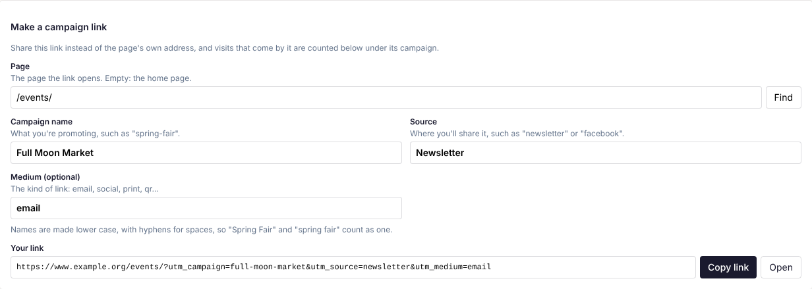

**Stats** in the top bar shows how the site is used: how many pages were viewed, by how many people,
which links they followed, which sites sent them and which campaigns brought them. Editors and admins
can see it.

The line under the heading says how visitors are counted on your site: without cookies, or with the
Stats cookie (see [How visitors are counted](#how-visitors-are-counted)). Admins also see a **Stats
settings** link there.

## Choosing the dates

At the top right:

- Click **7 days**, **30 days**, **90 days** or **Year** for the last that many days, up to today. Stats
  opens on the last 30 days.
- Or pick your own dates: choose **From** and **To**, then press **Show**. **To** can't be later than
  today. A range can be up to 731 days long.

Every number, table and download on the screen is for the dates chosen. Days follow the site's time zone.

## The totals

Three tiles sum up the dates chosen:

- **Page views**: how many times pages were opened.
- **Visitors**: how many different people came. Without the Stats cookie, each person is counted once
  a day, so someone who visits on three days counts three times; the tile says **Counted once a day
  each**. With it, each person who has the cookie counts once for the whole range, and the tile says how
  many return visits there were.
- **Links clicked**: how many times people followed a link on the site, to another page, another site,
  a file, an email address or a phone number.

## The chart

**Page views a day** has a bar for each day. Ranges over 90 days show **Page views a week** instead, a
bar for each week.

- Point at a bar, or press Tab to move to it, to see that day's (or week's) views, visitors and clicks.
- The number at the top left is the tallest bar, and the dates under the chart are the first and last
  days.
- **Show as a table** lists the same numbers, newest first: **Day** (or **Week**), **Views**,
  **Visitors** and **Clicks**.

Before anything has been counted, it says "Nothing counted yet in this range."

## Pages

Every page that was viewed, with its **Views** and its **Link clicks** (links followed from that page).
The count beside the heading says how many pages there are; the list shows up to the first 2,000.

- Click **Views** or **Link clicks** at the top of the list to sort by it. An arrow (↓) marks the one
  in use, and the sort is kept when you change the dates.
- Click a page's address to open it in a new tab.

## Links clicked

The links followed most, up to 100, with how many **Clicks** each had.

- Links to your own pages show as their address, such as `/about/`; links to other sites show the site
  and page and are marked **another site**.
- **from 3 pages** means the same link was clicked on several pages.
- Email addresses and phone numbers show as written.
- Anything after a `?` or `#` in a link is left off, so the same link is counted together.
- Links that only jump within a page aren't counted.

## Where visits came from

The other sites that sent people here most, up to 15, with the number of **Visits** from each, such as
a search engine or a social network. Moving from page to page on your own site isn't counted here.

Visits typed in, from bookmarks or from many apps (such as email programs) don't name a site, so they
aren't in this list.

## Campaigns

Visits that came by a link tagged with a campaign, with their **Campaign**, **Source**, **Medium** and
**Visits**. A part left out of the link shows as **(none)**.

### Making a campaign link

To see how many visits a newsletter, an advert or a social media post brings, share a campaign link
instead of the page's own address. **Make a campaign link**, above the **Campaigns** table, makes one:

1. **Page**: the page the link opens. Type its address (such as `/events/`), or click **Find** to search
   for it. Leave it empty for the home page.
2. Fill in:
   - **Campaign name**: what you're promoting, such as `spring-fair`.
   - **Source**: where you'll share it, such as `newsletter`, `facebook` or `poster`.
   - **Medium (optional)**: the kind of link, such as `email`, `social`, `print` or `qr`.
3. **Your link** appears underneath. Click **Copy link** and paste it into your email, post or advert,
   or **Open** to try it.

Names already used are suggested as you type, so a campaign keeps one spelling and its visits add up
on one line. Names are made lower case, with hyphens for spaces: "Spring Fair" becomes `spring-fair`.

For a poster or flyer, make a QR code from the link (with **Medium** set to `qr` or `print`) using any
free QR code maker.

### What a campaign link is

A campaign link is the page's address with `utm_` tags added:

`https://example.org/sale/?utm_campaign=spring-sale&utm_source=newsletter&utm_medium=email`

- `utm_campaign`: the campaign's name.
- `utm_source`: where the link is shared.
- `utm_medium`: the kind of link.

A link needs at least `utm_campaign` or `utm_source` to count as a campaign. You can also write these
by hand, or with another tool, as long as they lead to a page on this site.

## Downloading the numbers

Each part has **Download CSV**: a file that opens in Excel, Numbers or Google Sheets, for the dates you are
looking at. There is one for the chart's days, the **Pages** list (in the order you sorted it), **Links
clicked**, **Where visits came from** and **Campaigns**.

## How visitors are counted

Each page has a small script that tells the site a page was viewed or a link was followed.

- **Without the Stats cookie** (the usual way), no cookie is set and no visitor's address is kept. A
  visitor is recognised for one day only, by a scrambled code made from their connection and browser
  that is thrown away the next day, so each person counts once a day.
- **With the Stats cookie**, returning visitors are recognised across days. An admin turns it on and,
  where a cookie consent banner is used, it is set only for visitors who accept cookies (see
  [The Stats cookie](/admins/popups-and-cookies/#the-stats-cookie) in the Admin guide).

## What isn't counted

- You, and anyone else signed in as an editor or admin. (Members signed in to their account are
  counted like any visitor.)
- Search engines and other machines that announce themselves as such.
- Previews, the admin screens, and pages that don't exist (the "Not found" page).
- Visitors whose browsers don't run the page's script.

So Stats is a guide to how the site is used, not an exact count of every visit.

Numbers are kept for about 13 months (400 days), so a range further back than that shows nothing for
the earlier days.
