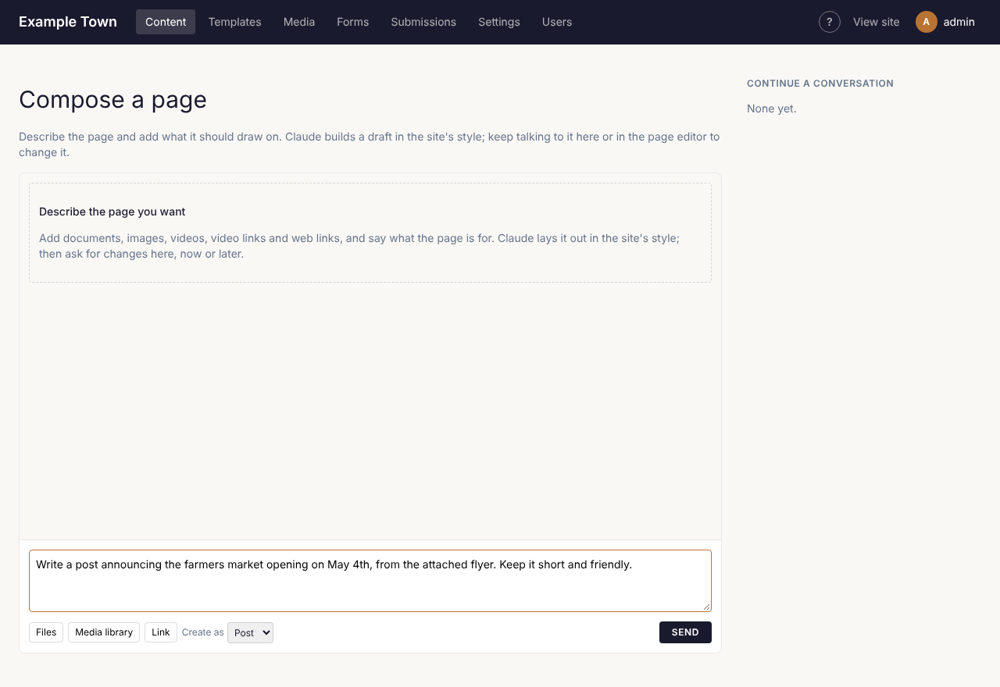

**Compose** writes for you with Claude, laid out in your site's style, from material you already have:
a flyer, a Word document, a PDF, some photos, a video, a link to another website. You then ask for
changes in plain words, as you would ask a colleague. It can make pages and posts (and any other kind
of content with a page of its own), forms, email campaigns, templates, template parts and patterns.

Nothing goes on your site until you publish it (or, for a template, part or pattern, until you click
**Save & apply**).

:::note
Compose needs Claude to be connected, which an admin does under Settings (see
[Connections](/admins/connections/)). Until then, Compose screens say **Claude isn't connected yet**.
:::

## Starting from the home screen

The admin's home screen (click the site's name at the top left) asks **What would you like to make?**

1. Pick what to make from the row of buttons: each kind of content with a page (such as **Page** or
   **Post**), then **Form**, **Campaign** (if your site uses mailing lists), **Template**, **Template
   part** and **Pattern**.
2. For a form, template, template part or pattern, type a name in the box that appears (you can
   leave it empty and rename it later).
3. In the big box, say what it should be, for example: "A page about our fall festival on October
   18th at Riverside Park: what's on, how to get there, and a call for volunteers."
4. Click **Compose page** (the button names what you picked). Ctrl+Enter (Cmd+Enter on a Mac) does
   the same.

For a page or post, Compose opens and sends your request at once. To add documents, photos or links
first, click **Add documents, images or links first** instead: Compose opens with your words in its
box, ready for you to add material and click **Send**.

A form, campaign, template, part or pattern is made straight away and opens in its own editor, where
Claude writes it (see [Forms, emails, templates and patterns](#forms-emails-templates-and-patterns)).

Below the box, **Recently edited** lists what you and others worked on lately, and **Continue with
Compose** lists recent conversations with Claude, with the last thing asked. Click one to pick it up.

## Composing a new page

1. Click **Compose** in the top bar, then the kind of content (for example **Post**). Or click
   **Compose** beside the **New** button on the list of any kind of content that has pages, or start
   from the home screen as above.
2. Add your material (see [What you can give Claude](#what-you-can-give-claude)).
3. In the box, say what you want, for example: "A post announcing the farmers market opening on
   May 4th, from the attached flyer. Keep it short and friendly."
4. Check **Create as** shows the right kind of content. (It's only there before your first message.)
5. Click **Send**, or press Enter. Shift+Enter starts a new line in the box instead.

While Claude works, the conversation shows what it's doing: **Sending...**, **Reading the materials**,
then **Claude is laying out the page**. It usually takes a minute or two. When it's done, the new page
opens as a draft in the page editor, with the conversation open beside it.

The right side of the Compose screen, **Continue a conversation**, lists recent conversations. Click
one to open its page in the editor with the conversation beside it.

### What Claude builds

- **The page**: a set of sections in your site's style, such as a large picture at the top, text,
  pictures beside text, cards, a gallery, a video, a quote, questions and answers, and a closing
  button. It uses your photos and videos where they fit.
- **Your site's own content**: when it helps, Claude can look up and link to pages, events and other
  content already on your site, or add a live list of them.
- **The page's details**: for kinds of content with their own details (for example an event's date
  or a place's address), Claude fills in what it finds in your material. The conversation says
  **Updated the details:** and which ones.
- **Search settings**: a search title and meta description (in the page's SEO settings). These are
  marked **Written by Compose; it updates when Compose rebuilds the page until you edit it.** Change
  them by hand and Claude leaves them alone from then on.

Claude can also just answer, for example to ask you a question about something your material doesn't
say, without changing the page.

## What you can give Claude

Under the box:

- **Files**: documents and pictures from your computer: PDF, Word (.docx), text (.txt), Markdown, web
  pages saved as HTML, CSV, images, and videos (MP4, WebM or MOV). Older Word files (.doc) aren't
  read: save them as .docx or PDF first.
- **Media library**: pictures and videos already on the site. You can pick several at once.
- **Link**: type or paste a web address and click **Add** (or press Enter). YouTube and Vimeo links
  become videos on the page; other links are read by Claude and can be linked to.

You can also drag files or links onto the panel, or paste a picture straight into the box.

What you've added shows as small tags above the box, marked **image**, **video**, **doc** or **link**.
Click **×** on one to take it off before sending. Pictures and videos you upload from your computer
are added to the media library, so they're there for later too.

Good to know about materials:

- Each message takes up to 10 documents, 40 pictures or videos and 20 links; any more are left out.
- A document over 25 MB is skipped, and the conversation says so.
- A very long Word or text document is read only up to a point (about 60,000 characters), and a web
  page's text up to about 12,000 characters.
- Claude reads a link as any visitor would. If it can't (the page is private, gone or blocks it), the
  conversation says **Could not read** with the address, and the link is still there for Claude to
  link to.
- Materials stay with the conversation: you don't need to add them again for later requests.

## Asking for changes

In the page editor, click **Compose** at the top to open the conversation beside the page (click it
again, or **Close**, to hide it). Type what you'd like changed and click **Send**:

- "Make the opening paragraph warmer and shorter."
- "Add a section with the opening hours from the flyer."
- "Use the second photo at the top instead."

Claude changes the sections it built and leaves the rest of the page alone. When a change is applied
you'll see **Updated the page:** with the page's title and how many sections it has.

If the page already had content and you open Compose for the first time, Claude adds its sections
after what is there. Tick **Replace what's on the page** before your first message to have Claude's
page replace everything instead.

### Changing just one part

1. Click the block on the page. The panel shows **Editing** with the block's name and first words.
2. If the block is inside a section, choose **Block** to change just that block, or **Section** to
   change the whole section around it.
3. Say what should change, for example "Warmer, half as long", and click **Send**.

When it's done, the conversation says **Changed the selected block**. Click **×** on the **Editing**
tag to send a request about the whole page instead; **Edit the selected ... instead** brings the tag
back.

### Your own edits

- Your own edits are kept. If you change some words by hand, Claude sees your version and builds on
  it.
- What Compose changes on the page is an ordinary edit: **Undo** in the editor takes it back.
- Changes save as a draft like any other edit (see [Saving and publishing](/editors/saving-and-publishing/)).
  Read the page, then publish it when you're happy.

### Keeping the panel open

Click **Pin** at the top of the panel to keep it open every time you open the editor (it then reads
**Pinned**; click again to unpin). This is remembered in your browser.

### Starting over

Each page keeps its conversation, so you can come back to it another day and carry on. To start
afresh, click **New conversation** at the top of the panel. Claude forgets the earlier messages and
materials; the page itself stays as it is.

## Forms, emails, templates and patterns

The **Compose** menu in the top bar also makes a **Form**, a **Campaign** (an email to your mailing
lists, if your site uses them), a **Template**, a **Template part** (such as a header, footer or
banner) or a **Pattern** (a group of blocks to reuse on any page). Each opens a screen like the one for
pages, with your latest ones of that kind listed beside it:

1. Give it a name (a campaign gets one from Claude).
2. In the box, say what it is for, for example "A volunteer sign-up form with availability by weekday"
   or "The October newsletter: the festival on the 18th, volunteers wanted, then our latest news".
3. For a form, tick what Claude should write: **Fields**, **Confirmation** and **Notification
   emails**, and under **Confirmation as** choose **A message** or **A thank-you page (a draft)**.
4. Click **Send** (or press Enter).

It is made, opens where you edit it, and Claude writes it straight away:

- **A form** opens in the form builder with its questions, thank-you message or page and emails
  filled in. Check them and click **Save**. See [Forms](/editors/forms/#having-claude-write-it).
- **A campaign** opens as a draft with its name, subject, preview line and email written in your
  site's email style; Claude can add your latest posts or upcoming events. Choose its lists, check it
  and **Save**: nothing is sent until someone sends it. A campaign you're already working on has its
  own **Compose** button at the top of its editor. It replaces the email's blocks, but keeps its look
  and any plain text of its own.
- **A template, part or pattern** opens in the editor with the Compose panel beside it, and Claude
  builds it there. Keep it with **Save & apply**.

### Templates, parts and patterns change every page

When you use Compose on a template, a template part or a pattern (or on a page edited in layout mode),
the panel says **Working on** the template's name: **changes show on every page that uses it, once you
Save & apply.** Claude knows this too. Check a page or two that use it before you click **Save &
apply**. See [The header, footer and templates](/editors/page-editor/#the-header-footer-and-templates).

## Other Compose buttons

Around the admin, smaller **Compose** buttons write one piece of text for you to check. They say
they're writing while they work, and nothing is saved until you save as usual:

| Where | What it writes |
| --- | --- |
| A page's settings, under **Excerpt** | A short summary for listings and search results: "Excerpt written. Edit it as you like." |
| A page's settings, in **SEO** | A search title and meta description from the page as it is in the editor. See [The page's settings](/editors/page-editor/#the-pages-settings). |
| **Media**, beside an image's **Alt text** | A one-sentence description of the picture (JPEG, PNG, GIF, WebP and AVIF images). See [Describing an image](/editors/images-and-files/#describing-an-image-alt-text). |
| **Content > Taxonomies**, a term's **Details** | The term's description, search title and description, and other details, from its name and what is filed under it. See [A term's details](/editors/pages-and-posts/#a-terms-details). |
| The form builder | A form's questions, thank-you message or page, and emails. See [Forms](/editors/forms/#having-claude-write-it). |

## How long it takes, and what you might see

A page usually takes a minute or two; a big page from long documents can take longer. The small
Compose buttons and the form and campaign writers take up to a minute. Keep the window open until
Claude finishes.

Messages you might see:

| Message | What it means |
| --- | --- |
| **Claude is still working on the last message in this conversation.** | One request at a time per conversation. Wait for the answer, then send the next. |
| **You already have two Compose turns running. Wait for one to finish.** | You can have at most two requests running at once, across all your conversations. |
| **That block is too large to change in one go. Select a smaller block inside it.** | The selected block (or section) is too big to rewrite. Click something smaller inside it. |
| **Claude stopped responding before finishing. Try again.** | The request took too long or stopped. Send it again. |
| **Lost contact with the server. Reload to see if the page was built.** | Your internet connection dropped while waiting. Reload the page. |
| **isn't a supported file** | That file type can't be used. See the list above. |
| **Claude isn't connected** | Claude's key hasn't been added. Ask an admin (see [Connections](/admins/connections/)). |
| **Claude declined to write this.** or **The answer was cut off. Try again.** | From a small Compose button. Try again, change your notes, or write it yourself. |

## What Claude won't do

- **Make things up on purpose.** Claude is told to use only facts from your material and the
  conversation, and never to invent prices, dates, phone numbers, addresses, names or quotes. It can
  still get things wrong, so check.
- **Add code.** Claude can't put HTML, scripts or embedded code on your pages. When it changes a
  block, its text is kept to simple formatting (bold, italics and links).
- **Add unsafe links.** Links can only go to web addresses, email addresses, phone numbers or pages on
  your site. A document or web page you give it can't make it do otherwise.
- **Publish.** Everything stays a draft (or unsaved, for templates) until you publish it or click
  **Save & apply**.
- **Write prices.** In forms, Claude leaves Product fields and their prices to you.

## Tips for good results

- **Say who it's for and what they should do.** "For families new to the area; end with how to sign
  up" gives a better page than "a page about our classes".
- **Give it the facts.** Attach the flyer, the minutes or the price list rather than describing them.
  Claude only knows what you give it and what's already on your site.
- **Ask for one change at a time** when you're refining, and select the block you mean.
- **Name things exactly**: "the second photo", "the opening hours section", "the button at the end".
- **Say what to keep**: "Keep the headings, just shorten the text."
- **Check the facts.** Read the page before publishing, especially dates, prices and names. For
  pictures, check the alt text too.
