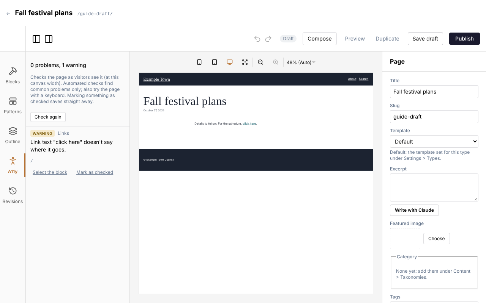
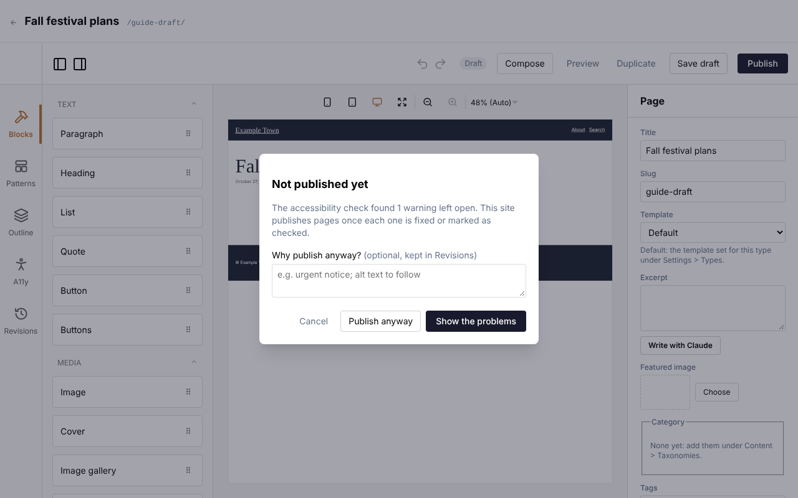

An accessible page works for everyone: people who are blind and hear pages read aloud, people who
can't use a mouse, and people who find small or faint text hard to read. The editor checks for the
most common problems as you work.

## The A11y check

Click **A11y** on the left side of the editor. It lists anything it finds on the page:

- **Problem**: something that needs fixing, such as an image with no description or text that is
  too faint against its background.
- **Warning**: something a person has to judge, such as a link that just says "click here".

Click **Select the block** to jump to the block concerned, fix it, and the list updates by itself.
**Check again** runs the check straight away.

## Marking something as checked

Some things can't be judged by a computer, for example whether text over a photo is easy to read. Look
at it yourself, and if it is fine, click **Mark as checked**, add a note if you like, and confirm. The
mark is saved straight away. If the text or picture changes later, the mark lapses and the warning
comes back for another look.

## Quick fixes for common problems

| The check says | What to do |
| --- | --- |
| Image has no alt text | Describe the image (see [Images and files](/cfpuck-cms/guide/images-and-files/)). |
| Link text doesn't say where it goes | Change "click here" to words that say where the link leads, such as "see the full schedule". |
| Text contrast is too low | Pick a darker text colour, or a lighter background. |
| Heading skips a level | Use headings in order: a page title, then sections, then sub-sections. |
| Text over an image | Check it is easy to read on every part of the picture, then mark it as checked. |

## When publishing waits for the check

An admin can turn on **Check accessibility before publishing** (in **Settings**, **Accessibility**).
Then, when you click **Publish**, the check runs first. If anything is left open, the page isn't
published yet and a box appears:

- **Show the problems** opens the A11y list so you can fix them, then publish again.
- **Publish anyway** publishes regardless. Say why in the box (for example "urgent notice; alt text
  to follow"). The reason is kept with that version in **Revisions**, so the team can follow up.
