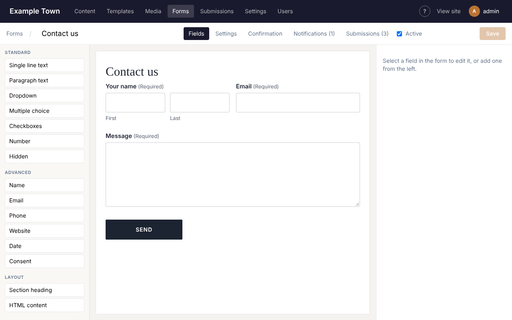
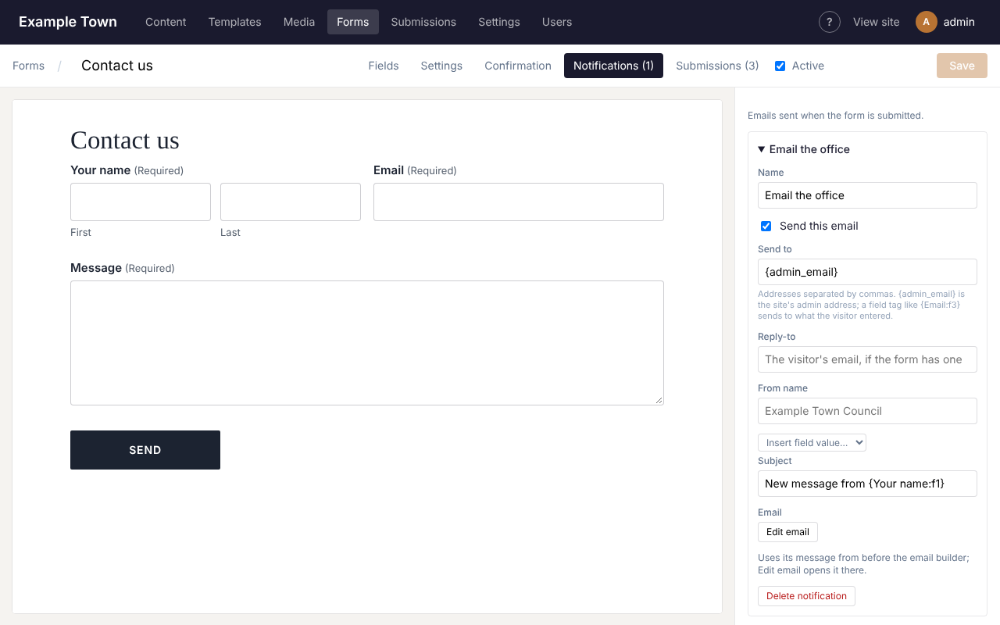
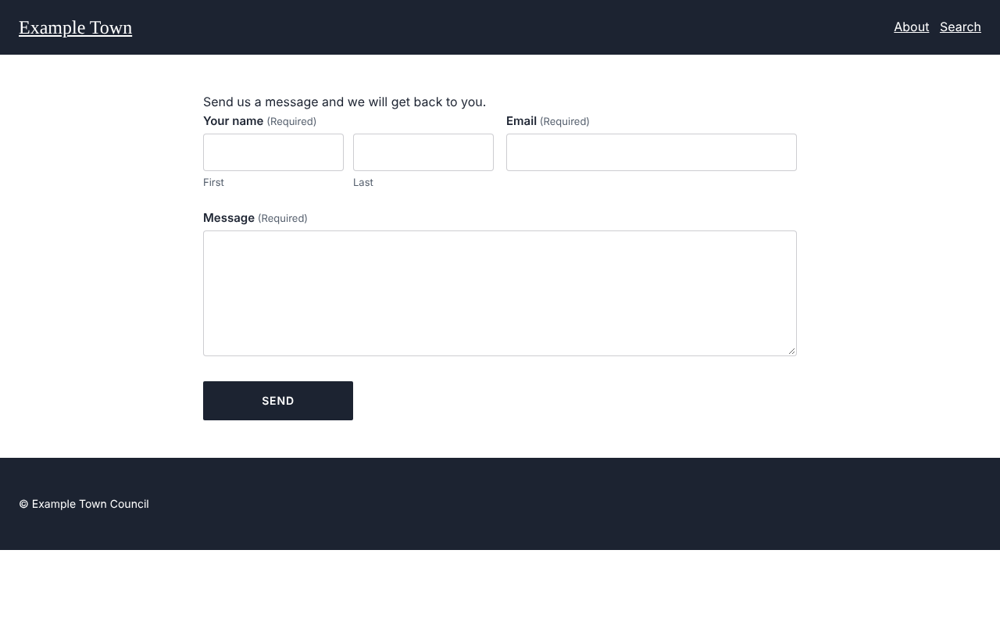
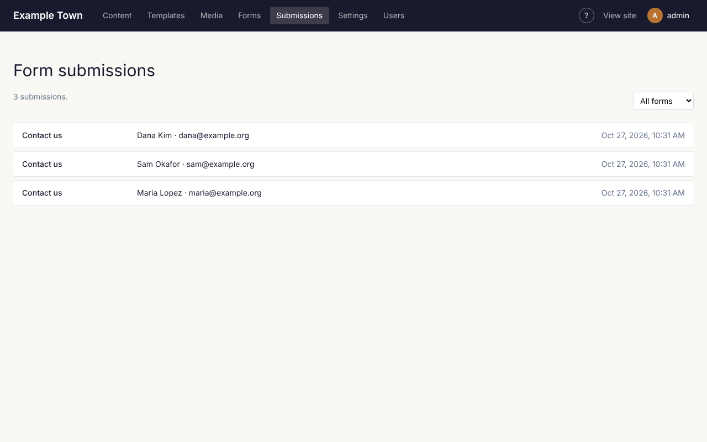

Forms let visitors send you a message, sign up, apply or register. You build a form once, then place
it on any page.

## Making a form

1. Click **Forms** in the top bar, then **New form**.
2. Give it a title.
3. On the **Fields** tab, add the questions you want to ask. Click a field type on the left to add it,
   or drag it into the form. Drag fields in the form to change their order.
4. Click a field in the form to change its label, make it required, or add a hint.
5. Click **Save** in the top right.

### Field types

| Field | Use it for |
| --- | --- |
| **Single line text** | Short answers, such as a business name. |
| **Paragraph text** | Longer answers, such as a message. |
| **Dropdown**, **Multiple choice**, **Checkboxes** | Picking from a list of options. |
| **Name** | First and last name boxes side by side. |
| **Email**, **Phone**, **Website**, **Date**, **Number** | Checked so people enter them properly. |
| **Consent** | A tick box such as "I agree to be contacted". |
| **Section heading** | A heading to break up a long form. |

### The other tabs

- **Settings**: a description shown above the form, the button's wording and how labels are placed.
- **Confirmation**: what people see after sending: a thank-you message, or another page.
- **Notifications**: who gets an email when the form is sent (see below).
- **Submissions**: what people have sent through this form.
- **Active**: untick to stop the form taking new answers without removing it from pages.

## Getting an email when someone sends the form

On the **Notifications** tab:

1. **Send to**: the email addresses to notify, separated by commas.
2. **Reply-to**: leave this as it is, so that replying to the email goes straight to the visitor.
3. **Subject**: the email's subject line. **Insert field value** adds an answer to it, such as the
   visitor's name.
4. Click **Edit email** to design the email itself, or leave it as it is to receive all the answers.
5. Click **Save**.

You can add more than one notification, for example one to your office and a "thanks, we got your
message" email to the visitor (put the form's email field in **Send to**).

## Putting a form on a page

1. Open the page in the editor.
2. Drag the **Form** block onto the page.
3. With the block selected, choose your form from the **Form** list on the right.
4. Publish the page.

The same form can be on several pages.

## Reading what people sent

Click **Submissions** in the top bar. The newest are at the top; pick a form from **All forms** to see
only that form's. Click one to read it in full.

From a submission you can **Reply by email**, jump to **Edit form**, or **Delete** it.

To download a form's submissions as a spreadsheet (for Excel or Google Sheets), pick the form from
**All forms**, then click **Export CSV**.

:::tip
Forms are protected against spam robots automatically. If you see a lot of junk anyway, let your
site's admin know.
:::

## Taking payments

If your site is set up for card payments, a form can also take money, for example for a donation or
a registration fee. A **Payment** tab appears in the form builder, and **Pricing** fields on the left.
Ask your admin if you'd like this turned on.
