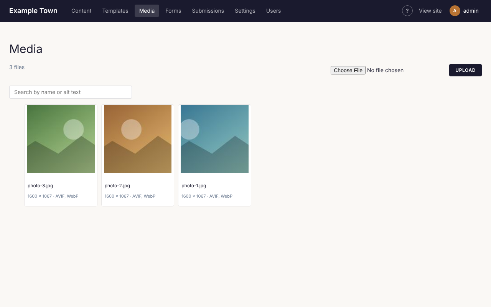
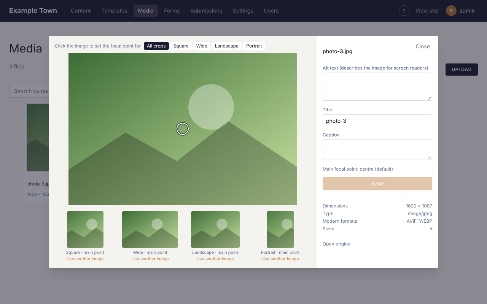

All your images live in **Media**, in the top bar. They can be used on any page.

## Uploading an image

**From the Media screen:**

1. Click **Media** in the top bar.
2. Click **Choose File** and pick the image on your computer.
3. Click **Upload**.

**From the page editor:** wherever you can add an image (an **Image** block, a **Featured image**, a
**Hero**), click **Choose**. You can pick one already in the library or upload a new one there and
then.

:::tip
Use photos at least 1600 pixels wide for big banner pictures. The site makes smaller copies for
phones by itself, so you don't need to resize anything.
:::

## Describing an image (alt text)

Click an image in **Media** to open its details.

**Alt text** is a short description of the picture, read aloud to people who can't see it and shown
if the picture doesn't load. Write what someone would need to know, for example "Children planting
flowers at the community garden". Leave it empty only for pictures that are purely decoration.

**Title** and **Caption** are optional. Click **Save** when done.

## Keeping the important part in view

Pictures are often cropped to fit, for example into a square on a list of posts. To choose which part
always stays in view, **click on the most important part of the picture** (a face, a building).
The small previews underneath show how each crop will look.

If one crop still doesn't work, for example a wide photo that looks wrong as a square, click **Use
another image** under that preview and pick a different picture to use only for that shape.

## Finding an image

Type in the search box on the **Media** screen. It searches file names and alt text, which is another
good reason to write alt text.

## Videos and documents

- **Videos from YouTube or Vimeo**: add an **Embed** or video block to the page and paste the video's
  web address.
- **Video files**: upload them like images. Large videos take a while to upload.
- **PDFs and other documents**: link to them from a paragraph or button. Ask your site's admin if you
  need a document hosted.

:::note
Images are never deleted from the library, so a picture used on an old page can't go missing by
accident.
:::
