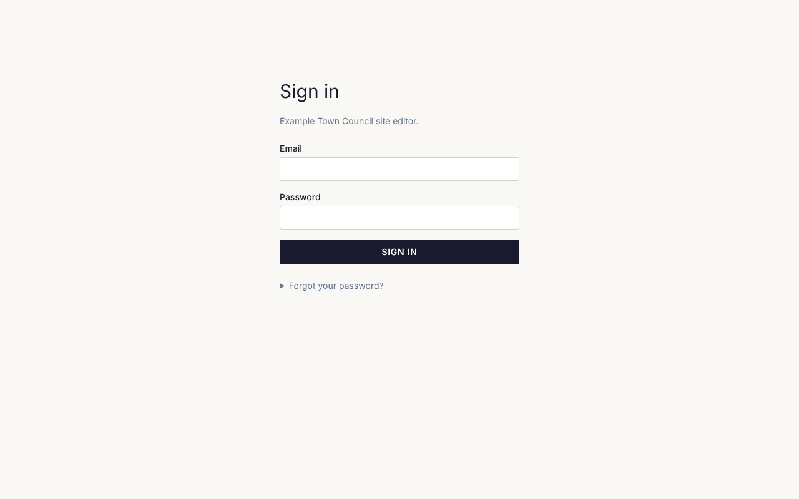

This guide is for the people who keep a site up to date day to day. You don't need to know anything
about websites or code to follow it. Each page walks through one job, step by step.

The **?** button at the top of every admin screen brings you back here.

## Signing in

1. Go to your site's address and add `/admin/` to the end, for example `www.yoursite.org/admin/`.
2. Enter your email address and password, then click **Sign in**.

**Forgot your password?** Click **Forgot your password?** on the sign-in screen, enter your email
address and click **Send link**. An email arrives with a link to set a new password. The link works
once and only for an hour, so use it soon.

**New here?** Someone at your organisation sends you an invitation by email. Click the link in it and
choose a password. The invitation lasts a week; if it has run out, ask them to send a new one.

To sign out, click your name in the top right corner, then **Sign out**.

## Finding your way around

The dark bar across the top of every admin screen takes you to each part of the site:

| Menu item | What it is for |
| --- | --- |
| **Content** ▾ | Your pages, posts and anything else the site lists, such as events, each kind on its own list; **Taxonomies** (categories and tags); and, below a line, **Templates**, the shared layouts every page uses, such as the header and footer. |
| **Compose** ▾ | Have Claude build something new from your material: a page or post (or any kind of content with a page), a form, a template, a template part or a pattern. See [Writing with Claude](/cfpuck-cms/guide/writing-with-claude/). |
| **Media** | Your photos, images, videos and documents. |
| **Forms** ▾ | **Forms** (contact forms, sign-up forms and the like) and **Submissions** (what people sent through them). |
| **People** ▾ | **Users** (who can sign in to look after the site; admins only), **Members**, **Mailing Lists** and **Tickets** (each only when your site uses it). |
| ⚙ (the gear) | **Settings**: site-wide settings, such as the menu. Admins only. |

Click **Content**, **Compose**, **Forms** or **People** to open its list, then the screen you want. On a phone or a narrow
window, the whole menu is behind the ☰ button at the top right.

**View site** (in the ☰ menu on a phone) opens your public website in a new tab, so you can see your changes as visitors will.

## Editors and admins

There are two kinds of account:

- **Editors** look after the content: pages, posts, events, images, forms and submissions.
- **Admins** can do everything editors can, and also change site-wide settings, the menu and who
  has access.

If you can't see something this guide mentions, it is probably for admins, or a feature your site
doesn't use.

## What's in this guide

- [Pages and posts](/cfpuck-cms/guide/pages-and-posts/): adding, finding and organising content.
- [Using the page editor](/cfpuck-cms/guide/page-editor/): changing what is on a page.
- [Saving and publishing](/cfpuck-cms/guide/saving-and-publishing/): drafts, publishing and going back to an earlier version.
- [Images and files](/cfpuck-cms/guide/images-and-files/): uploading and describing images.
- [Forms](/cfpuck-cms/guide/forms/): building forms and reading what people send.
- [Writing with Claude](/cfpuck-cms/guide/writing-with-claude/): having pages drafted for you from your documents.
- [Accessibility](/cfpuck-cms/guide/accessibility/): making sure everyone can use your pages.
- [Events and tickets](/cfpuck-cms/guide/events-and-tickets/): listing events and selling tickets.
- [Menu and settings](/cfpuck-cms/guide/menu-and-settings/): for admins.
- [People and access](/cfpuck-cms/guide/people/): for admins.
- [Common questions](/cfpuck-cms/guide/common-questions/): quick answers when something isn't working.
