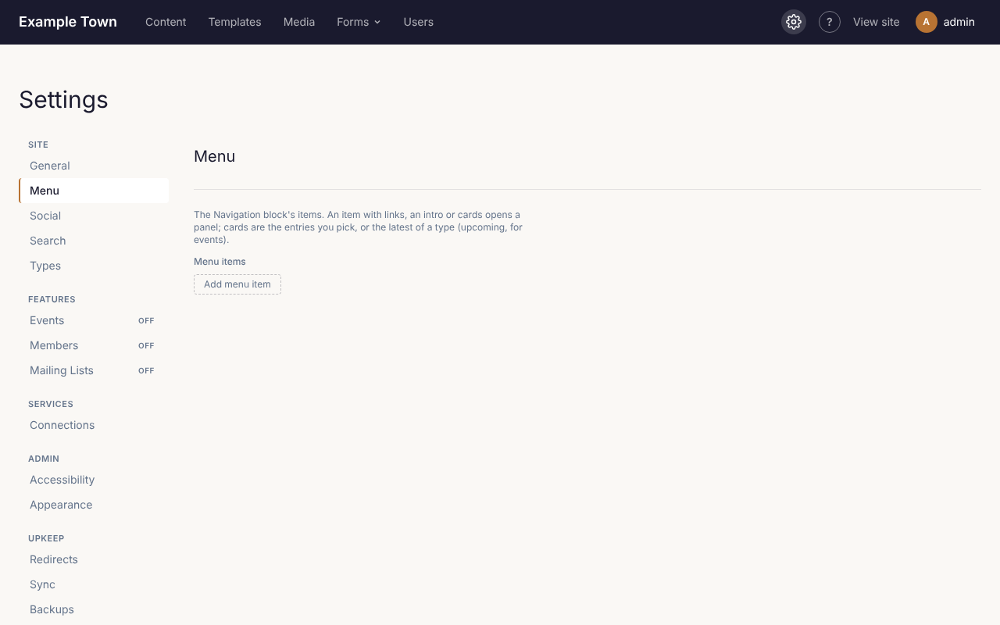
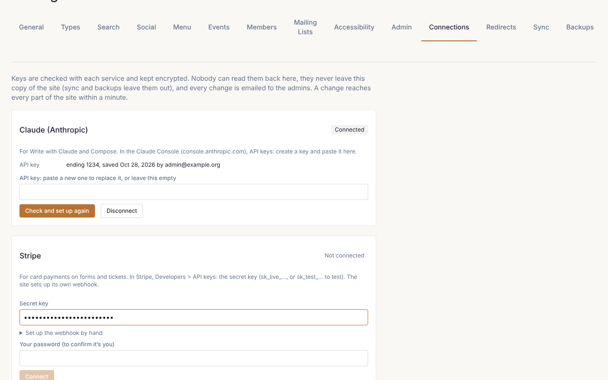

**Settings** (in the top bar, admins only) holds everything that applies to the whole site. Each tab
covers one area. Changes take effect when you click **Save settings**.

## The menu

The **Menu** tab holds the links in your site's main menu.

1. Click **Add menu item**.
2. Fill in the **Label** (the words people see, such as "Visit") and the **Link** (the page's
   address, such as `/visit/`, or a full web address for another site).
3. Use **Up** and **Down** to reorder items, and **Remove** to take one out.
4. Click **Save settings**.

An item can also open a larger drop-down panel: add **Links** under a **Links heading**, a short
**Intro**, or cards showing pages or the latest posts or events.

## Other tabs

| Tab | What it's for |
| --- | --- |
| **General** | The site's name, tagline, which page is the home page, and which page people see when an address doesn't exist. |
| **Types** | Which layout (template) each kind of content uses. Usually set up once. |
| **Search** | Which kinds of content the site search covers. |
| **Social** | Your social media profiles (shown as icons) and the picture used when a page without its own image is shared. |
| **Events** | Turn events on or off, and the site's time zone. |
| **Members** | Members-only pages and member accounts, if your site uses them. |
| **Mailing Lists** | Newsletter sign-ups and sending, if your site uses them. |
| **Accessibility** | Whether publishing waits for the [accessibility check](/cfpuck-cms/guide/accessibility/). |
| **Admin** | The colours and logo of these admin screens. |
| **Connections** | Connecting Claude, card payments (Stripe or Square) and Mailgun (see below). |
| **Redirects** | Send visitors from an old address to a new one (see below). |
| **Sync** and **Backups** | Copying content between copies of the site, and backups. Usually left to whoever set up the site. |

## Connections

Admins connect the services the site uses on the **Connections** tab:

- **Claude (Anthropic)**, for Compose and **Write with Claude**;
- **Stripe** or **Square**, for card payments on forms and tickets;
- **Mailgun**, for mailing lists.

1. Copy the key from the service's own website. Each card says where to find it.
2. Paste it into the card. For Stripe, Square and Mailgun, also type your own password.
3. Click **Connect**. The site checks the key and sets up the rest itself. If you have more than one
   Square location or Mailgun domain, it asks which one; pick it and click **Save**.

Keys are kept encrypted. Once saved, nobody can see them again, not even admins: the card shows only
the last 4 characters. To change a key, paste the new one and click **Connect**. **Disconnect** removes
it. Every admin gets an email whenever a connection changes, so if you get one you didn't expect,
check this tab and change your password.

A card that says **Set by the host** is set up on the server by whoever runs the site, and can only be
changed there.

## Redirects

When a page moves or is deleted, people may still arrive at its old address from Google or old
links. On the **Redirects** tab:

- Add a redirect from the old address (such as `/old-page/`) to the new one.
- The tab also lists addresses people tried that don't exist, with **Add redirect** beside each, so
  you can catch broken links.

Changing a published page's address adds a redirect for you automatically.

## When a page isn't found

Someone who follows a broken link sees a "page not found" page. To make your own:

1. Make an ordinary page (for example "Sorry, we couldn't find that") with a friendly message, a
   search box and links to your main pages. Publish it.
2. In **Settings > General**, choose it as the **Not found page**, then **Save settings**.

Search engines don't list it. To go back to the standard one, set **Not found page** to **Default**.

## Backups

The site can back itself up every day (**Backups** tab). Each backup can be restored if something
goes badly wrong. Restoring brings back pages and settings, not images, which are never deleted
anyway. If you're unsure, ask whoever set up your site before restoring.
