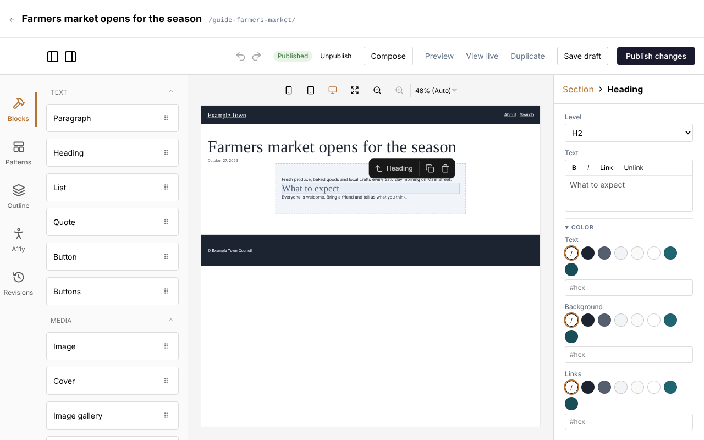

When you open a page, the editor shows it as it will look on your site. It has four areas:

- **The middle** is the page itself. Click anything on it to select it.
- **The left side** has the building blocks you can add (**Blocks**), ready-made sections
  (**Patterns**), a list of everything on the page (**Outline**), an accessibility check (**A11y**)
  and earlier versions (**Revisions**).
- **The right side** shows the settings of whatever you selected. With nothing selected, it shows
  the page's own settings: title, address, featured image, tags and so on.
- **The top** has the buttons to save, preview and publish.

## Blocks

A page is made of blocks stacked one under the other: a heading, a paragraph, an image, a row of
buttons, and so on.

**To add a block:** drag it from the **Blocks** list on the left onto the page, to where you want it.
A line shows where it will land.

**To change a block:** click it on the page. Its settings appear on the right. For text, you can
also click into the words and type.

**To move a block:** drag it by its handle, or use the arrows in the small toolbar that appears
above it when it is selected.

**To copy or remove a block:** select it and use the copy or bin icon in that small toolbar.

:::tip
Made a mistake? The undo arrow at the top of the editor (or Ctrl+Z, Cmd+Z on a Mac) takes back the
last change. You can undo several times.
:::

### Common blocks

| Block | Use it for |
| --- | --- |
| **Heading** | A title for a section of the page. |
| **Paragraph** | Ordinary text. Select words to make them bold, italic or a link (see Links below). |
| **List** | Bullet points or numbered steps. |
| **Image** | One picture. |
| **Image gallery** | Several pictures as a grid or a slider. |
| **Button** / **Buttons** | A link styled as a button, such as "Book now". |
| **Hero** | A large picture across the top of a page, with a title and buttons. **Overlay** darkens the picture so the text stays readable. |
| **Cover** | A picture with text laid over it. Its **Overlay** can be even, or a gradient from the bottom or left, where the text sits. |
| **Media & text** | A picture beside some text. |
| **Columns** | Puts blocks side by side. |
| **Section** | Groups blocks, with a background colour or spacing around them. |
| **Form** | One of your [forms](/cfpuck-cms/guide/forms/). |
| **File** | A link to a document (a PDF, say) with its type, size and a Download button. |
| **Collection** | An automatic list of your latest posts, events or other content. Each entry shows as a card; select a block in the first card to change them all. A card's **Featured image** is Medium height (240px) unless you pick another **Height**: Small, Large, Extra large, **Auto** (the picture's own height) or **Custom**. |

Your site may have extra blocks of its own, made for its design.

### Blocks inside blocks

Some blocks, like **Section** and **Columns**, hold other blocks. Drag blocks into them. The
**Outline** on the left shows how everything is nested, and clicking a line there selects that block,
which helps when blocks are hard to click on the page.

### Copying a block's look

To make one block look like another, select the block whose look you like, scroll to the end of its
settings and click **Copy styles**. Then select the other block and click **Paste styles**. Its colours,
spacing, text style and borders change to match; its words and pictures stay as they are. Between two
blocks of the same kind (two sections, say) the layout comes too: alignment, gaps, height and overlay.

The copy stays in your browser, so you can paste it on another page or in a pattern. Changed your mind?
Click Undo.

### Links

To make a link, select some words in a text box and click **Link** above it. Boxes that take a link
(a button's **Link**, a menu item's **Link** and other link boxes) have **Find** beside them. Then:

- **To a page on your site**: start typing its title and pick it from the list (use the arrow keys and
  Enter, or click it).
- **To a file**: click **Media library** and pick a picture or a document.
- **To another website**: paste its address (such as `https://example.org`). Email addresses and phone
  numbers work too.

Links to other websites open in a new tab unless you untick **Open in a new tab**. To change or remove
a link, put the cursor in it and click **Link** again.

## Patterns

**Patterns** are ready-made groups of blocks, such as a "call to action" band or a team section,
already styled to match your site. Drag one from the **Patterns** tab onto the page, then change the
words and pictures.

To reuse something you built, select its outer block and click **Save as pattern** at the bottom of
its settings.

## The page's settings

Click an empty part of the page (or press Escape until nothing is selected) to see the page's
settings on the right:

- **Title**: the page's name, shown at the top of the page and in the browser tab.
- **Slug**: the page's address.
- **Template**: the layout around the page. Usually leave this as it is.
- **Excerpt**: a sentence or two summing up the page, shown in lists of pages.
- **Featured image**: the picture used for this page in lists and when it is shared on social media.
- **Tags** and categories: see [Pages and posts](/cfpuck-cms/guide/pages-and-posts/).
- **SEO**: how the page appears in Google. **Generate** can write these for you.
  - **Hide from search engines and AI answer engines** asks Google and the like not to list the page,
    and the tools behind ChatGPT, Claude, Perplexity and Google's AI answers not to read it. Use it
    for pages only your members or partners need, for example.
  - **Leave out of this site's search** stops the page appearing in your own site's search (it still
    shows in menus and lists).

Events and other kinds of content have their own extra settings here too, such as dates and venues.

## The header, footer and templates

The parts that appear on every page, such as the header, menu and footer, aren't part of each page.
They are in **Templates**. When you hover over them in the editor, admins see a link to edit them.

:::caution
A change to a template or the header changes every page that uses it, straight away. Take care, and
check a few pages afterwards.
:::

Some pages are made entirely from their template (a home page, often). When you open one, a line under
the editor's toolbar says **Editing this page's template**, and the button says **Save & apply**:
changes go to every page using that template.

To start a new page from a template or a pattern, click **Make a page** beside it in **Templates** (or
at the top of the editor while editing it). Give the page a title, choose its type and click **Make
the page**. You get a new draft with a copy of the template's blocks to change freely: editing it
never changes the template.

To change the name of a template, part or pattern, click **Rename** beside it in **Templates** (or at
the top of the editor while editing it) and type the new name. Its **Address** follows the name; change
it if you want another. Click **Rename**. Pages, settings and other templates using it switch to the new
address, and anything still using the old one keeps working. Save your changes before giving a template
you're editing a new address.

The menu's links are changed under **Settings**, not in the header itself. See
[Menu and settings](/cfpuck-cms/guide/menu-and-settings/).
