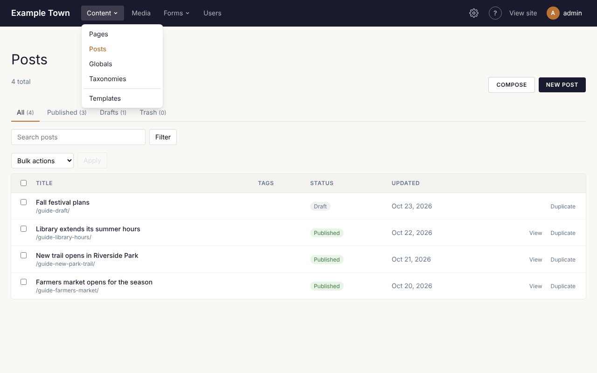

Everything on your site lives under **Content** in the top bar. Click it to see each kind of content
your site has, such as **Pages**, **Posts** or **Events**, then pick one to see its list. The number
under the heading is how many there are.

## Adding a new page or post

1. Click **Content**, then the kind of thing you want to add (for example **Pages**).
2. Click the **New** button in the top right (it says **New Page**, **New Post** and so on).
3. The page editor opens with an empty page. Type a title in the **Title** box on the right.
4. Add what you want on the page (see [Using the page editor](/cfpuck-cms/guide/page-editor/)).
5. Click **Publish** when it is ready for visitors, or leave it as a draft for now.

:::tip
Your work is saved automatically as you go, a few seconds after each change. A new page stays a
private draft until you click **Publish**, so it is safe to start something and finish it later.
:::

Prefer to start from a document you already have? Use **Compose** instead of **New**. See
[Writing with Claude](/cfpuck-cms/guide/writing-with-claude/).

## Finding something

- **Search**: type a few words in the search box above the list and press Enter.
- **Status tabs**: **All**, **Published** (on the site), **Drafts** (not on the site yet) and
  **Trash** (deleted, but not gone for good).
- **Tags**: if your site uses tags, pick one from the list beside the search box and click **Filter**.

Click a title to open it in the editor. **View** opens the page as visitors see it.

A row marked **Unpublished changes** is a published page with edits that aren't live yet. Open it
and click **Publish changes** when they are ready.

## Making a copy

**Duplicate** (beside each row, and at the top of the editor) makes a draft copy titled "(copy)"
with its own address. It is a quick way to start a page that looks like one you already have.

## Doing the same thing to several at once

1. Tick the box beside each one in the list.
2. Pick an action from **Bulk actions**: **Publish**, **Move to drafts**, **Move to trash**, or add
   or remove a category or tag.
3. Click **Apply**.

## Deleting

Choose **Move to trash** (from the editor's list, or a bulk action). The page comes off your site but
isn't gone: open the **Trash** tab, tick it and choose **Restore** to bring it back as a draft. Only
**Delete permanently**, in the Trash, removes it for good.

:::caution
The home page can't be moved to the trash. To use a different home page, ask an admin to change
it under **Settings**.
:::

## Categories and tags

Categories and tags group related content, so visitors can find everything on one subject.

- Add tags to a page in the editor's right-hand panel: type a tag and press Enter. New tags are
  made for you.
- Pick categories in the same panel.
- To rename, rearrange or describe them, click **Content**, then **Taxonomies**. Drag a category by its handle to move it, or onto another to put it underneath.

### Featured content

When an admin has turned on **Featured** for a kind of content (**Settings**, **Types**), each one has a
**Featured** switch in its settings. In the list of that content, a star marks the featured ones; tick
**Featured only** and click **Filter** to see just those, or tick several and choose **Mark featured** from
**Bulk actions**. A Collection block can then show featured content only.

### Your own ways to sort content

Admins can add a taxonomy of their own, such as Colors or Regions, and choose which types of content
use it.

1. Click **Content**, then **Taxonomies**, then **Add a taxonomy**.
2. Give it a name (Colors) and a name for one of them (Color).
3. To give each term a page listing its content, type an address, such as `colors`. Red would then be
   at `/colors/red/`. Leave it empty for no pages.
4. Tick **A flat list, like tags** if its terms never sit under each other.
5. Under **Used on**, tick each type that uses it, then click **Add taxonomy**.

Add its terms on its tab. Each page of a ticked type then has a picker for them in its right-hand
panel. To change the name, address or types later, open the taxonomy's tab and click its settings.
The same place adds more types to the site's own taxonomies, such as Category; the types the site
was built with stay ticked.

## Page addresses

Each page has an address, shown in the editor beside its title (for example `/about-us/`). It is
made from the title when you first publish. You can change it in the **Slug** box in the editor's
right-hand panel. If you change the address of a published page, the old address keeps working and
sends visitors to the new one.
