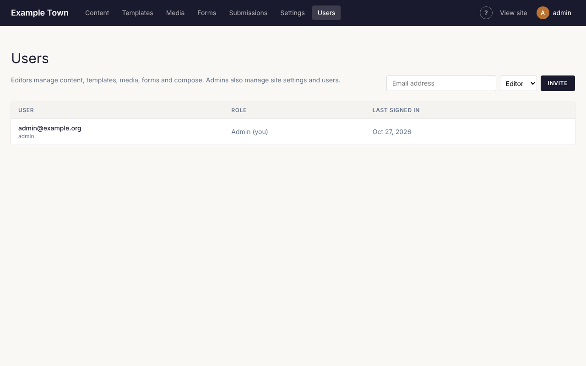

**Users** (under **People** in the top bar, admins only) lists everyone who can sign in to look after the site.

## Inviting someone

1. Type their email address in the box at the top.
2. Choose **Editor** (content only) or **Admin** (everything, including settings and users).
3. Click **Invite**.

They get an email with a link to set their password. The link lasts a week. If they can't find it,
click **Resend invitation** beside their name.

:::tip
Give people the **Editor** role unless they really need settings. It is easy to change later.
:::

## Changing someone's role

Pick a different role beside their name and click **Save**.

## Removing someone

Click **Delete** beside their name. They can no longer sign in. Pages they wrote stay on the site.
You can't delete your own account.

## Someone forgot their password

They can reset it themselves: on the sign-in screen, **Forgot your password?** sends them a link.

## Members

If your site has members-only content, members are managed separately under **People**, **Members**
in the top bar. Members can sign in to see members-only pages, but can't get into these admin screens.
