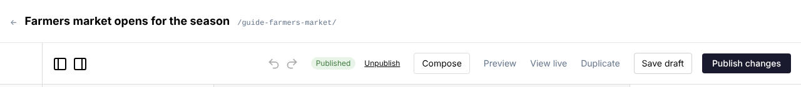
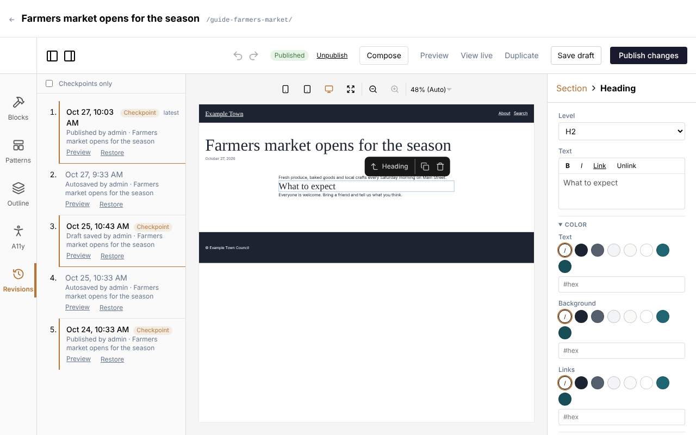

## Your work saves itself

The editor saves your changes a few seconds after you make them. The top of the editor shows
**Unsaved changes** while it is waiting, and **Autosaved** with the time once done.

Saving doesn't put anything on your website. A page only changes for visitors when you publish.

## Publishing

- **Publish** puts a new page on your site.
- **Publish changes** makes your edits to a page that is already on the site go live.
- **Save draft** saves without publishing. On a published page, visitors keep seeing the old
  version until you click **Publish changes**.

Beside the buttons, a label shows whether the page is **Published** or a **Draft**.

## Previewing

**Preview** opens the page in a new tab exactly as it will look once published, including changes
you haven't published yet. **View live** shows the page as visitors see it now.

## Taking a page off the site

- **Unpublish** takes the page off your site and keeps it as a draft.
- **Discard changes** throws away unpublished edits and goes back to the live version.

## Going back to an earlier version

Every time you save, the editor keeps a copy. To go back:

1. Click **Revisions** on the left side of the editor.
2. Find the version you want. **Preview** shows it in a new tab.
3. Click **Restore**. The page in the editor goes back to that version.
4. Click **Publish changes** to put it on the site (or keep editing first).

Restoring can be undone with the undo arrow, so it is safe to try.

Versions you saved yourself are marked **Checkpoint**; automatic saves are listed between them. Tick
**Checkpoints only** to hide the automatic ones.

## Leaving the editor

If you try to leave with changes that aren't saved yet, a box asks what to do: save them, leave
without saving, or stay.

## When two people edit the same page

If someone else saved the page after you opened it, the editor tells you before you save over their
work. To be safe, reload the page to see their version first.
