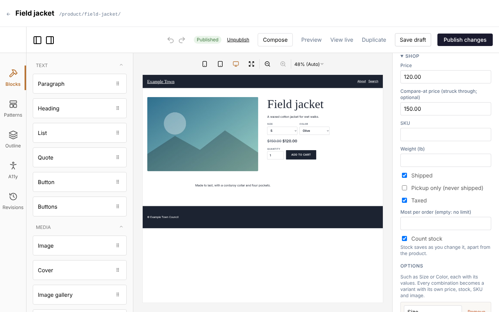
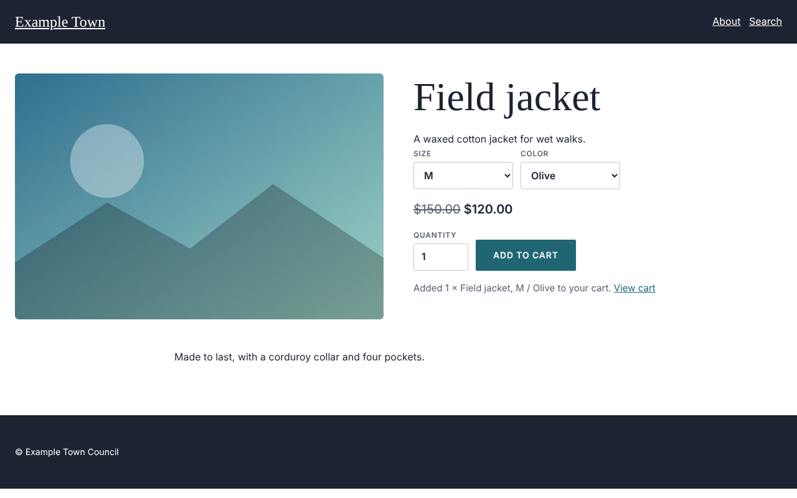
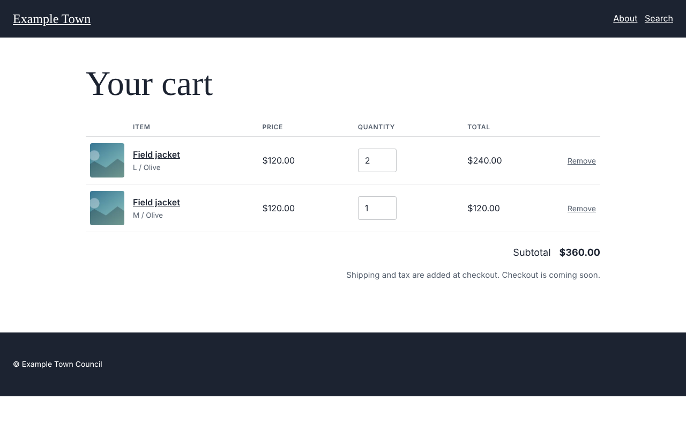

:::note[Preview]
The shop is being built. Products, options, stock and the cart work now; checkout (paying, shipping,
tax and orders) comes next. Until then visitors can fill a cart but can't buy.
:::

If your site has a shop, products appear under **Content**, **Products**, and on your site at `/shop/`.
(If you don't see **Products** under **Content**, the shop is turned off; an admin can turn it on under
**Settings**, **Shop**.)

## Adding a product

1. Click **Content**, then **Products**, then **New Product**.
2. Give it a **Title** in the right-hand panel.
3. Add a **Featured image** and an **Excerpt**: they show beside the price on its page and in the shop.
4. Describe it on the page itself, as with any page.
5. Under **Shop**, give it a **Price**. Add a **Compare-at price** to show a higher price struck
   through (a sale).
6. Click **Publish**.

A product without a price isn't for sale. The other settings under **Shop**:

- **SKU** and **Weight**: for your records, and later for shipping by weight.
- **Shipped**: untick it for things nobody posts, such as a class or a gift card.
- **Pickup only**: collected, never posted.
- **Taxed**: untick it for things you don't charge tax on.
- **Most per order**: leave it empty for no limit.

## Sizes, colors and other options

Under **Options**, click **Add an option**, name it (**Size**) and type its values with commas between
them (**S, M, L**). Add up to three options. Each combination becomes a **variant** (S / Olive,
M / Olive...), listed under **Variants**.

Open a variant to give it its own **Price**, **SKU**, **Weight** or **Image** (shown when a visitor
picks it). Left empty, it uses the product's. Tick **Not sold** for a combination that doesn't exist.
**Every variant's price** and **Every variant's stock** set them all at once.

## Stock

Tick **Count stock** to keep count of what you have. Type how many are **In stock** (on each variant,
when the product has options). Stock saves as soon as you leave the box, without saving the product:
nobody's other changes to the product can overwrite it. Leave **Count stock** unticked for no limit.

On the site, what has run out says **Sold out** and can't be added to the cart.

## On the site

A product's page shows its options, price and **Add to cart**.

The cart is at `/cart/`. Visitors change quantities or remove things there; it never takes more than
you have in stock.

## Blocks for the shop

In the page editor, under **Shop**:

- **Add to cart**: on a product's page it sells that product; anywhere else, choose one in its settings.
- **Product price**: the price, or "From" the lowest when variants differ.
- **Cart**: the cart itself. Your `/cart/` page shows it on its own; a page you make with that address
  needs this block.
- **Cart link**: a link to the cart with the number of things in it, for the header.

Collections can show products with the **Product: image, name and price** card.

## Turning the shop on

**Settings**, **Shop** (admins): tick **Shop on**, choose the **Currency** and the unit **Weights** are
in, and click **Save settings**. Turning it on the first time adds two templates under **Templates**:
**Product** (a product's page) and **Shop** (the `/shop/` listing). Change them like any template.
Turning the shop off deletes nothing; products are hidden until it is on again.
