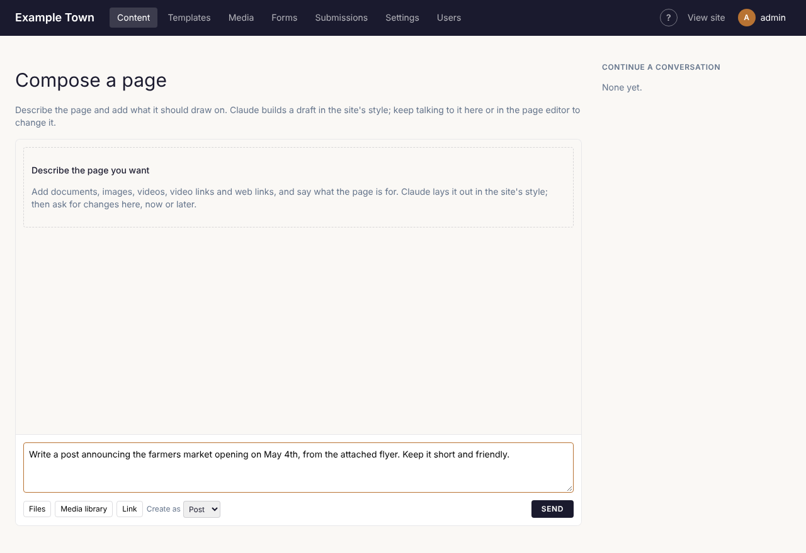

**Compose** writes a page for you, laid out in your site's style, from material you already have:
a flyer, a Word document, a PDF, some photos, a link to another website. You then ask for changes in
plain words, as you would ask a colleague. Nothing goes on your site until you publish it.

## Starting a new page

1. Click **Compose** in the top bar, then what you want to make (for example **Post**). Or click
   **Compose** beside the **New** button on any list in **Content**. Or start on the home screen (click
   the site's name at the top left): pick **Post**, describe it and click **Compose post**, or click **Add
   documents, images or links first** to bring your material along.
2. Add your material:
   - **Files**: documents (PDF, Word, text) and images or videos from your computer.
   - **Media library**: images already on the site.
   - **Link**: a web address to read, or a YouTube or Vimeo video.
3. In the box, say what you want, for example: "A post announcing the farmers market opening on
   May 4th, from the attached flyer. Keep it short and friendly."
4. Check **Create as** shows the right kind of content, then click **Send**.

It takes a minute or two. When it is done, the new page opens as a draft in the editor.

## Forms, emails, templates and patterns

The **Compose** menu also makes a **Form**, a **Campaign** (an email to your mailing lists, if your site
uses them), a **Template**, a **Template part** (such as a header or footer) or a **Pattern**. It opens a
page like the one for pages:

1. Give it a name (a campaign gets one from Claude).
2. In the box, say what it is for, for example "A volunteer sign-up form with availability by weekday"
   or "The October newsletter: the festival on the 18th, volunteers wanted, then our latest news".
3. Click **Send**.

It is made and opens where you edit it, and Claude writes it straight away. A form's questions,
thank-you message and emails, or a campaign's subject and email, are filled in for you to check and
**Save** (a campaign is a draft until you send it). A template, part or pattern is built in the editor,
kept with **Save & apply**.

A campaign you're already working on has its own **Compose** button at the top of its editor.

## Asking for changes

In the page editor, click **Compose** at the top to open the conversation beside the page. Type what
you'd like changed and click **Send**:

- "Make the opening paragraph warmer and shorter."
- "Add a section with the opening hours from the flyer."
- "Use the second photo at the top instead."

**To change just one part**, click that block on the page first. The panel shows **Editing** with the
block's name, and your request only changes that block (or its whole section, if you pick
**Section**).

## Good to know

- **Check the facts.** Claude writes from what you give it, but read the page before publishing,
  especially dates, prices and names.
- Your own edits are kept. If you change some words by hand, later requests build on your version.
- Each page keeps its conversation, so you can come back to it another day.
- Compose can also work on templates and the header or footer; the panel says when a change affects
  every page.
- **Compose** buttons elsewhere (for example under the excerpt, in the SEO settings, or beside an
  image's alt text in **Media**) write just that one piece of text. In the form builder, **Compose** writes a form's questions, its thank-you message or
  page and its emails (see [Forms](../forms/)).
